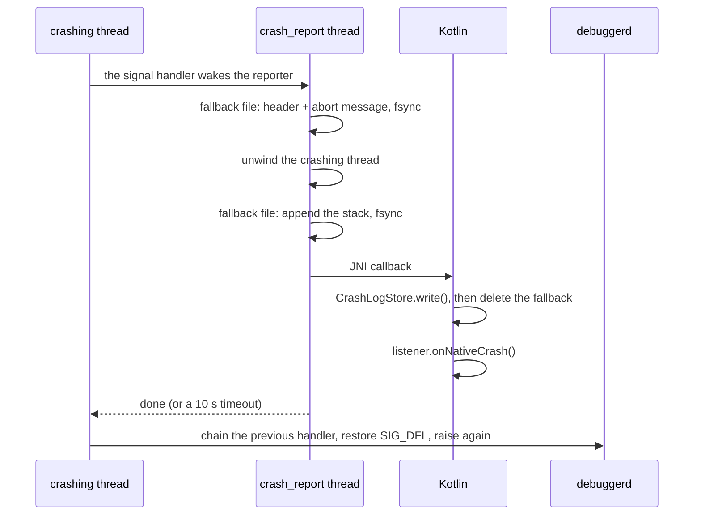

# crash: design

English | [中文](DESIGN_CN.md) · [Guide](README.md)

For developers changing this module or wanting to know how it behaves in the worst cases.

## The idea

- **Two processes**: the main process installs the capture, writes logs and runs uploads; the `:crash` process only runs the crash screen and **never** installs the capture. Being in its own process, the screen still shows when the main process hangs (ANR) or is going away (native crash).
- **One way out**: all three kinds of crash end up in `CrashLogStore`, in one format. Deduplication, the screen and uploading know only that format.
- **Disk first, callback second**: each crash is saved before the listener runs, so a failing listener, a blocked Activity start or the process ending loses nothing.

## Java crashes

```
uncaught exception (any thread, the main thread included)
  └─ JavaCrashHandler.uncaughtException()
       ├─ CrashLogStore.write()        the log is on disk
       ├─ listener.onJavaCrash()       for the process's first crash only
       └─ the previous handler (finally)  always, even if the above throws
            └─ the system: tells ActivityManager, ends the process
```

- The main thread's `Looper` is not wrapped. A main-thread exception leaves `Looper.loop()` and the runtime gives it to the default handler like any other. A crash is never swallowed to keep the app running.
- When several threads crash almost at once, each is saved but only the first reaches the listener; the screen reads every saved log.

## Native crashes



- The signal handler runs on an alternate signal stack and only wakes the reporting thread (one per process). The crashing thread waits at most 10 seconds, then lets the signal go on.
- The **fallback file** is written before anything touches the JVM, and its header without the heap. So even when the JNI callback cannot finish (ART deadlocked, attach failing, the process killed halfway) the crash is not lost.
- Kotlin deletes the fallback only after its own log is saved, and before calling the listener: a hanging listener leaves no duplicate, and a failed write keeps the fallback.
- The signal handlers are active as soon as the native library is loaded (the first use of `CrashHandler`); `install()` only connects them to the listener.

## ANRs

1. SIGQUIT arrives (the system sends it when about to declare the process unresponsive). The main thread's stack is captured at once, since a background ANR can be killed right after the system's dump.
2. SIGQUIT goes on to ART's Signal Catcher, and the system dumps its traces as usual.
3. Within at most 5 seconds it is confirmed to be this process's ANR: the main thread stays unresponsive **and** `ActivityManager.getProcessesInErrorState()` reports the process `NOT_RESPONDING`. If the main thread answers (another app's ANR, `adb shell kill -3`, a stall that recovered), the report is dropped.
4. Once confirmed, the log is written, then `onAnrCrash` called. The module never ends the process on an ANR; the host decides.

## Storing logs

| Directory | Files | What for |
| --- | --- | --- |
| `home/native_crash/` | `native_<ms>_<pid>.log` | Native fallback copies |
| `home/logs/` | `crash_<date>_<time>_<seq>_<type>_<signature>_<count>.log` | The logs |
| `noBackupFilesDir/crash_reports/` | `report_<ms>_<uuid>.txt` | The upload queue |

Only `crash_*` files are touched in `home/logs/`, so the directory can be shared with the app's other logs.

**Writing**: a `.tmp` file is written and renamed to `.log`, so readers never see half a log; the earlier log of the same crash is deleted only after the rename. `write()` never throws: with a full disk the returned `CrashLog.file` is `null` and the text is still in `CrashLog.content`, which the host passes straight to the screen.

**Deleting**:

- The same crash again replaces its log and counts up.
- At start, `.tmp` leftovers older than 60 seconds go, and at most 20 kinds of crash are kept (this runs before fallbacks are adopted, so after adopting many reports there can be more than 20 until the next start).
- The screen's `consumeAll()` deletes each log as it reads it, unreadable ones too, so a broken file does not come back forever. From then on the text is only in a `ViewModel`: it survives rotation, not the end of the `:crash` process.

**Adopting fallbacks**: at the next start `install()`, before switching the fallback on again, turns leftover fallback files into regular logs, with the original crash time and the same signature as the live path, so they deduplicate with the same bug's logs. Converted files are deleted; failures are kept for the next start; a file under 60 seconds old whose writer is still alive is skipped.

**Signatures** (messages, addresses and ids are left out on purpose: they differ every time for the same bug):

| Type | Signature |
| --- | --- |
| Java | Exception class + top 10 frames, over up to 5 throwables of the cause chain |
| ANR | The main thread's top 20 frames |
| Native | Signal number + reporter message, with hex addresses, pid/tid and the `/data/app/...` install path normalized |

The type is hashed too; the first 12 hex digits of the SHA-1 are kept.

## Uploading

- The content is staged as a file (WorkManager input is limited to 10 KB) and only its path goes to the worker.
- `enqueue()` blocks until WorkManager has persisted the work, so the caller can end its process right after; not on the main thread.
- The worker sends an HTTP POST of `text/plain; charset=utf-8`, needs a network, and backs off exponentially from 30 seconds. I/O errors, 408, 429 and 5xx are retried, 5 attempts in all; other 4xx are not.
- The queue file is deleted after success, a rejection not worth retrying, or the last failed attempt; files older than 7 days go at the next `enqueue()`.

## Typical cases

| Case | What happens |
| --- | --- |
| A crash in the foreground, all well | The log is saved, the screen opens, reads and deletes it. Nothing is left on disk unless the user sent a report |
| A native crash whose JNI callback failed | Only the fallback is left. It is adopted in `attachBaseContext` at the next start; when the first Activity is created `hasLogs()` is true and the screen opens in "previous launch" mode |
| A crash in the background | The log is saved, but Android 10+ forbids starting an Activity from the background; it shows when the app is next opened |
