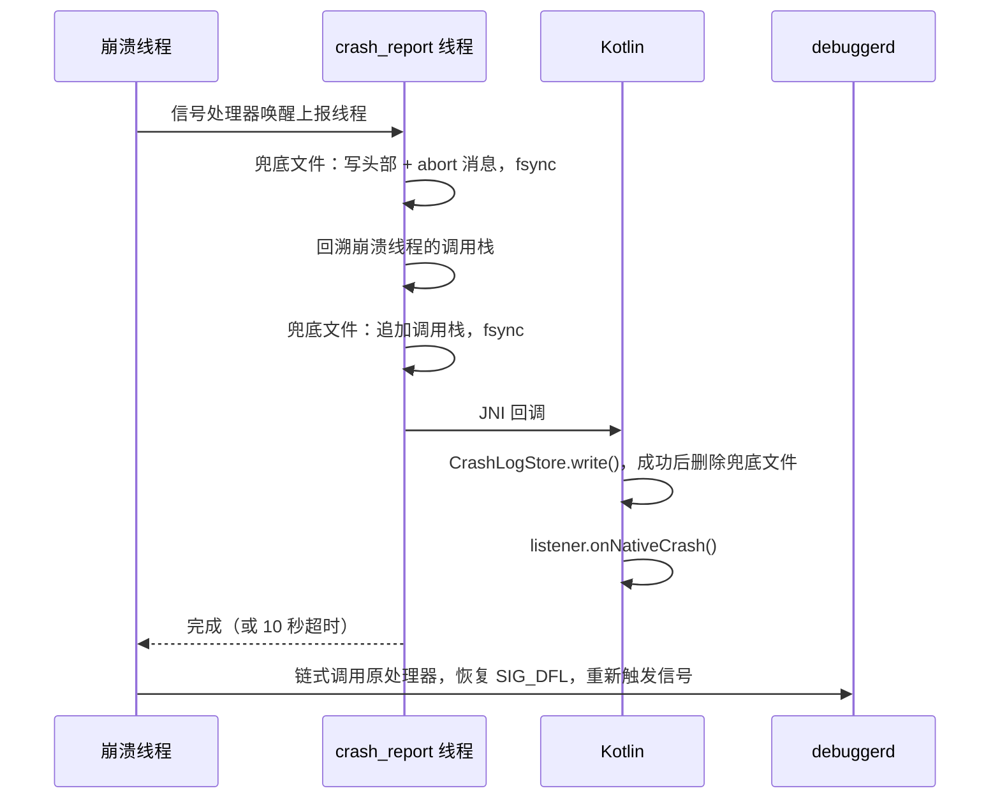

# crash：设计

[English](DESIGN.md) | 中文 · [说明](README_CN.md)

本文面向要修改本模块或理解它在极端情况下行为的开发者。

## 总体思路

- **两个进程**：主进程安装捕获、写日志、执行上传任务；`:crash` 进程只运行展示界面，**绝不**安装捕获。展示界面在独立进程中，所以主进程卡死（ANR）或正在退出（native 崩溃）时它仍能显示。
- **一个出口**：三种崩溃最终都交给 `CrashLogStore`，写成同一种格式。去重、展示、上传只处理这一种格式。
- **先落盘，再回调**：每次崩溃在监听器运行之前就已保存，所以监听器出错、Activity 启动被拦截或进程退出，记录都不会丢。

## Java 崩溃

```
未捕获异常（任意线程，包括主线程）
  └─ JavaCrashHandler.uncaughtException()
       ├─ CrashLogStore.write()        日志落盘
       ├─ listener.onJavaCrash()       只针对进程的第一次崩溃
       └─ 原来的处理器（finally）       一定执行，即使上面抛出异常
            └─ 系统：上报 ActivityManager，结束进程
```

- 不包装主线程的 `Looper`。主线程异常从 `Looper.loop()` 抛出后，运行时像对其他线程一样交给默认处理器。绝不为了让应用继续运行而吞掉崩溃。
- 多个线程几乎同时崩溃时每次都会保存，但只有第一次通知监听器；展示界面读取所有已保存的日志。

## native 崩溃



- 信号处理器运行在备用信号栈上，只负责唤醒上报线程（每个进程一个）。崩溃线程最多等 10 秒，之后让信号继续传递。
- **兜底文件**在任何 JVM 操作之前写入，且写头部时不使用堆内存。所以即使 JNI 回调无法完成（ART 死锁、attach 失败、进程中途被杀），崩溃也不会丢。
- Kotlin 只有在自己的日志保存成功后才删除兜底文件，并且在调用监听器之前删除：监听器卡住也不会留下重复记录，写入失败时兜底文件保留。
- 信号处理器在 native 库加载时（首次访问 `CrashHandler`）即生效，`install()` 只负责把它们连到监听器上。

## ANR

1. SIGQUIT 到达（系统即将判定进程无响应时发送）。立即对主线程调用栈快照，因为后台 ANR 可能在系统转储后立刻被杀。
2. SIGQUIT 转发给 ART 的 Signal Catcher，系统照常转储 traces。
3. 最多 5 秒内确认确实是本进程的 ANR：主线程持续无响应，**并且** `ActivityManager.getProcessesInErrorState()` 报告本进程为 `NOT_RESPONDING`。主线程有响应（其他应用的 ANR、`adb shell kill -3`、已恢复的卡顿）时取消。
4. 确认后写日志，再调用 `onAnrCrash`。本模块在 ANR 时从不结束进程，是否结束由宿主决定。

## 日志存储

| 目录 | 文件 | 作用 |
| --- | --- | --- |
| `home/native_crash/` | `native_<ms>_<pid>.log` | native 兜底副本 |
| `home/logs/` | `crash_<日期>_<时间>_<seq>_<类型>_<签名>_<次数>.log` | 正式日志 |
| `noBackupFilesDir/crash_reports/` | `report_<ms>_<uuid>.txt` | 上传队列 |

`home/logs/` 中只处理 `crash_*` 文件，可以与应用的其他日志共用。

**写入**：先写 `.tmp` 再重命名为 `.log`，读取方不会看到写了一半的文件；重命名成功后才删除同一崩溃的旧日志。`write()` 从不抛异常，磁盘满时返回的 `CrashLog.file` 为 `null`，文本仍在 `CrashLog.content` 中，宿主直接把文本传给展示界面。

**删除**：

- 同一崩溃再次发生时新日志替换旧日志，次数加一。
- 启动时删除超过 60 秒的 `.tmp` 残留，最多保留 20 种崩溃（清理在接管兜底文件之前执行，所以接管大量报告后可能暂时超过 20 条）。
- 展示界面调用 `consumeAll()` 时读一条删一条，无法读取的也删除，避免损坏的文件反复出现。之后文本只在 `ViewModel` 中，能挺过屏幕旋转，但挺不过 `:crash` 进程结束。

**接管兜底文件**：下次启动时 `install()` 在重新启用兜底之前把遗留的兜底文件转成正式日志，使用原始崩溃时间，签名算法与实时流程相同，因此能与同一 bug 的日志去重。转换成功的删除，失败的保留到下次重试；写入它的进程仍存活且文件不到 60 秒时跳过。

**去重签名**（消息、地址、ID 故意排除，因为同一 bug 每次都不同）：

| 类型 | 签名 |
| --- | --- |
| Java | 异常类名 + 前 10 个栈帧，最多覆盖因果链中的 5 个异常 |
| ANR | 主线程前 20 个栈帧 |
| native | 信号编号 + 上报消息，其中十六进制地址、pid/tid、`/data/app/...` 安装路径被归一化 |

类型也参与哈希，取 SHA-1 的前 12 个十六进制字符。

## 上传

- 内容先暂存为文件（WorkManager 输入数据限 10 KB），只把路径交给 Worker。
- `enqueue()` 阻塞到 WorkManager 持久化完成，所以调用方之后可以立即结束进程；不要在主线程调用。
- Worker 发送 `text/plain; charset=utf-8` 的 HTTP POST，需要网络，指数退避从 30 秒开始。I/O 错误、408、429、5xx 重试，最多 5 次；其他 4xx 不重试。
- 上传成功、不可重试的拒绝或最后一次失败后删除队列文件；超过 7 天的在下次 `enqueue()` 时删除。

## 几种典型情况

| 情况 | 结果 |
| --- | --- |
| 前台崩溃，一切正常 | 日志保存，展示界面打开并读取删除。除非用户提交了报告，磁盘上不留任何东西 |
| native 崩溃，JNI 回调失败 | 只剩兜底文件。下次启动时在 `attachBaseContext` 中被接管，第一个 Activity 创建时 `hasLogs()` 为真，展示界面以「上次启动」模式打开 |
| 后台崩溃 | 日志保存，但 Android 10+ 禁止后台启动 Activity；下次打开应用时显示 |
