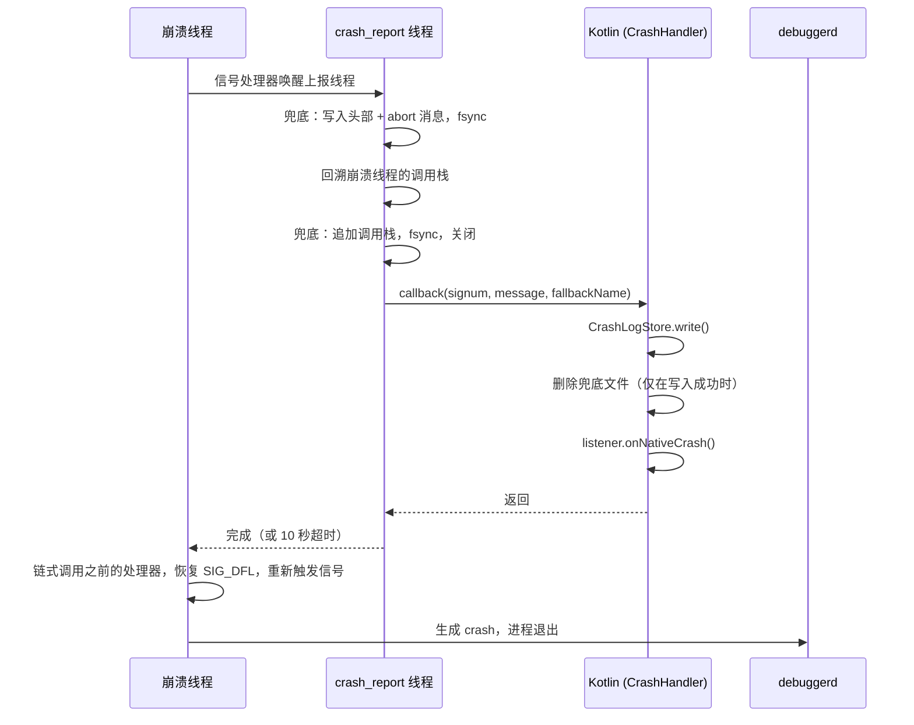

# 崩溃捕获模块

在进程内捕获 Java 崩溃、Native 崩溃和 ANR，在执行任何其他操作之前先把每一次崩溃保存到磁盘，并通过专门的 `CrashActivity` 向用户展示所有未查看过的崩溃，用户可以在其中复制、导出或上传崩溃信息。

本模块的设计目标是与系统机制共存，而不是取而代之：

- **Java 崩溃**先被记录，然后交给之前的默认处理器（通常是系统的处理器），由它上报给 ActivityManager 并结束进程。Android vitals、`ApplicationExitInfo` 以及其他崩溃 SDK 仍能照常看到这些崩溃。
- **Native 崩溃**先被记录，然后信号会继续传递下去，因此 `debuggerd` 仍会写入 crash。
- **ANR** 通过 SIGQUIT 检测，而 SIGQUIT 总会被转发给 ART 的 Signal Catcher，因此系统的 `traces.txt` 不受影响。

## 目录

1. [架构](#架构)
2. [捕获流程](#捕获流程)
3. [日志存储](#日志存储)
4. [上传](#上传)
5. [集成](#集成)
6. [使用方法](#使用方法)
7. [测试](#测试)
8. [已知限制](#已知限制)

---

## 架构

### 进程

| 进程 | 职责 |
|---|---|
| 主进程 | 安装崩溃捕获、写入崩溃日志、执行上传任务 |
| `:crash` | 仅运行 `CrashActivity`。**绝不**在此进程中安装崩溃捕获 |

`CrashActivity` 运行在独立的进程中，这样即使主进程卡死（ANR）或正在退出（Native 崩溃），它依然可以显示。

### 源文件

| 文件 | 职责 |
|---|---|
| `CrashHandler.kt` | 公开入口：`install()` / `uninstall()`、Java 未捕获异常处理器、Native 崩溃和 ANR 的 JNI 回调、仅限调试版本的测试 API |
| `CrashLogStore.kt` | 崩溃日志的唯一管理者：写入、去重、清理、接管 Native 兜底报告、`consumeAll()` |
| `CrashReportUploader.kt` | 使用 WorkManager 将报告加入上传队列；由 `CrashReportWorker` 负责发送 |
| `CrashActivity.kt` | 展示所有未查看的崩溃；支持上报、复制、导出、重启、关闭 |
| `MyApplication.kt` | 宿主示例：安装捕获、打开 `CrashActivity`、在 `:crash` 中初始化 WorkManager |
| `crash_handler.cpp` | 信号处理器、崩溃上报线程、SIGQUIT（ANR）监控 |
| `fallback_report.cpp/.h` | Native 崩溃报告的 Native 端预写副本 |

所有类型的崩溃最终都汇集到**同一个**地方 —— `CrashLogStore`，并采用**同一种**格式。所有下游环节（去重、`CrashActivity`、上传）都只处理这一种格式。

---

## 捕获流程

### Java 崩溃

```
未捕获异常（任意线程，包括主线程）
  └─ JavaCrashHandler.uncaughtException()
       ├─ CrashLogStore.write()                 日志已落盘
       ├─ listener.onJavaCrash()                仅针对进程的第一次崩溃
       └─ 之前的处理器（finally）               始终执行，即使上面的步骤抛出异常
            └─ 系统：ActivityManager.handleApplicationCrash()，然后结束进程
```

- **不会**包装主线程的 `Looper`。主线程异常会从 `ActivityThread.main()` 中的 `Looper.loop()` 抛出，运行时会像对待其他线程一样把它分发给默认处理器。绝不会为了让应用继续运行而吞掉崩溃。
- 如果多个线程几乎同时崩溃，每一次崩溃都会被保存，但只有第一次会传递给监听器。无论如何，`CrashActivity` 都会读取所有已保存的日志。
- `onJavaCrash` **不得**退出进程，并且应当尽快返回。系统会在其返回后立即结束进程。
- 如果不存在之前的处理器（这种情况很少见），则直接结束进程。

**可预期的异常应在其源头处理。** 用户输入的无效正则表达式、格式错误的文件、I/O 错误：应在发生的地方捕获这些异常并给出明确的错误提示。任何到达未捕获异常处理器的异常都会导致进程结束。

### Native 崩溃



- 信号处理器运行在备用信号栈上，只负责唤醒上报线程。每个进程只有一个线程进行上报；崩溃线程最多等待 10 秒，之后让信号继续传递。
- Native **兜底报告**会在任何 JVM 操作之前写入，因此即使 JNI 回调无法完成（ART 死锁、attach 失败、进程在上报过程中被结束），崩溃也不会丢失。详见[日志存储](#日志存储)。
- `onNativeCrash` 运行在 `crash_report` 线程上。它**不得**退出进程：它返回后，信号会到达 `debuggerd`，由其写入 crash，进程随后自行退出。
- Native 信号处理器在 Native 库加载时（首次访问 `CrashHandler` 时）即生效。`install()` 负责将它们与监听器连接起来。

### ANR

当调用 `install(anrMonitor = true)` 时，Native 层会监听 SIGQUIT —— 系统在即将判定某个进程无响应时会向其发送该信号。

1. SIGQUIT 到达。`onAnrSignal()` 立即对主线程的调用栈进行快照，因为后台 ANR 可能会在系统完成转储后立即被结束。
2. SIGQUIT 被转发给 ART 的 Signal Catcher，因此系统的 trace 转储照常进行。
3. `onAnrConfirm()` 会在最多 5 秒内确认这是否确实是本进程的 ANR：主线程必须持续无响应，并且 `ActivityManager.getProcessesInErrorState()` 必须报告本进程处于 `NOT_RESPONDING` 状态。如果主线程有响应（其他应用的 ANR、`adb shell kill -3`、已恢复的卡顿），则取消本次报告。
4. 确认后：执行 `CrashLogStore.write()`，然后调用 `listener.onAnrCrash()`。

`onAnrCrash` 在主线程卡住期间运行于 Native 的 `anr_report` 线程上：不要在其中操作 UI，也不要等待主线程。默认情况下它会转发给 `onJavaCrash`。本库在 ANR 时绝不会结束进程；示例 `MyApplication` 选择了结束进程（参见[使用方法](#使用方法)）。

---

## 日志存储

### 目录

| 目录 | 文件 | 作用 | 写入者 | 删除者 |
|---|---|---|---|---|
| `filesDir/native_crash/` | `native_<epoch_ms>_<pid>.log` | Native 预写副本 | Native 上报线程 | Kotlin（在自身日志保存成功后）；或在下次启动时被接管 |
| `filesDir/logs/` | `crash_<yyyyMMdd>_<HHmmss>_<SSS>_<seq>_<type>_<signature>_<count>.log` | **正式的**崩溃日志 | `CrashLogStore.write()` | 去重替换、启动时清理、`consumeAll()` |
| `noBackupFilesDir/crash_reports/` | `report_<ms>_<uuid>.txt` | 上传队列条目 | `CrashReportUploader.enqueue()` | `CrashReportWorker` |

在 `filesDir/logs/` 中只会列出或删除 `crash_*` 文件，因此该目录可以与应用的其他日志共用。

### 日志格式

```
Type: Java Crash
Time: 2026-10-08 14:03:21.457
Occurrences: 3 (only the latest is kept)     <- 仅当次数 > 1 时出现
Thread: main                                 <- 已知时出现
Process: x.editor.app (pid 12345)
App: x.editor.app 1.2.0 (120)
Device: Google Pixel 8
Android: 15 (API 35)
ABIs: arm64-v8a, armeabi-v7a, armeabi
------------------------------------------
java.lang.RuntimeException: ...
    at ...
```

### 保存

每一次崩溃都会在监听器运行**之前**持久化，因此即使监听器执行失败、Activity 启动被阻止或进程退出，崩溃记录也能保留下来。

- 内容先写入 `.tmp` 文件，然后重命名为 `.log`，因此读取方永远不会看到写了一半的日志。
- 只有在重命名成功之后，才会删除同一崩溃的旧日志。
- `write()` 从不抛出异常。如果保存失败（磁盘已满），返回的 `CrashLog.file` 为 `null`，而 `CrashLog.content` 仍携带文本内容，`MyApplication` 随后会将其直接传给 `CrashActivity`。

Native 崩溃额外增加了一个预写步骤：

1. 上报线程写入兜底文件的头部（信号、pid、tid、线程名、abort 消息）并执行 `fsync`，整个过程不使用堆内存。
2. 回溯完成后，追加调用栈，再次执行 `fsync` 并关闭文件。
3. Kotlin 通过 `CrashLogStore.write()` 保存自己的日志。
4. **只有在保存成功后**，Kotlin 才会删除兜底文件，并且是在调用监听器**之前**删除。因此，即使监听器抛出异常或卡住，也不会留下重复记录；而写入失败时会保留兜底文件，确保崩溃不会丢失。

### 删除

**崩溃日志（`crash_*.log`）**

- **去重替换**：当同一个崩溃再次发生时，新日志会替换旧日志，文件名中的计数随之增加。每一种不同的崩溃只保留最新的一份。
- **启动时清理**（`CrashLogStore.init()`）：删除超过 60 秒的 `.tmp` 残留文件，并最多保留最新的 20 种不同崩溃。
- **已查看即删除**（`consumeAll()`）：`CrashActivity` 读取每一条日志，并在读取时将其删除，无法读取的日志也一并删除，这样损坏的文件就不会无休止地反复出现。此后文本只存在于 `ViewModel` 中：它能在屏幕旋转后保留，但不能在 `:crash` 进程结束后保留。用户可以通过导出来保存一份副本。

**Native 兜底报告（`native_*.log`）**

- **正常情况**：在同一次崩溃过程中由 Kotlin 删除（即上面的第 4 步）。
- **遗留情况**：在下次启动时，`install()` 会在重新启用兜底机制之前调用 `CrashLogStore.adoptNativeFallbacks()`。每个文件都会被转换为一条常规崩溃日志，使用原始的崩溃时间，并采用与实时流程完全相同的方式计算签名，从而能够与同一 bug 的常规日志进行去重。转换成功的文件会被删除；空文件会被删除；转换失败的文件会被保留，并在下次启动时重试。如果写入该文件的进程仍然存活且文件存在时间不足 60 秒，则跳过该文件。

**上传队列条目（`report_*.txt`）**

- 在上传成功、遇到不可重试的拒绝或最后一次尝试失败后，由 Worker 删除。
- 超过 7 天的条目会在下次运行 `enqueue()` 时被删除。

### 去重签名

当两次崩溃的签名一致时，即视为"同一个"崩溃。消息、地址和 ID 被有意排除在外，因为同一个 bug 的不同次发生中这些值都会不同。

| 类型 | 签名 |
|---|---|
| Java | 异常类名加上前 10 个栈帧，最多覆盖异常因果链中的 5 个 throwable |
| ANR | 主线程的前 20 个栈帧 |
| Native | 信号编号加上上报线程的消息，其中十六进制地址、pid/tid 以及随机化的 `/data/app/...` 安装路径都会被归一化 |

类型也参与哈希计算，结果取 SHA-1 的 12 个十六进制字符。

### 典型场景

**前台崩溃，一切正常。** 日志被保存（对于 Native 崩溃，兜底文件会先写入再删除），`CrashActivity` 打开，读取日志并将其删除。除非用户提交了报告（该报告会留在上传队列中直到发送完成），否则磁盘上不会留下任何内容。

**Native 崩溃，JNI 回调失败。** 只剩下兜底文件。下次启动时，`attachBaseContext` 中的 `install()` 会将其接管为一条常规日志。当第一个 Activity 被创建时，`hasLogs()` 为 true，于是 `CrashActivity` 会以"上次启动"模式显示在应用之上。接管操作在任何 Activity 之前执行，因此一定能找到被接管的日志。

**后台崩溃。** 日志被保存，但 Android 10 及以上版本禁止从后台启动 Activity。日志会保留在磁盘上，直到用户再次打开应用，之后的流程与上一个场景相同。

---

## 上传

`CrashReportUploader.enqueue(context, url, content)` 使用 WorkManager 将报告加入队列，因此即使用户离开当前界面、进程被结束或设备处于离线状态，上传任务也能保留下来。

- 内容会先暂存为文件（WorkManager 的输入数据限制为 10 KB），只把文件路径传给 Worker。
- `enqueue()` 会阻塞，直到 WorkManager 将任务持久化完成，因此调用方可以在调用后立即结束自己的进程。请勿在主线程中调用。
- Worker 以 `text/plain; charset=utf-8` 请求体发送 HTTP `POST` 请求。它需要网络连接，并采用从 30 秒开始的指数退避策略进行重试。
- 会重试的情况：I/O 错误、HTTP 408、429 和 5xx，总共最多尝试 5 次。其他 4xx 响应不会重试。
- `:crash` 只负责记录任务，任务的**执行**在主进程中进行，必要时由系统的任务调度器启动主进程。

---

## 集成

### Gradle

本模块使用 CMake 构建其 Native 库。应用模块需要依赖 WorkManager：

```groovy
dependencies {
    implementation project(':crash')                              // 模块名：请按实际调整
    implementation "androidx.work:work-runtime-ktx:<version>"
}
```

### Manifest

```xml
<uses-permission android:name="android.permission.INTERNET" />

<!-- 仅在 Android 9 及以下版本导出时需要 -->
<uses-permission
    android:name="android.permission.WRITE_EXTERNAL_STORAGE"
    android:maxSdkVersion="28" />

<application android:name=".MyApplication" ...>

    <activity
        android:name=".activity.CrashActivity"
        android:process=":crash"
        android:exported="false"
        android:excludeFromRecents="true">
        <intent-filter>
            <!-- 必须与 Constants.ACTION_CRASH_REPORT 一致 -->
            <action android:name="x.editor.app.action.CRASH_REPORT" />
            <category android:name="android.intent.category.DEFAULT" />
        </intent-filter>
    </activity>

</application>
```

### 规则

- 在 `Application.attachBaseContext` 中、在主线程上调用 `CrashHandler.install()`，并且**绝不**在 `:crash` 进程中调用。
- 不要在 `onJavaCrash` 或 `onNativeCrash` 中退出进程。系统和 `debuggerd` 会负责处理。
- 在 `onAnrCrash` 中，不要操作 UI，也不要等待主线程。
- 不要在 `:crash` 进程中访问 `CrashHandler`，否则会在该进程中加载 Native 库。`CrashLogStore` 和 `CrashReportUploader` 可以在 `:crash` 中安全使用。
- 在 `:crash` 中手动初始化 WorkManager，并将主进程设为其默认进程（参见下面的示例）。WorkManager 的默认初始化器只在主进程中运行。
- 每次崩溃都创建一个新的 `Intent`。可能有多个线程同时崩溃。
- 其他崩溃 SDK：请在 `CrashHandler.install()` **之后**安装。这样它们会包装本处理器，而本处理器仍会继续转发给系统。

---

## 使用方法

### 在 Application 中安装

```kotlin
class MyApplication : Application() {

    private var isCrashProcess = false

    override fun attachBaseContext(context: Context) {
        super.attachBaseContext(context)

        isCrashProcess = detectCrashProcess()
        if (isCrashProcess) return

        CrashHandler.install(this, object : OnExceptionListener {

            // 返回后系统会结束进程
            override fun onJavaCrash(thread: Thread, throwable: Throwable, log: CrashLog) {
                startCrashActivity(log)
            }

            // 返回后 debuggerd 会写入 crash，进程随之退出
            override fun onNativeCrash(signum: Int, message: String, log: CrashLog) {
                startCrashActivity(log)
            }

            // 本示例在确认 ANR 后结束进程。如果不重写此方法，
            // 则会回退到 onJavaCrash，并交由系统的 ANR 对话框决定。
            override fun onAnrCrash(thread: Thread, error: AnrException, log: CrashLog) {
                try {
                    startCrashActivity(log)
                } finally {
                    Process.killProcess(Process.myPid())
                    exitProcess(10)
                }
            }
        })
    }

    override fun onCreate() {
        super.onCreate()
        if (isCrashProcess) {
            // :crash 负责记录上传任务；由主进程执行
            try {
                WorkManager.initialize(
                    this,
                    Configuration.Builder().setDefaultProcessName(packageName).build()
                )
            } catch (e: IllegalStateException) {
                // 已经初始化过
            }
        } else {
            showPendingCrashOnFirstActivity()
        }
    }

    private fun startCrashActivity(log: CrashLog) {
        try {
            val intent = Intent(Constants.ACTION_CRASH_REPORT).apply {
                setPackage(packageName)
                addFlags(Intent.FLAG_ACTIVITY_NEW_TASK or Intent.FLAG_ACTIVITY_CLEAR_TASK)
                // 正常情况下日志已在磁盘上；只有不在磁盘上时才传递文本
                if (log.file == null) {
                    putExtra(Constants.EXTRA_CRASH_STACK_TRACE, log.content.take(100_000))
                }
            }
            startActivity(intent)
        } catch (e: Throwable) {
            // 日志已在磁盘上，会在下次启动时显示
        }
    }

    // 应用未能显示的崩溃（后台崩溃、Activity 启动失败）：
    // 在下次启动的第一个 Activity 之上打开 CrashActivity。
    private fun showPendingCrashOnFirstActivity() {
        registerActivityLifecycleCallbacks(object : ActivityLifecycleCallbacks {
            override fun onActivityCreated(activity: Activity, savedInstanceState: Bundle?) {
                unregisterActivityLifecycleCallbacks(this)
                if (!CrashLogStore.hasLogs(this@MyApplication)) return
                activity.startActivity(
                    Intent(Constants.ACTION_CRASH_REPORT)
                        .setPackage(packageName)
                        .putExtra(Constants.EXTRA_CRASH_FROM_PREVIOUS_LAUNCH, true)
                )
            }
            // 其他回调：空实现
        })
    }
}
```

完整版本（包括 `detectCrashProcess()`）请参见 `MyApplication.kt`。

### 自行读取和上传日志

`CrashActivity` 已经实现了这些功能。最简形式如下，可在应用的任意进程中、在后台线程上执行：

```kotlin
val crashes: List<StoredCrash> = CrashLogStore.consumeAll(context)   // 读取并删除
if (crashes.isNotEmpty()) {
    val text = crashes.joinToString("\n\n") { crash ->
        "[${crash.type?.label ?: "Crash"} x${crash.count}]\n${crash.content}"
    }
    CrashReportUploader.enqueue(context, "https://example.com/crash", text)
}
```

`consumeAll()` 会删除它所返回的内容，因此如果之后还需要这些文本，请自行保留。

### 卸载

```kotlin
CrashHandler.uninstall()   // 主线程
```

调用 `uninstall()` 之后：

- 不再调用监听器。
- Java 崩溃直接交给系统处理。如果在此期间有其他 SDK 包装了本处理器，本处理器会保留在该调用链中并只做转发，因此不会把其他 SDK 隔断。
- ANR 监控停止。
- Native 信号处理器保持注册状态，因为其他 SDK 可能已在其上链接了自己的处理器。Native 崩溃仍然会被**保存**到磁盘并在下次启动时显示，但不会通知监听器。

之后可以再次调用 `install()`。

---

## 测试

测试 API 仅在可调试（debuggable）的构建中有效；在 release 构建中它们只会输出一条警告，不执行任何操作。

| 调用 | 效果 |
|---|---|
| `CrashHandler.testJavaCrash()` | 在调用线程上抛出 `RuntimeException` |
| `CrashHandler.testNativeCrash()` | 在 Native 代码中解引用空指针 |
| `CrashHandler.testAnrCrash()` | 在前台有序广播中使主线程死锁；系统会在大约 10 秒后判定 ANR。请在应用处于前台时调用。 |

建议执行的检查：

1. **Java 崩溃到达系统。** 调用 `testJavaCrash()` 后，`CrashActivity` 打开，`adb logcat -s AndroidRuntime` 显示 `FATAL EXCEPTION`，并且 `adb shell dumpsys activity exit-info <package>`（API 30+）列出原因为 `CRASH` 的退出记录。
2. **Native 兜底文件清理。** 调用 `testNativeCrash()` 后，`files/native_crash/` 为空，并且存在 crash。
3. **兜底文件接管。** 临时在 `CrashHandler.callback` 开头抛出异常，触发一次 Native 崩溃，然后重新启动应用。该崩溃会出现在 `CrashActivity` 中，并标记为从 Native 兜底报告中恢复。
4. **去重。** 在打开应用之前触发两次相同的崩溃。只会出现一条记录，并标记为 `×2`。
5. **后台崩溃。** 在应用处于后台时触发崩溃，然后打开应用。`CrashActivity` 会以上次启动模式打开。

---

### 单元测试

在 JVM 上运行（`./gradlew :crash:testDebugUnitTest`）：

| 测试 | 覆盖内容 |
|---|---|
| `CrashSignatureTest` | 判断两次崩溃是否为同一种：取决于异常类和原因链上的栈顶帧，与异常消息无关；原生崩溃会去掉地址、pid/tid 和安装目录这些每次都会变化的部分 |
| `CrashLogStoreTest` | 每种不同的崩溃对应一个文件，文件名包含时间、类型、签名和次数；同一种崩溃再次发生时，计数加一，而不是新建文件 |

## 已知限制

- **重复崩溃会弹出系统对话框。** 由于 Java 崩溃会交给系统处理，主进程在大约一分钟内第二次崩溃时，Android 会显示"应用屡次停止运行"对话框，并可能覆盖在 `CrashActivity` 之上。在 Android 9 及以上版本中，第一次崩溃不会弹出系统对话框。
- **进程内 Native 栈回溯。** 调用栈是在崩溃进程内部回溯的，并且报告会使用堆内存。对于堆损坏或发生在 `malloc` 内部的崩溃，上报线程可能会卡住；此时只有兜底文件的头部（信号、线程、abort 消息）能够保留下来，没有调用栈。成熟的方案（Crashpad、Breakpad、xCrash）会在独立进程中进行栈回溯。
- **仅包含崩溃线程。** Native 报告只包含崩溃线程的调用栈和 abort 消息，不包含所有线程、寄存器或内存映射。这些信息可以在系统 crash 中找到。
- **不进行符号化。** release 版本的 `.so` 文件经过 strip 处理，因此 Native 栈帧显示为地址。请为每个发布版本保留未 strip 的库，并使用 `ndk-stack` 或 `llvm-symbolizer` 进行符号化；为此，报告中必须包含 build-id 和相对 pc。
- **上传由用户主动发起。** 只有用户提交的报告才会被发送，因此本模块无法统计崩溃率。如需统计数据，请搭配崩溃上报服务使用。
- **无法捕获**：被系统以应用无法感知的信号方式结束的进程（低内存终止机制、被静默结束的后台 ANR）。`ApplicationExitInfo`（API 30+）可以在下次启动时弥补这一空缺。
- **被接管崩溃的头部信息**描述的是接管它们的那次启动，而不是发生崩溃的那次启动。如果应用在此期间进行了更新，版本号会不同。
- 启动时清理在接管之前执行，因此在接管了大量报告之后，日志数量可能会暂时超过 20 条，直到下次启动。
- 崩溃日志可能包含用户数据（异常消息）。请在上传前告知用户，并在隐私政策中加以说明。
