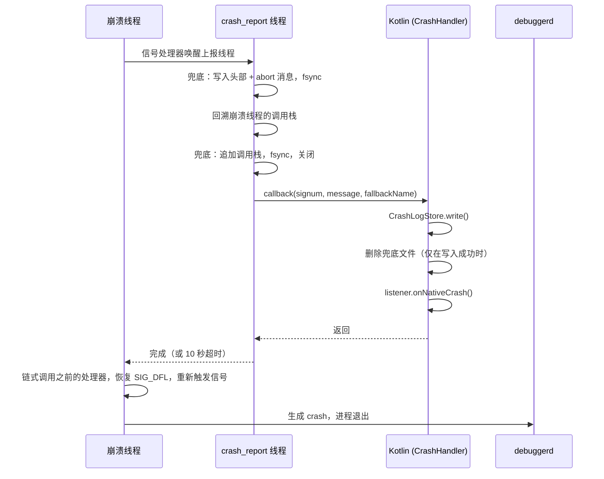

# crash：设计与原理

> [crash](../crash/README_CN.md) 模块文档 · [English](crash_architecture.md)

## 架构

### 进程

| 进程 | 职责 |
|---|---|
| 主进程 | 安装崩溃捕获、写入崩溃日志、执行上传任务 |
| `:crash` | 仅运行 `CrashActivity`。**绝不**在此进程中安装崩溃捕获 |

`CrashActivity` 运行在独立的进程中，这样即使主进程卡死（ANR）或正在退出（Native 崩溃），它依然可以显示。

### 源文件

| 文件 | 职责 |
|---|---|
| `CrashHandler.kt` | 公开入口：`install()` / `uninstall()`、Java 未捕获异常处理器、Native 崩溃和 ANR 的 JNI 回调、仅限调试版本的测试 API |
| `CrashLogStore.kt` | 崩溃日志的唯一管理者：写入、去重、清理、接管 Native 兜底报告、`consumeAll()` |
| `CrashReportUploader.kt` | 使用 WorkManager 将报告加入上传队列；由 `CrashReportWorker` 负责发送 |
| `CrashActivity.kt` | 展示所有未查看的崩溃；支持上报、复制、导出、重启、关闭 |
| `MyApplication.kt` | 宿主示例：安装捕获、打开 `CrashActivity`、在 `:crash` 中初始化 WorkManager |
| `crash_handler.cpp` | 信号处理器、崩溃上报线程、SIGQUIT（ANR）监控 |
| `fallback_report.cpp/.h` | Native 崩溃报告的 Native 端预写副本 |

所有类型的崩溃最终都汇集到**同一个**地方 —— `CrashLogStore`，并采用**同一种**格式。所有下游环节（去重、`CrashActivity`、上传）都只处理这一种格式。

## 捕获流程

### Java 崩溃

```
未捕获异常（任意线程，包括主线程）
  └─ JavaCrashHandler.uncaughtException()
       ├─ CrashLogStore.write()                 日志已落盘
       ├─ listener.onJavaCrash()                仅针对进程的第一次崩溃
       └─ 之前的处理器（finally）               始终执行，即使上面的步骤抛出异常
            └─ 系统：ActivityManager.handleApplicationCrash()，然后结束进程
```

- **不会**包装主线程的 `Looper`。主线程异常会从 `ActivityThread.main()` 中的 `Looper.loop()` 抛出，运行时会像对待其他线程一样把它分发给默认处理器。绝不会为了让应用继续运行而吞掉崩溃。
- 如果多个线程几乎同时崩溃，每一次崩溃都会被保存，但只有第一次会传递给监听器。无论如何，`CrashActivity` 都会读取所有已保存的日志。
- `onJavaCrash` **不得**退出进程，并且应当尽快返回。系统会在其返回后立即结束进程。
- 如果不存在之前的处理器（这种情况很少见），则直接结束进程。

**可预期的异常应在其源头处理。** 用户输入的无效正则表达式、格式错误的文件、I/O 错误：应在发生的地方捕获这些异常并给出明确的错误提示。任何到达未捕获异常处理器的异常都会导致进程结束。

### Native 崩溃



- 信号处理器运行在备用信号栈上，只负责唤醒上报线程。每个进程只有一个线程进行上报；崩溃线程最多等待 10 秒，之后让信号继续传递。
- Native **兜底报告**会在任何 JVM 操作之前写入，因此即使 JNI 回调无法完成（ART 死锁、attach 失败、进程在上报过程中被结束），崩溃也不会丢失。详见[日志存储](#日志存储)。
- `onNativeCrash` 运行在 `crash_report` 线程上。它**不得**退出进程：它返回后，信号会到达 `debuggerd`，由其写入 crash，进程随后自行退出。
- Native 信号处理器在 Native 库加载时（首次访问 `CrashHandler` 时）即生效。`install()` 负责将它们与监听器连接起来。

### ANR

当调用 `install(anrMonitor = true)` 时，Native 层会监听 SIGQUIT —— 系统在即将判定某个进程无响应时会向其发送该信号。

1. SIGQUIT 到达。`onAnrSignal()` 立即对主线程的调用栈进行快照，因为后台 ANR 可能会在系统完成转储后立即被结束。
2. SIGQUIT 被转发给 ART 的 Signal Catcher，因此系统的 trace 转储照常进行。
3. `onAnrConfirm()` 会在最多 5 秒内确认这是否确实是本进程的 ANR：主线程必须持续无响应，并且 `ActivityManager.getProcessesInErrorState()` 必须报告本进程处于 `NOT_RESPONDING` 状态。如果主线程有响应（其他应用的 ANR、`adb shell kill -3`、已恢复的卡顿），则取消本次报告。
4. 确认后：执行 `CrashLogStore.write()`，然后调用 `listener.onAnrCrash()`。

`onAnrCrash` 在主线程卡住期间运行于 Native 的 `anr_report` 线程上：不要在其中操作 UI，也不要等待主线程。默认情况下它会转发给 `onJavaCrash`。本库在 ANR 时绝不会结束进程；示例 `MyApplication` 选择了结束进程（参见[使用方法](crash_usage_cn.md#使用方法)）。

## 日志存储

### 目录

| 目录 | 文件 | 作用 | 写入者 | 删除者 |
|---|---|---|---|---|
| `filesDir/native_crash/` | `native_<epoch_ms>_<pid>.log` | Native 预写副本 | Native 上报线程 | Kotlin（在自身日志保存成功后）；或在下次启动时被接管 |
| `filesDir/logs/` | `crash_<yyyyMMdd>_<HHmmss>_<SSS>_<seq>_<type>_<signature>_<count>.log` | **正式的**崩溃日志 | `CrashLogStore.write()` | 去重替换、启动时清理、`consumeAll()` |
| `noBackupFilesDir/crash_reports/` | `report_<ms>_<uuid>.txt` | 上传队列条目 | `CrashReportUploader.enqueue()` | `CrashReportWorker` |

在 `filesDir/logs/` 中只会列出或删除 `crash_*` 文件，因此该目录可以与应用的其他日志共用。

### 日志格式

```
Type: Java Crash
Time: 2026-10-08 14:03:21.457
Occurrences: 3 (only the latest is kept)     <- 仅当次数 > 1 时出现
Thread: main                                 <- 已知时出现
Process: x.editor.app (pid 12345)
App: x.editor.app 1.2.0 (120)
Device: Google Pixel 8
Android: 15 (API 35)
ABIs: arm64-v8a, armeabi-v7a, armeabi
------------------------------------------
java.lang.RuntimeException: ...
    at ...
```

### 保存

每一次崩溃都会在监听器运行**之前**持久化，因此即使监听器执行失败、Activity 启动被阻止或进程退出，崩溃记录也能保留下来。

- 内容先写入 `.tmp` 文件，然后重命名为 `.log`，因此读取方永远不会看到写了一半的日志。
- 只有在重命名成功之后，才会删除同一崩溃的旧日志。
- `write()` 从不抛出异常。如果保存失败（磁盘已满），返回的 `CrashLog.file` 为 `null`，而 `CrashLog.content` 仍携带文本内容，`MyApplication` 随后会将其直接传给 `CrashActivity`。

Native 崩溃额外增加了一个预写步骤：

1. 上报线程写入兜底文件的头部（信号、pid、tid、线程名、abort 消息）并执行 `fsync`，整个过程不使用堆内存。
2. 回溯完成后，追加调用栈，再次执行 `fsync` 并关闭文件。
3. Kotlin 通过 `CrashLogStore.write()` 保存自己的日志。
4. **只有在保存成功后**，Kotlin 才会删除兜底文件，并且是在调用监听器**之前**删除。因此，即使监听器抛出异常或卡住，也不会留下重复记录；而写入失败时会保留兜底文件，确保崩溃不会丢失。

### 删除

**崩溃日志（`crash_*.log`）**

- **去重替换**：当同一个崩溃再次发生时，新日志会替换旧日志，文件名中的计数随之增加。每一种不同的崩溃只保留最新的一份。
- **启动时清理**（`CrashLogStore.init()`）：删除超过 60 秒的 `.tmp` 残留文件，并最多保留最新的 20 种不同崩溃。
- **已查看即删除**（`consumeAll()`）：`CrashActivity` 读取每一条日志，并在读取时将其删除，无法读取的日志也一并删除，这样损坏的文件就不会无休止地反复出现。此后文本只存在于 `ViewModel` 中：它能在屏幕旋转后保留，但不能在 `:crash` 进程结束后保留。用户可以通过导出来保存一份副本。

**Native 兜底报告（`native_*.log`）**

- **正常情况**：在同一次崩溃过程中由 Kotlin 删除（即上面的第 4 步）。
- **遗留情况**：在下次启动时，`install()` 会在重新启用兜底机制之前调用 `CrashLogStore.adoptNativeFallbacks()`。每个文件都会被转换为一条常规崩溃日志，使用原始的崩溃时间，并采用与实时流程完全相同的方式计算签名，从而能够与同一 bug 的常规日志进行去重。转换成功的文件会被删除；空文件会被删除；转换失败的文件会被保留，并在下次启动时重试。如果写入该文件的进程仍然存活且文件存在时间不足 60 秒，则跳过该文件。

**上传队列条目（`report_*.txt`）**

- 在上传成功、遇到不可重试的拒绝或最后一次尝试失败后，由 Worker 删除。
- 超过 7 天的条目会在下次运行 `enqueue()` 时被删除。

### 去重签名

当两次崩溃的签名一致时，即视为"同一个"崩溃。消息、地址和 ID 被有意排除在外，因为同一个 bug 的不同次发生中这些值都会不同。

| 类型 | 签名 |
|---|---|
| Java | 异常类名加上前 10 个栈帧，最多覆盖异常因果链中的 5 个 throwable |
| ANR | 主线程的前 20 个栈帧 |
| Native | 信号编号加上上报线程的消息，其中十六进制地址、pid/tid 以及随机化的 `/data/app/...` 安装路径都会被归一化 |

类型也参与哈希计算，结果取 SHA-1 的 12 个十六进制字符。

### 典型场景

**前台崩溃，一切正常。** 日志被保存（对于 Native 崩溃，兜底文件会先写入再删除），`CrashActivity` 打开，读取日志并将其删除。除非用户提交了报告（该报告会留在上传队列中直到发送完成），否则磁盘上不会留下任何内容。

**Native 崩溃，JNI 回调失败。** 只剩下兜底文件。下次启动时，`attachBaseContext` 中的 `install()` 会将其接管为一条常规日志。当第一个 Activity 被创建时，`hasLogs()` 为 true，于是 `CrashActivity` 会以"上次启动"模式显示在应用之上。接管操作在任何 Activity 之前执行，因此一定能找到被接管的日志。

**后台崩溃。** 日志被保存，但 Android 10 及以上版本禁止从后台启动 Activity。日志会保留在磁盘上，直到用户再次打开应用，之后的流程与上一个场景相同。

## 上传

`CrashReportUploader.enqueue(context, url, content)` 使用 WorkManager 将报告加入队列，因此即使用户离开当前界面、进程被结束或设备处于离线状态，上传任务也能保留下来。

- 内容会先暂存为文件（WorkManager 的输入数据限制为 10 KB），只把文件路径传给 Worker。
- `enqueue()` 会阻塞，直到 WorkManager 将任务持久化完成，因此调用方可以在调用后立即结束自己的进程。请勿在主线程中调用。
- Worker 以 `text/plain; charset=utf-8` 请求体发送 HTTP `POST` 请求。它需要网络连接，并采用从 30 秒开始的指数退避策略进行重试。
- 会重试的情况：I/O 错误、HTTP 408、429 和 5xx，总共最多尝试 5 次。其他 4xx 响应不会重试。
- `:crash` 只负责记录任务，任务的**执行**在主进程中进行，必要时由系统的任务调度器启动主进程。
