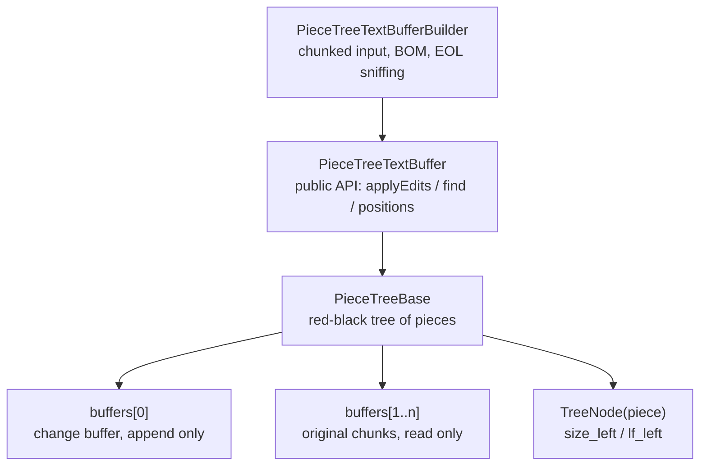

# piecetable: Design and internals

> Part of the documentation of the [piecetable](../piecetable/README.md) module · [中文](piecetable_architecture_cn.md)

## How it works



- A **piece** is a triple of "which buffer, start cursor, end cursor". It owns no characters.
- `buffers[0]` is the only writable buffer and all new input is appended to it; `buffers[1..n]`
  hold the original file content and are never modified. Deleting text just splits a piece.
- The **in-order traversal** of the red-black tree is the document. Because every node caches
  `size_left` and `lf_left`, offsets and line numbers are found in O(log n).
- Each buffer carries a **lineStarts** array (now an unboxed `IntList`) used to binary search a
  position inside a piece.
- **CRLF** must never be split across two pieces, otherwise the line count is wrong. That is
  what `validateCRLFWithPrevNode` / `fixCRLF` take care of on every edit.

## Complexity

| Operation | Cost |
| --- | --- |
| `insert` / `delete` | O(log n), n = number of pieces |
| `getOffsetAt` / `getPositionAt` | O(log n) |
| `getLineContent` | O(log n) + line length |
| `getLinesRawContent` / `toString` | O(document length), allocates a full copy |
| `createSnapshot` | O(n) + a copy of the typed text still in the document |
| `exportSlice` | O(log n + pieces in the range); copies only content below 16K chars |
| putting a slice of k runs back | O((k + 1) log n), no text copied |
| snapshot `get` / `getNearestChunk` | O(log n) |
| building from a file | O(document length), memory ≈ file size |

Pieces accumulate during a long editing session; `compact()` merges them again, see
[Memory and compaction](#memory-and-compaction).

## Threading

**Per buffer: many readers or one writer, never both. Different buffers are independent.**

1. **Concurrent reads are safe while nobody edits.** The only state a read updates is the
   search cache (its methods are `synchronized`) and the one-line cache `_lastVisitedLine`
   (an immutable object behind a `@Volatile` field, replaced as a whole). The readers must
   see the finished edit: the last edit has to *happen-before* the reads, e.g. through a lock
   or by submitting the read task after the edit. The tree's own fields are not volatile.
2. **An edit must run alone on its buffer**: no other edit and no read of the same buffer at the
   same time. Buffers share no mutable state (every tree owns its sentinel), so two buffers can
   be edited on two threads at the same time without any coordination.
3. **Snapshots can be read during edits.** `createSnapshot()` is a read, so rule 1 applies to
   it. After that the snapshot never touches the buffer again (see [Snapshots](piecetable_usage.md#snapshots)):
   any number of threads may read it at any time without a lock. All its fields are final, so
   every usual way of handing it over (an executor, a channel, a volatile field) makes it fully
   visible to the receiving thread.

In practice, either:

- do all edits and reads on one thread (the editor thread or a single thread dispatcher) and
  give background work a copy of the text (`readPiecesContent` / `toString` on that thread), or
- give every buffer **its own** `ReentrantReadWriteLock`:

```kotlin
import java.util.concurrent.locks.ReentrantReadWriteLock
import kotlin.concurrent.read
import kotlin.concurrent.write

val lock = ReentrantReadWriteLock()   // one per buffer

lock.write { buffer.applyEdits(ops, false, true) }          // editor thread
lock.read { buffer.find(regex, range, 1000) { cancelled } }  // any thread
```

Work that runs for a while and must not block typing (highlighting, saving, indexing) takes a
snapshot instead of holding the read lock.

### Highlighting while typing

A background parse needs one consistent version of the text for its whole run; reading the live
buffer between keystrokes would mix two versions. Give it a snapshot:

1. After every edit, on the editor thread, keep the `changes` that `applyEdits` returned.
2. When the debounce timer fires, take a snapshot on the editor thread and hand it to the
   background thread together with the changes collected since the last round.
3. The background thread applies those changes to the previous syntax tree, parses the snapshot
   incrementally (`getNearestChunk` as the read callback) and computes the highlight spans.
4. Use the result only if it is still current: same buffer and
   `getVersionId() == snapshot.versionId`. Otherwise shift the spans by the later changes or
   wait for the next round. One parse at a time.

Drawing the visible lines stays on the editor thread like every other read; only the parse moves
to the background.

```kotlin
import java.util.concurrent.Executors
import x.github.module.piecetable.*
import x.github.module.piecetable.common.*

// stand-ins for your parser binding (tree-sitter or another one)
interface SyntaxTree
interface IncrementalParser {
    /** [read] returns the text at a char offset, "" at the end */
    fun parse(old: SyntaxTree?, edits: List<ContentChange>, read: (Int) -> String): SyntaxTree
}

class Highlighter<Span>(
    private val doc: EditorDocument,                   // see Editor integration
    private val parser: IncrementalParser,
    private val computeSpans: (SyntaxTree) -> List<Span>,
    private val postToUi: (Runnable) -> Unit,
    private val onSpans: (List<Span>) -> Unit          // runs on the UI thread
) {
    private val worker = Executors.newSingleThreadExecutor()   // one parse at a time

    // editor thread only
    private val pendingEdits = mutableListOf<ContentChange>()
    private var lastBuffer: PieceTreeTextBuffer? = null

    // worker thread only
    private var oldTree: SyntaxTree? = null

    /** editor thread, after every successful edit */
    fun onEdited(result: ApplyEditsResult) {
        pendingEdits += result.changes
    }

    /** editor thread, when the debounce timer fires */
    fun highlight() {
        val (buffer, snapshot) = doc.snapshot()
        val fullParse = buffer !== lastBuffer       // the first round, or the document was rebuilt
        lastBuffer = buffer
        val edits = if (fullParse) emptyList() else pendingEdits.toList()
        pendingEdits.clear()

        worker.execute {
            // only the snapshot is read here: no lock, the user keeps typing meanwhile
            val tree = parser.parse(if (fullParse) null else oldTree, edits) { offset ->
                snapshot.getNearestChunk(offset)
            }
            oldTree = tree
            val spans = computeSpans(tree)
            postToUi(Runnable {
                if (doc.isCurrent(buffer, snapshot)) onSpans(spans)
            })
        }
    }
}
```

tree-sitter bindings usually read by byte offset; with UTF-16 input the char offset is
`byteOffset / 2`.

## Memory and compaction

**Why memory grows.** Edits never modify or free text. Inserted text is appended to the change
buffer and stays there after it is deleted again (undo and redo append it once more); the
original chunks are kept whole even when most of their text was deleted. Every edit at a new
place also splits a piece, so a long session ends up with many small pieces. Reads stay
O(log n), but memory is roughly "file + everything ever typed" plus about 100 bytes per piece.
The VS Code original behaves the same.

**The fix: `compact()`.** It rebuilds the storage from the current text: fresh chunks of at most
64K chars, one piece each, and an empty change buffer. Text, EOL, offsets, positions and line
numbers are unchanged, so cursors, decorations and undo data (texts and offsets, never
references into buffers) stay valid. It is O(n) and needs about one extra copy of the document
while it runs. `setEOL()` also rebuilds, but rewrites the line breaks; `compact()` never does,
it also keeps a buffer built with `normalizeEOL = false` exactly as it is.

**When to call it.** `getStorageStats()` tells you whether it is worth it. A reasonable policy is
"more than half of the stored text is garbage and at least a few MB, or a very large number of
pieces", checked after saving or when the editor has been idle for a moment:

```kotlin
// a member of EditorDocument, next to edit()
fun compactIfWorthIt() = lock.write {
    val stats = buffer.getStorageStats()
    val garbage = stats.storedLength - stats.length
    if (garbage > maxOf(stats.length.toLong(), 4L * 1024 * 1024) || stats.pieceCount > 50_000) {
        buffer.compact()
    }
}
```

`compact()` is an edit: it holds the write lock for its whole duration and readers wait, which is
why it belongs in an idle moment and not in the typing path. Measure it on your slowest device
for your largest files.

A snapshot keeps the chunks it points at alive, also after `compact()` replaced them, so the
memory comes back only once no snapshot of the old storage is left.

**Undo history.** With `applyEdits`, the history holds every removed text as a String: after
`compact()` the storage is small, but the history still has its own copies. With
[slices](piecetable_usage.md#slices-undo-without-copying-large-content) the history refers to the storage instead,
so removed text exists once; `compact()` cannot free storage the history still refers to, which
is exactly the text an undo needs.

---

#### Tests

- The test bodies moved to `src/sharedTest` and now run on both the JVM and a device,
  223 cases at the time (135 on the JVM before), **244** after round 2, 253 after round 3, 256 after
  round 4, 271 after round 5 and **286** after round 6.
- Assertion arguments are consistently `(expected, actual)`; the shared assertions live in
  `TestSupport` and now reconcile the tree metadata against `getLength()` / `getLineCount()` and
  check `getLinesContent()` line by line, which is exactly the assertion whose absence let the
  `getLinesContent` bug survive.
- Random tests use fixed seeds, the pointless `Thread.sleep(500)` calls are gone, and the
  `assertSame(Int, Int)` in `depth()` became `assertEquals`.
- Undo/redo tests no longer depend on coroutines and `delay(750/1000)`; the merge window is an
  explicit `commitUndoGroup()` call, which cuts about 6 seconds and all the timing flakiness.
