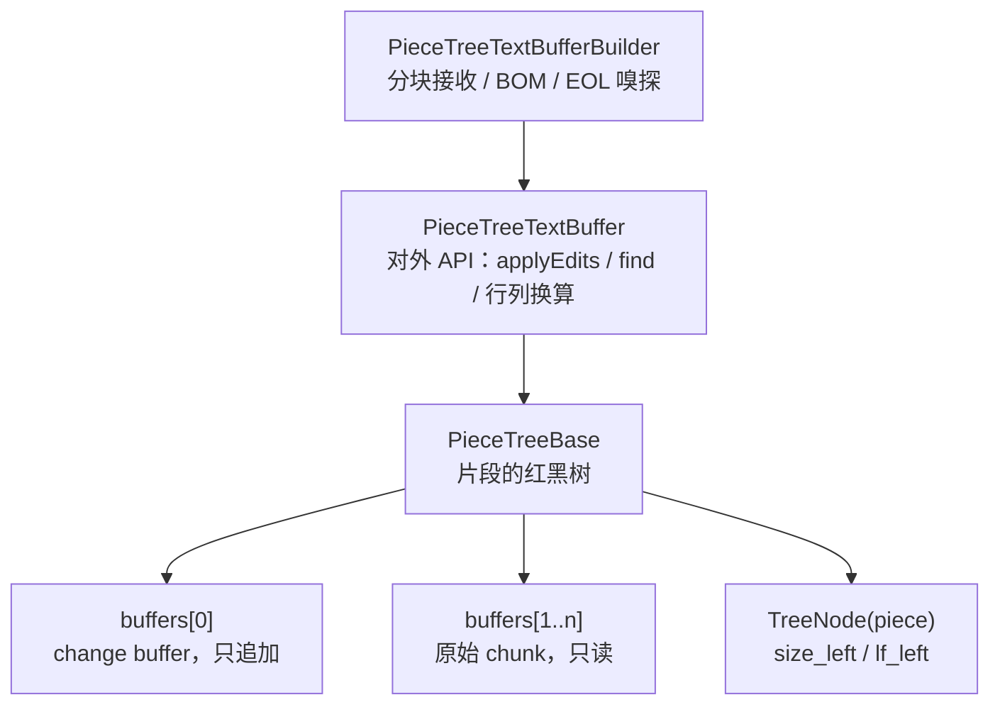

# piecetable：设计与原理

> [piecetable](../piecetable/README_CN.md) 模块文档 · [English](piecetable_architecture.md)

## 实现原理



- **Piece** 是「属于哪个 buffer + 起点 + 终点」的三元组，本身不持有字符。
- `buffers[0]` 是唯一可写的缓冲区，新输入一律追加到末尾；`buffers[1..n]` 是文件原始内容，永不修改。
  所以「删除」只是把 piece 切开，不搬运字符。
- 红黑树的**中序遍历**就是文档顺序；节点缓存 `size_left` 与 `lf_left`，因此偏移量与行号可以
  在 O(log n) 内定位。
- 每个 buffer 自带 **lineStarts**（现在是不装箱的 `IntList`），piece 内部的定位靠它二分查找。
- **CRLF 必须始终落在同一个 piece 内**，否则行数会算错。每次编辑后的
  `validateCRLFWithPrevNode` / `fixCRLF` 就在做这件事。

## 复杂度

| 操作 | 复杂度 |
| --- | --- |
| `insert` / `delete` | O(log n)，n 为 piece 数 |
| `getOffsetAt` / `getPositionAt` | O(log n) |
| `getLineContent` | O(log n) + 行长度 |
| `getLinesRawContent` / `toString` | O(文档长度)，会分配等长内存 |
| `createSnapshot` | O(n) + 复制仍在文档中的输入文本 |
| `exportSlice` | O(log n + 区间内的 piece 数)；只复制 16K 字符以下的内容 |
| 插回一个含 k 段引用的片段 | O((k + 1) log n)，不复制文本 |
| 快照的 `get` / `getNearestChunk` | O(log n) |
| 构建（builder） | O(文档长度)，内存约等于文件本身 |

长时间编辑后 piece 数会增长，`compact()` 可以把碎片重新合并，见[内存与压缩](#内存与压缩)。

## 线程模型

**以缓冲区为单位：可以多个线程同时读，或者一个线程写，但读写不能同时进行。不同缓冲区互不影响。**

1. **没有编辑时，并发读是安全的。** 读操作只会更新两处状态：搜索缓存（方法都是 `synchronized`）
   和单行缓存 `_lastVisitedLine`（`@Volatile` 字段里的不可变对象，只整体替换）。读线程必须能看到
   编辑完成后的结果，即最后一次编辑要 *happens-before* 这些读操作，例如通过锁，或在编辑之后再提交
   读任务。树本身的字段不是 volatile 的。
2. **编辑在本缓冲区内必须独占**：同一缓冲区上不能同时有其他编辑或读取。缓冲区之间没有共享的可变
   状态（每棵树有自己的 sentinel），两个缓冲区可以在两个线程上同时编辑，无需任何协调。
3. **快照可以在编辑期间读取。** `createSnapshot()` 是读操作，遵守第 1 条。之后快照再也不碰缓冲区
   （见[快照](piecetable_usage_cn.md#快照)），任意多个线程可以随时读它，不需要锁。快照的字段都是 final 的，用常见的方式
   交给其他线程（executor、channel、volatile 字段）都能保证对方看到完整内容。

实践中二选一：

- 编辑和读取都放在同一个线程（编辑器线程，或一个 single-thread dispatcher），后台任务拿文本副本
  （在该线程上用 `readPiecesContent` / `toString` 生成）；
- 或者给每个缓冲区**一把自己的** `ReentrantReadWriteLock`：

```kotlin
import java.util.concurrent.locks.ReentrantReadWriteLock
import kotlin.concurrent.read
import kotlin.concurrent.write

val lock = ReentrantReadWriteLock()   // 每个缓冲区一把

lock.write { buffer.applyEdits(ops, false, true) }          // 编辑线程
lock.read { buffer.find(regex, range, 1000) { cancelled } }  // 任意线程
```

耗时较长、又不能阻塞输入的工作（高亮、保存、建索引）使用快照，而不是持有读锁。

### 边输入边高亮

后台解析在整个过程中需要同一个版本的文本；在两次按键之间读实时的缓冲区，会把两个版本拼在一起。
所以交给它一个快照：

1. 每次编辑后，在编辑线程上记下 `applyEdits` 返回的 `changes`。
2. 防抖到期后，在编辑线程上创建快照，连同上一轮以来积累的 `changes` 一起交给后台线程。
3. 后台线程先用这些 `changes` 更新上一棵语法树，再在快照上增量解析（读取回调用
   `getNearestChunk`），生成高亮区间。
4. 只有结果仍然对应当前内容时才使用：缓冲区是同一个，且 `getVersionId() == snapshot.versionId`。
   否则按之后的编辑平移这些区间，或者等下一轮结果。同一时间只做一次解析。

绘制可见行仍然和其他读操作一样留在编辑线程上，挪到后台的只有解析这一步。

```kotlin
import java.util.concurrent.Executors
import x.github.module.piecetable.*
import x.github.module.piecetable.common.*

// 代表你使用的解析器绑定（tree-sitter 或其他）
interface SyntaxTree
interface IncrementalParser {
    /** [read] 返回某个字符偏移处的文本，到末尾返回 "" */
    fun parse(old: SyntaxTree?, edits: List<ContentChange>, read: (Int) -> String): SyntaxTree
}

class Highlighter<Span>(
    private val doc: EditorDocument,                   // 见「编辑器集成」
    private val parser: IncrementalParser,
    private val computeSpans: (SyntaxTree) -> List<Span>,
    private val postToUi: (Runnable) -> Unit,
    private val onSpans: (List<Span>) -> Unit          // 在 UI 线程上调用
) {
    private val worker = Executors.newSingleThreadExecutor()   // 同一时间只做一次解析

    // 只在编辑线程上访问
    private val pendingEdits = mutableListOf<ContentChange>()
    private var lastBuffer: PieceTreeTextBuffer? = null

    // 只在后台线程上访问
    private var oldTree: SyntaxTree? = null

    /** 编辑线程，每次编辑成功后调用 */
    fun onEdited(result: ApplyEditsResult) {
        pendingEdits += result.changes
    }

    /** 编辑线程，防抖到期时调用 */
    fun highlight() {
        val (buffer, snapshot) = doc.snapshot()
        val fullParse = buffer !== lastBuffer       // 第一轮，或者文档被重建过
        lastBuffer = buffer
        val edits = if (fullParse) emptyList() else pendingEdits.toList()
        pendingEdits.clear()

        worker.execute {
            // 这里只读快照：不加锁，用户同时可以继续输入
            val tree = parser.parse(if (fullParse) null else oldTree, edits) { offset ->
                snapshot.getNearestChunk(offset)
            }
            oldTree = tree
            val spans = computeSpans(tree)
            postToUi(Runnable {
                if (doc.isCurrent(buffer, snapshot)) onSpans(spans)
            })
        }
    }
}
```

tree-sitter 的绑定通常按字节偏移读取；输入编码为 UTF-16 时，字符偏移等于 `byteOffset / 2`。

## 内存与压缩

**内存为什么会增长。** 编辑从不修改或释放文本。插入的文本追加到 change buffer，之后即使被删除
也仍然留在那里（撤销、重做还会再追加一次）；原始 chunk 即使大部分内容已被删除，也会整块保留。
每次在新位置编辑还会把 piece 切开，长时间编辑后会留下大量小 piece。读操作仍是 O(log n)，
但内存大致等于「文件 + 输入过的全部文本」，外加每个 piece 约 100 字节。VSCode 原版也是这样。

**解决办法：`compact()`。** 它用当前文本重建存储：新的、每块不超过 64K 字符的 chunk，每块一个
piece，change buffer 清空。文本、EOL、偏移量、位置、行号都不变，所以光标、装饰和撤销数据
（保存的是文本和偏移量，从不引用缓冲区）依然有效。耗时 O(n)，运行期间需要额外约一份文档大小的
内存。`setEOL()` 也会重建，但会改写换行符；`compact()` 从不改写，`normalizeEOL = false` 的缓冲区
也会原样保留。

**什么时候调用。** 用 `getStorageStats()` 判断是否值得。一个合理的策略是：「存储的文本里超过
一半是垃圾且至少有几 MB，或者 piece 数非常多」，在保存之后或编辑器空闲时检查：

```kotlin
// EditorDocument 的成员函数，与 edit() 并列
fun compactIfWorthIt() = lock.write {
    val stats = buffer.getStorageStats()
    val garbage = stats.storedLength - stats.length
    if (garbage > maxOf(stats.length.toLong(), 4L * 1024 * 1024) || stats.pieceCount > 50_000) {
        buffer.compact()
    }
}
```

`compact()` 属于编辑操作：整个过程都持有写锁，读线程要等待，所以应该放在空闲时，而不是输入路径上。
请在最慢的目标设备上用最大的文件测一下耗时。

快照会让它引用的 chunk 一直留在内存里，即使 `compact()` 已经把它们换掉；只有旧存储的快照都不再被
持有之后，这部分内存才会释放。

**撤销历史。** 使用 `applyEdits` 时，撤销历史用 String 保存每段被删除的文本：`compact()` 之后存储
变小了，但历史里仍有自己的副本。使用[片段](piecetable_usage_cn.md#片段不复制大段内容的撤销)时，历史引用存储本身，被删除的
文本只存在一份；`compact()` 无法释放历史仍在引用的存储，而那正是撤销需要的文本。
