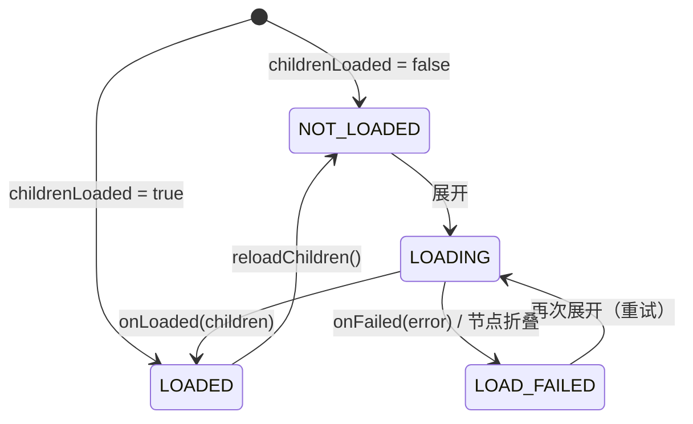

# treeview：设计与原理

> [treeview](../treeview/README_CN.md) 模块文档 · [English](treeview_architecture.md)

## 数据模型：`TreeNode`

节点持有 `value`、其 `parent` 和 `children`、`isExpanded` 以及 `loadState`。节点按引用（identity）比较，而不是按值比较，因此两个节点可以持有相等的值。`depth` 会被缓存，并在节点挂载或解除挂载时更新，因为适配器会在密集循环中比较深度。

`TreeNode` 的结构性方法（`addChild`、`insertChild`、`removeChild`）只修改数据，不会通知任何人；它们用于在将树交给适配器之前构建树。出于同样的原因，`isExpanded` 和 `loadState` 在库外部是只读的：一旦树被显示，所有修改都必须通过 `TreeAdapter` 进行。

## 扁平化投影：`TreeAdapter`

RecyclerView 显示的是一个扁平列表，因此适配器维护两个结构：

- `roots` —— 顶层节点；
- `visibleNodes` —— 一个前序遍历列表，只包含所有祖先都已展开的节点。节点的适配器位置就是它在该列表中的索引。

```
x ▼                     visibleNodes[0]
├── github ▼            visibleNodes[1]
│   └── module ▶        visibleNodes[2]   （子节点被隐藏：不在列表中）
└── README.md           visibleNodes[3]
```

由于一个节点的可见后代总是紧跟在它之后形成一个连续的块（即比它更深的那些行），折叠就是一次区间删除，展开就是一次区间插入。每个操作都会原地修改 `visibleNodes`，并发出范围最小的通知：对子树使用 `notifyItemRangeInserted` / `notifyItemRangeRemoved`，对指示器发生变化的节点使用 `notifyItemChanged(position, PAYLOAD_EXPANSION_CHANGED)`。带有该 payload 的局部重新绑定让 `onBindNode` 可以只更新指示器。

展开、折叠、插入和删除在最坏情况下的复杂度为 O(可见行数)（列表移位和位置查找）。`toggleAt(position)` 省去了查找步骤，推荐在点击处理中使用。

## 可展开性

`isExpandable(node)` 决定一行是否显示指示器以及是否响应展开。默认规则是*有子节点，或其子节点尚未加载*。该方法是 open 的，因此可以使用其他规则，例如让空目录也可展开：

```kotlin
override fun isExpandable(node: TreeNode<FileItem>) =
    super.isExpandable(node) || node.value.isDirectory
```

`node.isKnownEmpty`（已加载且没有子节点）让 UI 可以以不同方式展示空节点。

## 懒加载



- **请求标识。** 每次加载都由一个请求对象表示，节点会将其保存为当前等待的请求。只有属于该请求的结果才会被应用，因此已被删除、重新加载或被 `setRoots` 替换的节点的结果会被静默丢弃，并且同一个回调永远不会被应用两次。
- **线程切换。** `ChildLoadCallback` 可以在任意线程中被调用；结果会先被投递到主线程，然后才会触及适配器。
- **延迟启动。** 在某个操作过程中请求的加载会被放入队列，直到适配器状态重新一致后才启动。因此，同步返回结果的加载器重新进入的是一个有效的适配器，而由该嵌套结果触发的加载也会被同一个循环处理。
- **加载中折叠**不会取消请求：子节点会被添加，但会保持隐藏，直到该节点再次被展开。
- 如果一个节点加载后发现为空且不可展开，它会被重新折叠；加载失败的节点也会被折叠，以便下次展开时进行重试。

## 单子节点链

启用 `autoExpandSingleChild` 后，展开一个节点时会持续向下遍历，只要当前节点恰好只有一个子节点，且该子节点可展开、未知为空，并被受保护的钩子方法 `canAutoExpand(child)` 接受。整条链上的状态会先全部更新，然后用**一次**通知插入所有行，因此整条链会以单个变更的形式呈现动画。如果遍历到一个子节点尚未加载的节点，则会加载该节点，并在结果到达后继续遍历。折叠不受影响，`reveal()` 也永远不会进行链式展开。

## 布局：`TreeLayoutManager`

**坐标模型。** 滚动位置由两个绝对偏移量 `verticalOffset` 和 `horizontalOffset` 表示。由于行高固定，可见行范围就是 `verticalOffset / rowHeight … (verticalOffset + viewportHeight) / rowHeight`，因此布局开销为 O(可见行数)，较大的滚动增量（快速惯性滑动）也不会留下空白，跳转到任意位置的复杂度为 O(1)。水平滚动永远不会改变哪些行可见，它只是平移已挂载的子视图。

**回收。** 垂直滚动时，布局管理器会平移子视图，回收离开可见范围的行，并添加进入可见范围的行，同时保持已挂载的子视图连续并按位置排序。仅仅被平移的行既不会重新测量，也不会重新布局。

**内容宽度。** 水平滚动范围等于最宽行的宽度。它有两个来源，取两者中较大者，因此低估永远不会导致某一行被截断：

1. 一个 `ContentWidthProvider` —— 如果设置了 `contentWidthProvider` 则使用它，否则若适配器实现了该接口则使用适配器。`TreeAdapter` 实现了该接口：配合 `RowWidthCalculator` 时，它会报告可见行中最宽行的精确宽度；
2. 到目前为止已测量行的自然宽度。该值在结构变化（展开、折叠、插入、删除）时会被重置，而在滚动过程中只增不减，因此垂直滚动永远不会导致水平位置跳动。

当内容变窄（例如折叠之后）而视图正处于向右滚动的位置时，水平偏移量会被拉回到有效范围内。

**行宽缓存。** 适配器将每一行的宽度连同一个代次戳（generation stamp）缓存在其节点上。`invalidateRowWidths()` 只是将代次戳加一（O(1)）；单个节点自身的缓存会在调用 `notifyNodeChanged` 或其深度变化时被丢弃。添加行时最大值会增量更新，删除行后则会惰性地重新计算一次。

**行测量。** 每一行首先以 `UNSPECIFIED` 宽度进行测量以得到其自然宽度。启用 `stretchRowWidth`（默认）时，行随后会以 `max(contentWidth, viewportWidth)` 的精确宽度重新测量，使背景和分割线能够横跨整个可滚动区域。只有当目标宽度变化时，行才会被重新测量。

**滚动轴锁定。** RecyclerView 会在每个触摸事件中、以及在计算惯性滑动速度时，调用 `canScrollHorizontally()` / `canScrollVertically()`。布局管理器通过一个不拦截事件的 `OnItemTouchListener` 观察触摸事件，RecyclerView 会在处理每个事件*之前*调用它。一旦手指移动超过触摸阈值（touch slop），主导方向就会被锁定，另一个方向的 `canScroll…()` 返回 `false`，从而同时抑制该方向上的拖动和惯性滑动，且无需继承 RecyclerView。手势结束后锁定会被释放，因此通过代码触发的滚动不受限制。

**其他行为。** `scrollToPosition` 只滚动显示该行所需的最小距离（与 `LinearLayoutManager` 一致）；`scrollToPositionWithOffset` 会将其对齐到顶部；`smoothScrollToPosition` 只进行垂直滚动，并保持水平位置不变。两个偏移量都会随实例状态一起保存和恢复。

## 点击

`TreeAdapter.onCreateViewHolder` 是 final 的：它调用 `onCreateNodeViewHolder`，并为每个 ViewHolder 在其 item 视图上安装一次点击和长按监听器。节点在事件发生时通过 `bindingAdapterPosition` 解析，因为随着树的变化，ViewHolder 会被重新绑定，行也会移动。一次点击会先通知 `onNodeClickListener`，然后在启用 `toggleOnClick` 时切换该行的展开状态 —— 但前提是该行仍显示同一个节点，以防监听器修改了树。只有在设置了 `onNodeLongClickListener` 时行才可长按，这样无障碍服务就不会播报一个毫无作用的长按操作。

## 线程

所有适配器和布局管理器的方法都必须在主线程中调用。唯一的例外是 `ChildLoadCallback`，它可以在任意线程中调用。
