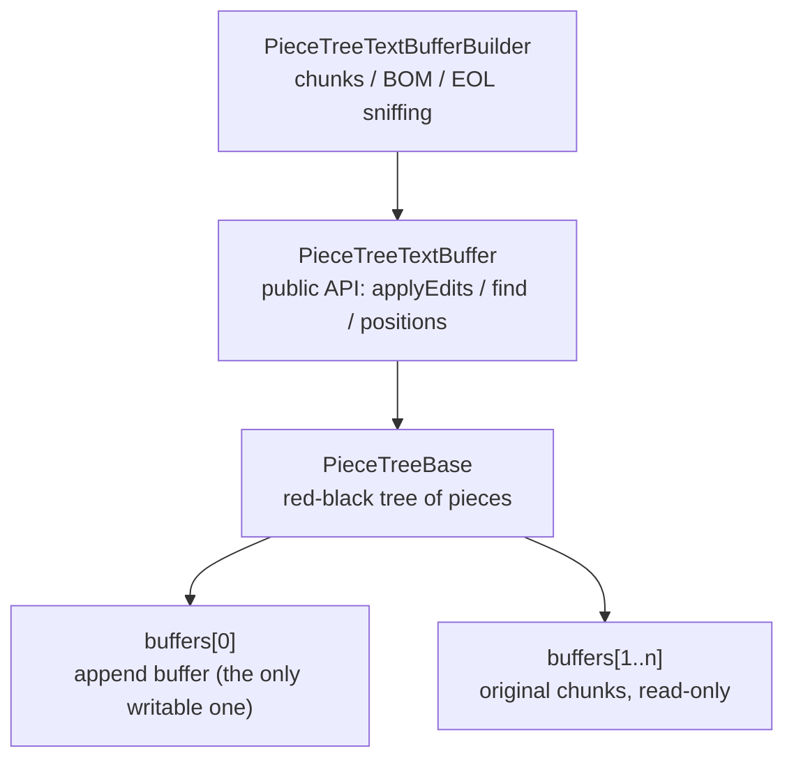

# piecetable: design

English | [中文](DESIGN_CN.md) · [Guide](README.md)

For developers changing the buffer or wiring it into their own editor.

## How it works



An example. Open a file holding `hello world`, then type `, dear` after `hello`:

```
buffers[1] (original): "hello world"     buffers[0] (append): ", dear"

pieces before:   [buf1, 0..11)
pieces after:    [buf1, 0..5)  [buf0, 0..6)  [buf1, 5..11)
the document:    "hello"       ", dear"      " world"
```

- A **piece** is only "which buffer + start + end"; it holds no characters. An insert splits a piece and puts a new one pointing into the append buffer in the middle; a delete shortens or drops pieces. No characters move.
- The pieces are in a **red-black tree** whose in-order walk is the document. Each node caches the characters `size_left` and line feeds `lf_left` of its left subtree, so finding an offset or a line is O(log n).
- Each buffer keeps the starts of its lines, `lineStarts`; positions inside a piece are found by binary search there.
- **`\r\n` must always be inside one piece**, or line counts go wrong; `validateCRLFWithPrevNode` / `fixCRLF` see to it after every edit.

| Operation | Cost |
| --- | --- |
| `insert` / `delete`, `getOffsetAt` / `getPositionAt` | O(log n), n pieces |
| `getLineContent` | O(log n) + the line's length |
| `createSnapshot` | O(n) + copying the typed text still in the document |
| Exporting or putting back a slice (`TextSlice`) | O(log n + pieces involved); no text copied from 16K characters up |
| `toString`, building | O(document length) |

## Why the threading rule holds

- Reads update only two things: the search cache (its methods are `synchronized`) and the last-line cache (an immutable object in a `@Volatile` field, replaced whole). So concurrent reads are safe while nothing edits, provided the last edit *happens-before* them (through a lock, or by posting reads after the edit), since the tree's fields are not volatile.
- Each tree has its own sentinel node, and buffers share no mutable state, so two buffers can be edited on two threads at once.

## Why a snapshot does not change

When a snapshot is made, each piece becomes "text, start, length": a piece of an original chunk refers to that chunk (which the tree never writes again); the append buffer grows with every edit, so its pieces are copied. After that the snapshot never goes through the tree, the buffer list or `lineStarts`. Its fields are final, so handing it over by executor, channel or volatile field shows the other thread all of it.

The price: while a snapshot is alive, the chunks it refers to cannot be freed, even after `compact()` / `setEOL()` replaced them in the buffer.

## Slices (TextSlice)

`applyEdits` returns what it deleted as a String, so deleting a large selection keeps a whole extra copy for undo. Slices use `TextSlice` instead:

- Content under 16K characters (`TextSlice.TEXT_THRESHOLD`) is a String; longer content is references, "buffer, start, length", and putting it back makes pieces pointing at them: nothing copied, nothing appended. Storage that `compact()` replaced meanwhile is taken back into the buffer.
- Line endings go back as they were whenever they can, so unless `setEOL()` ran meanwhile, undo restores exactly the same text, mixed line endings included.
- A `SliceChange` carries only the range, lengths, line structure and the new content as a slice; to update decorations or an incremental parser use `content.length` / `eolCount` / `lastLineLength`, not text. `SliceChange.removed` is what that change deleted.
- A slice holding references belongs to its buffer: reading it is a read of that buffer and needs that buffer's lock; putting it into another buffer throws (across buffers use `TextSlice.of(slice.toText())`).

With slices the undo history refers to the storage itself, so deleted text exists once; but `compact()` cannot free storage the history still refers to, since that is the text undo needs.

## Highlighting while typing

A background parse needs the same version of the text all the way through, so it gets a snapshot:

1. After each edit, on the editing thread, keep the `changes` of `applyEdits`.
2. When the debounce runs out, make a snapshot on the editing thread and hand it, with the changes kept since last time, to the background thread.
3. The background thread first applies the changes to the previous syntax tree, then parses the snapshot incrementally (reading with `getNearestChunk`).
4. Use the result only when the buffer is the same one and `getVersionId() == snapshot.versionId`; otherwise shift it or wait for the next round. One parse at a time.

```kotlin
fun highlight() {                                   // editing thread
    val (buffer, snapshot) = doc.snapshot()
    val full = buffer !== lastBuffer; lastBuffer = buffer
    val edits = if (full) emptyList() else pendingEdits.toList()
    pendingEdits.clear()
    worker.execute {                                // a single-thread executor
        val tree = parser.parse(if (full) null else oldTree, edits) { off -> snapshot.getNearestChunk(off) }
        oldTree = tree
        val spans = computeSpans(tree)
        postToUi { if (doc.isCurrent(buffer, snapshot)) onSpans(spans) }
    }
}
```

When tree-sitter reads UTF-16, a character offset is the byte offset / 2.

## Editor integration

The buffer is only a data structure. The layer that owns it (the editor's document) should take care of four things:

1. **Recovering from a failed edit.** `IllegalArgumentException` (overlapping ranges) is thrown before anything changes: the buffer is intact and the caller has a bug. Anything else (an internal defect, `OutOfMemoryError`) can leave the tree half updated: save what can still be read to a `.recovered` file as a best effort, reload from disk and clear the undo history. The damage is limited to that buffer.
2. **Validating positions from the UI.** Ranges are clamped, but not moved out of surrogate pairs. Clamp lines and columns in one place, and move a column that falls between the halves of an emoji back by one.
3. **Taking only the visible part of very long lines.** `getLineContent` copies the whole line, which on a minified file can be megabytes per frame; above a threshold (say 10,000 characters) use `getValueInRange` for the visible columns. `getLineLength` is cheap only with `normalizeEOL = true`.
4. **Snapshots for background work.** Make them under the read lock; a recovered document has a new buffer whose version starts again from 0, so checking whether a result is stale compares the buffer too.

```kotlin
fun snapshot() = lock.read { buffer to buffer.createSnapshot() }
fun isCurrent(src: PieceTreeTextBuffer, s: PieceTreeSnapshot) =
    lock.read { buffer === src && src.getVersionId() == s.versionId }
```

## Test setup

The tests are in `src/sharedTest`, attached to both the `test` and `androidTest` source sets. Bringing the module into your own project, these are what goes wrong most:

```kotlin
android {
    defaultConfig { testInstrumentationRunner = "androidx.test.runner.AndroidJUnitRunner" }
    sourceSets {
        // both java and kotlin: with AGP's built-in Kotlin, Kotlin files are picked up only through kotlin.srcDir
        getByName("test") { java.srcDir("src/sharedTest/java"); kotlin.srcDir("src/sharedTest/java") }
        getByName("androidTest") { java.srcDir("src/sharedTest/java"); kotlin.srcDir("src/sharedTest/java") }
    }
}
dependencies {
    testImplementation("org.jetbrains.kotlin:kotlin-test-junit5")         // JUnit 5 on the JVM
    testRuntimeOnly("org.junit.platform:junit-platform-launcher")
    androidTestImplementation("org.jetbrains.kotlin:kotlin-test-junit")    // the JUnit 4 flavour on devices
    androidTestImplementation("androidx.test.ext:junit:1.2.1")
    androidTestImplementation("androidx.test:runner:1.6.2")
}
```

| Symptom | Cause |
| --- | --- |
| androidTest: `Unresolved reference 'TestSupport'` | `sharedTest` is not attached to `androidTest`, or only through `java.srcDir`. Check with `./gradlew :piecetable:sourceSets` |
| Device tests compile but hardly any run | androidTest uses `kotlin-test-junit5`: `AndroidJUnitRunner` is a JUnit 4 runner and silently skips JUnit 5 tests |
| `Space characters in SimpleName ... prior to DEX version 040` | Backtick test names with spaces, which DEX accepts only from API 30. Set `minSdk` to the app's (unset, it is 1), or replace the spaces with underscores |

Random tests use fixed seeds and report the seed and step when they fail, so a failure can be replayed exactly; add seeds for more coverage. Wrap regression tests for old infinite loops in `TestSupport.runWithTimeout { }`. `sharedTest` must not use `android.*`.
