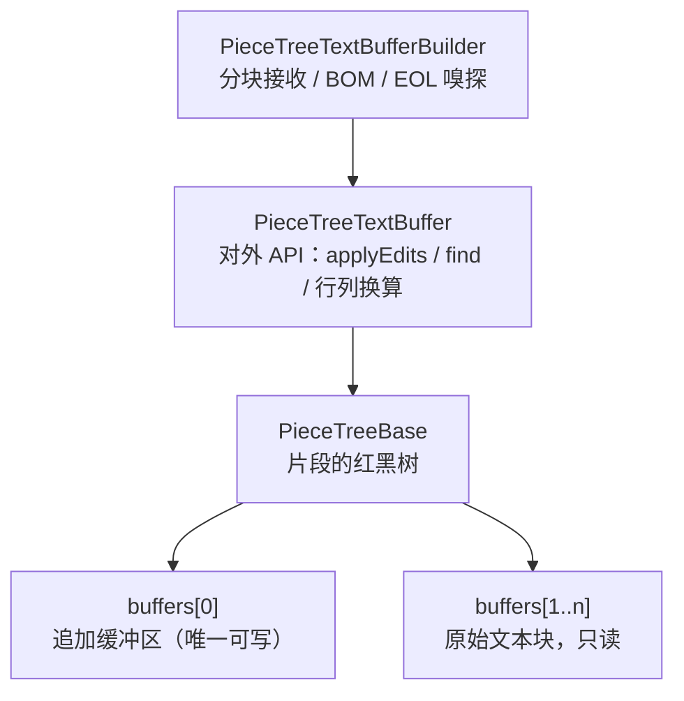

# piecetable：设计

[English](DESIGN.md) | 中文 · [说明](README_CN.md)

本文面向要修改缓冲区或把它接入自己编辑器的开发者。

## 原理



用一个例子说明。打开内容为 `hello world` 的文件，然后在 `hello` 后面输入 `, dear`：

```
buffers[1]（原始）: "hello world"        buffers[0]（追加）: ", dear"

编辑前的片段序列： [buf1, 0..11)
编辑后的片段序列： [buf1, 0..5)  [buf0, 0..6)  [buf1, 5..11)
文档内容：          "hello"       ", dear"      " world"
```

- **片段（piece）** 只是「哪个缓冲区 + 起点 + 终点」，本身不持有字符。插入是把一个片段切开、中间插入指向追加缓冲区的新片段；删除只是缩短或去掉片段，都不搬运字符。
- 片段存放在**红黑树**中，中序遍历就是文档顺序。每个节点缓存左子树的字符数 `size_left` 和换行数 `lf_left`，所以按偏移量或行号定位都是 O(log n)。
- 每个缓冲区保存自己的行首位置表 `lineStarts`，片段内部的定位靠二分查找。
- **`\r\n` 必须落在同一个片段内**，否则行数会算错；每次编辑后的 `validateCRLFWithPrevNode` / `fixCRLF` 负责这件事。

| 操作 | 复杂度 |
| --- | --- |
| `insert` / `delete`、`getOffsetAt` / `getPositionAt` | O(log n)，n 为片段数 |
| `getLineContent` | O(log n) + 行长度 |
| `createSnapshot` | O(n) + 复制仍在文档中的输入文本 |
| 导出或插回片段（`TextSlice`） | O(log n + 涉及的片段数)，16K 字符以上不复制文本 |
| `toString`、构建 | O(文档长度) |

## 线程安全的依据

- 读操作只更新两处状态：搜索缓存（方法 `synchronized`）和单行缓存（`@Volatile` 字段中的不可变对象，整体替换）。所以没有编辑时并发读是安全的，前提是最后一次编辑 *happens-before* 这些读（通过锁或在编辑后提交读任务），因为树的字段不是 volatile 的。
- 每棵树有自己的 sentinel 节点，缓冲区之间没有共享的可变状态，因此两个缓冲区可以在两个线程上同时编辑。

## 快照为什么不受后续编辑影响

创建快照时，每个片段被换算成「文本、起点、长度」：原始块中的片段直接引用那个块（树持有它之后再也不会写它）；追加缓冲区每次编辑都会增长，其中的片段复制一份。之后快照不再经过树、缓冲区列表或 `lineStarts`。快照的字段都是 final 的，用 executor、channel、volatile 字段交给其他线程都能看到完整内容。

代价是：快照存活期间，它引用的块不能被回收，即使 `compact()` / `setEOL()` 已经在缓冲区中把它们换掉。

## 片段（TextSlice）

`applyEdits` 用 String 返回被删除的内容，所以删除一大段选区时，撤销数据要再保留一份完整副本。片段接口改用 `TextSlice`：

- 短于 16K 字符（`TextSlice.TEXT_THRESHOLD`）的内容保存为 String；更长的保存为若干段「缓冲区、起点、长度」的引用，插回时直接生成指向这些段的片段，既不复制也不往追加缓冲区追加。被 `compact()` 换掉的旧存储，插回时会重新纳入缓冲区。
- 换行符能原样插回时就原样插回，所以只要期间没有 `setEOL()`，撤销能还原完全相同的文本，包括混合换行符。
- `SliceChange` 只带区间、长度、行结构和以片段表示的新内容，更新装饰或增量解析器时用 `content.length` / `eolCount` / `lastLineLength`，不需要文本。`SliceChange.removed` 是这一处删掉的内容。
- 持有引用的片段属于它的缓冲区：读取它是对该缓冲区的读操作，要在缓冲区的锁下使用；插入其他缓冲区会抛异常（跨缓冲区请用 `TextSlice.of(slice.toText())`）。

使用片段时，撤销历史引用的是存储本身，被删除的文本只存在一份；但 `compact()` 无法释放历史仍在引用的存储，因为那正是撤销需要的文本。

## 边输入边高亮

后台解析需要整个过程中都是同一版本的文本，所以交给它快照：

1. 每次编辑后，在编辑线程上记下 `applyEdits` 返回的 `changes`。
2. 防抖到期后，在编辑线程上创建快照，连同积累的 `changes` 交给后台线程。
3. 后台线程先用 `changes` 更新上一棵语法树，再在快照上增量解析（读取回调用 `getNearestChunk`）。
4. 只有缓冲区是同一个且 `getVersionId() == snapshot.versionId` 时才使用结果，否则平移结果或等下一轮。同一时间只做一次解析。

```kotlin
fun highlight() {                                   // 编辑线程
    val (buffer, snapshot) = doc.snapshot()
    val full = buffer !== lastBuffer; lastBuffer = buffer
    val edits = if (full) emptyList() else pendingEdits.toList()
    pendingEdits.clear()
    worker.execute {                                // 单线程 executor
        val tree = parser.parse(if (full) null else oldTree, edits) { off -> snapshot.getNearestChunk(off) }
        oldTree = tree
        val spans = computeSpans(tree)
        postToUi { if (doc.isCurrent(buffer, snapshot)) onSpans(spans) }
    }
}
```

tree-sitter 按 UTF-16 读取时，字符偏移 = 字节偏移 / 2。

## 编辑器集成

缓冲区只是数据结构。持有它的那一层（编辑器的文档对象）应负责四件事：

1. **编辑失败后的恢复**。`IllegalArgumentException`（区间重叠）只会在任何修改之前抛出，缓冲区完好，是调用方的 bug。其他异常（内部缺陷、`OutOfMemoryError`）可能让树停在更新到一半的状态：尽力把能读出的内容另存为 `.recovered` 文件，然后从磁盘重新加载、清空撤销历史。损坏只限于这个缓冲区。
2. **校验来自 UI 的位置**。区间会被自动钳制，但不会避开代理对。统一在一处把行列钳制进文档，并把落在 emoji 两半之间的列前移一格。
3. **超长行只取可见部分**。`getLineContent` 会复制整行，压缩过的文件每帧可能复制几 MB；超过阈值（如 1 万字符）时用 `getValueInRange` 只取可见列。`getLineLength` 只在 `normalizeEOL = true` 时便宜。
4. **给后台任务提供快照**。快照在读锁下创建；恢复后的文档换了新缓冲区、版本号从 0 开始，所以判断结果是否过期要同时比较缓冲区是否同一个。

```kotlin
fun snapshot() = lock.read { buffer to buffer.createSnapshot() }
fun isCurrent(src: PieceTreeTextBuffer, s: PieceTreeSnapshot) =
    lock.read { buffer === src && src.getVersionId() == s.versionId }
```

## 测试配置

用例在 `src/sharedTest`，同时挂到 `test` 和 `androidTest` 两个源集上。把模块引入自己的项目时，以下几点最容易出错：

```kotlin
android {
    defaultConfig { testInstrumentationRunner = "androidx.test.runner.AndroidJUnitRunner" }
    sourceSets {
        // java 和 kotlin 都要加：使用 AGP 内置 Kotlin 时，Kotlin 文件只通过 kotlin.srcDir 收录
        getByName("test") { java.srcDir("src/sharedTest/java"); kotlin.srcDir("src/sharedTest/java") }
        getByName("androidTest") { java.srcDir("src/sharedTest/java"); kotlin.srcDir("src/sharedTest/java") }
    }
}
dependencies {
    testImplementation("org.jetbrains.kotlin:kotlin-test-junit5")         // JVM 用 JUnit 5
    testRuntimeOnly("org.junit.platform:junit-platform-launcher")
    androidTestImplementation("org.jetbrains.kotlin:kotlin-test-junit")    // 设备必须用 JUnit 4 版本
    androidTestImplementation("androidx.test.ext:junit:1.2.1")
    androidTestImplementation("androidx.test:runner:1.6.2")
}
```

| 现象 | 原因 |
| --- | --- |
| androidTest 报 `Unresolved reference 'TestSupport'` | `androidTest` 没有挂上 `sharedTest`，或只写了 `java.srcDir`。用 `./gradlew :piecetable:sourceSets` 检查 |
| 设备测试能编译但几乎什么都没跑 | androidTest 用了 `kotlin-test-junit5`：`AndroidJUnitRunner` 是 JUnit 4 运行器，JUnit 5 注解的用例被静默跳过 |
| `Space characters in SimpleName ... prior to DEX version 040` | 反引号测试名含空格，API 30 以下的 DEX 不接受。把 `minSdk` 设成与应用一致（未设置时为 1），或把测试名中的空格换成下划线 |

随机测试都使用固定种子，失败时信息中会写明种子和步骤，可以原样复现；扩大覆盖面请加种子。针对死循环的回归用例用 `TestSupport.runWithTimeout { }` 包住。`sharedTest` 中不能引用 `android.*`。
