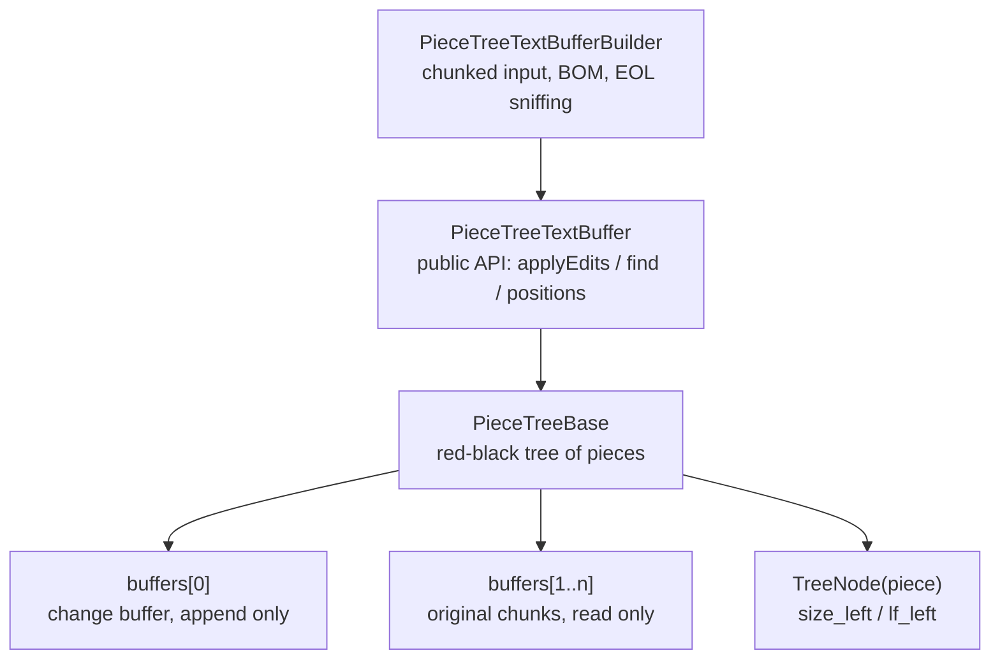

# piecetable

A **piece tree text buffer** (red-black tree + piece table) written in Kotlin, ported from the
`pieceTreeTextBuffer` of [VSCode](https://github.com/microsoft/vscode) and tuned for code editors
on Android.

[中文文档](README_cn.md)

Compared with a `StringBuilder` or a `List<String>` of lines:

- **Opening a large file copies nothing.** The original chunks are kept as they were read, and
  edits only append to a single growing change buffer.
- **Insert and delete are O(log n)** in the number of pieces, independent of document size.
- **Line/column to offset conversion is O(log n)**, every tree node caches the length
  (`size_left`) and the line feed count (`lf_left`) of its left subtree.
- **Reads can run in parallel** on several threads while no edit is running (see
  [Threading](#threading)).
- **Background work does not block typing.** An immutable snapshot can be read by any thread
  while the buffer keeps being edited (see [Snapshots](#snapshots)).

---

## Contents

- [Getting started](#getting-started)
- [How it works](#how-it-works)
- [API overview](#api-overview)
- [Complexity](#complexity)
- [Threading](#threading)
- [Editor integration](#editor-integration)
- [Memory and compaction](#memory-and-compaction)
- [What changed in this revision](#what-changed-in-this-revision)
- [Remaining limitations](#remaining-limitations)
- [Testing](#testing)
- [License](#license)

---

## Getting started

### 1. Add the module

```kotlin
// settings.gradle.kts
include(":piecetable")

// app/build.gradle.kts
dependencies {
    implementation(project(":piecetable"))
}
```

The module itself only depends on `kotlinx-serialization`, for the `@Serializable` annotations on
the public value types (`Range`, `Position`, `TextChange`, ...). The buffer and the tree are not
serializable: persist the text (plus your editor state) and rebuild the buffer on restore.

### 2. Build a buffer

```kotlin
import x.github.module.piecetable.*
import x.github.module.piecetable.common.*

// streaming: feed the file in chunks, no need to materialise the whole String
val builder = PieceTreeTextBufferBuilder()
file.bufferedReader().use { reader ->
    val chars = CharArray(64 * 1024)
    while (true) {
        val n = reader.read(chars)
        if (n <= 0) break
        builder.acceptChunk(String(chars, 0, n))
    }
}

val textBuffer: PieceTreeTextBuffer = builder.build(
    eol = EndOfLine.LF,
    normalizeEOL = true
)

textBuffer.getLineCount()      // number of lines
textBuffer.getLineContent(1)   // first line, line numbers are 1 based
textBuffer.getEOL()            // "\n" or "\r\n", sniffed from the content
textBuffer.getBOM()            // UTF-8 BOM if the file had one
```

`acceptChunk` handles a `\r\n` or a UTF-16 surrogate pair that straddles a chunk boundary, so
any chunk size is safe. Large chunks are sliced into buffers of at most 64K chars, so handing over
the whole file as one String (or to the `PieceTreeTextBufferBuilder(text)` constructor) is fine too.

### 3. Edit

```kotlin
val result = textBuffer.applyEdits(
    listOf(
        SingleEditOperation(Range(1, 1, 1, 1), "// "),   // insert at the start of line 1
        SingleEditOperation(Range(3, 1, 4, 1), "")       // delete line 3
    ),
    recordTrimAutoWhitespace = false,
    computeUndoEdits = true                              // needed for undo
)

result.changes        // ContentChange list, feed it to the view / highlighter
result.reverseEdits   // inverse operations, push them onto your undo stack
```

Operations are applied bottom-up internally, so the offsets of one operation are unaffected by
the others. Ranges must not overlap (touching is fine); overlapping ranges throw
`IllegalArgumentException`. Out of range ranges are clamped into the document instead of
corrupting the tree, and inserted text is converted to the buffer's line ending, also when it
mixes several kinds.

### 4. Undo

```kotlin
val undo = result.reverseEdits!!.map { SingleEditOperation(it.range, it.text) }
textBuffer.applyEdits(undo, false, false)   // back to the previous state
```

`TextChange.compressConsecutiveTextChanges` can merge the changes of several edits into a single
undo step, which is what an editor usually wants for rapid typing.

The reverse edits hold the removed text as Strings, so undoing a delete of a large selection
keeps a full copy of it. `applyEditsWithSliceUndo` returns the undo batch as slices that refer
to the storage instead, see [Slices](#slices-undo-without-copying-large-content):

```kotlin
val result = textBuffer.applyEditsWithSliceUndo(ops)       // same edits as applyEdits
val undone = textBuffer.applySliceEdits(result.reverseEdits) // undo; returns the redo batch
textBuffer.applySliceEdits(undone.reverseEdits)              // redo
```

### 5. Search

```kotlin
// plain text; a search text with line breaks matches across lines, whatever break it uses
buffer.find("TODO", searchRange, limitResultCount = 1000) { false }

// regex, matched line by line
buffer.find(Regex("""fun\s+\w+"""), searchRange, 1000) { isCancelled() }

// regex across lines: RegexOption.MULTILINE, or a pattern containing \n, \r or \W
buffer.find(Regex("""\{\s*\n\s*\}"""), searchRange, 1000) { isCancelled() }
```

- The search range is clamped into the document; its start and end columns are honoured.
- `^` and `$` always mean start and end of a **line**, like VS Code's `m` flag, in both engines.
  The start and end columns of the search range are not a line start / end, and lookarounds and
  `\b` see the text of the line outside the range.
- A line-by-line match never spans a line break. Patterns that can match one (a literal line
  break, `\n`, `\r`, `\W`) go to the multiline engine automatically: it joins the lines of the
  range with `\n` and matches inside the range, so `\n` matches every line break kind.
- The last argument is a cancellation callback, useful for long searches on a background job.

### 6. Save

```kotlin
textBuffer.readPiecesContent { chunk ->
    outputStream.write(chunk.toByteArray())   // piece by piece, no full copy
}
```

`toString()` materialises the whole document into one String and can throw `OutOfMemoryError`
on large files; prefer `readPiecesContent` for I/O.

### 7. Read in the background: snapshots

```kotlin
// on the editor thread (or under the read lock): cheap, the file content is not copied
val snapshot = textBuffer.createSnapshot()

// any thread, any time, no lock, also while the user keeps typing
executor.execute {
    var offset = 0
    while (true) {
        val chunk = snapshot.getNearestChunk(offset)   // how an incremental parser reads
        if (chunk.isEmpty()) break
        offset += chunk.length
    }
    // snapshot.versionId is textBuffer.getVersionId() of the moment it was taken:
    // compare them to know whether a result is still current
}
```

A snapshot is the document at one version and never changes, whatever happens to the buffer
afterwards (edits, `compact()`, `setEOL()`). Background highlighting and saving read it instead
of holding a lock; see [Highlighting while typing](#highlighting-while-typing).

---

## How it works



- A **piece** is a triple of "which buffer, start cursor, end cursor". It owns no characters.
- `buffers[0]` is the only writable buffer and all new input is appended to it; `buffers[1..n]`
  hold the original file content and are never modified. Deleting text just splits a piece.
- The **in-order traversal** of the red-black tree is the document. Because every node caches
  `size_left` and `lf_left`, offsets and line numbers are found in O(log n).
- Each buffer carries a **lineStarts** array (now an unboxed `IntList`) used to binary search a
  position inside a piece.
- **CRLF** must never be split across two pieces, otherwise the line count is wrong. That is
  what `validateCRLFWithPrevNode` / `fixCRLF` take care of on every edit.

---

## API overview

### Reading

| Method | Description |
| --- | --- |
| `getLineCount()` | number of lines, at least 1 |
| `getLineContent(line)` | line content **without** the line terminator, cached |
| `getLineContentWithEOL(line)` | line content plus the EOL |
| `getLinesContent()` | all lines as a list |
| `getLineLength(line)` / `getLineMaxColumn(line)` | line length / length + 1, exact also on a non-normalized buffer |
| `getLineFirstNonWhitespaceColumn(line)` | first non blank column, 0 when the line is blank |
| `getValueInRange(range, eol)` | text of a range (clamped into the document), optionally with a forced line ending |
| `getOffsetAt(line, column)` / `getPositionAt(offset)` | position conversions, both clamped |
| `getCharCode(offset)` / `getLineCharCode(line, index)` | UTF-16 code unit, `charCodeAt` semantics; 0 at the end of the document |
| `getNearestChunk(offset)` | the contiguous run of text at `offset` (about 64K chars at most, `""` at the end), for incremental parsers |
| `createSnapshot(preserveBOM = false)` | immutable copy of the current content that any thread can read during edits, see [Snapshots](#snapshots) |
| `getVersionId()` | changes with every change of the content (`applyEdits`, `setEOL`), not with reads or `compact()` |
| `find(text or regex, range, limit, isCancelled)` | search, see [Search](#5-search) |
| `length` / `get(i)` / `subSequence(a, b)` | `CharSequence` implementation, out of range indices throw `IndexOutOfBoundsException` |
| `contentEquals(other)` | compares BOM, EOL and content |

### Writing

| Method | Description |
| --- | --- |
| `applyEdits(ops, recordTrimAutoWhitespace, computeUndoEdits)` | the entry point for all edits |
| `setEOL(eol)` | switch the line ending and rebuild the document |
| `compact()` | rebuild the storage from the current text, see [Memory and compaction](#memory-and-compaction) |
| `getStorageStats()` | document length, stored chars, change buffer size, piece count |
| `applyEditsWithSliceUndo(ops)` | text edits like `applyEdits`, the undo batch as slices, see [Slices](#slices-undo-without-copying-large-content) |
| `applySliceEdits(edits)` | replace ranges with `TextSlice`s (undo / redo); returns the changes and the reverse batch |

**Arguments.** Line based queries (`getLineContent`, `getLineContentWithEOL`, `getLineLength`,
`getLineMinColumn` / `getLineMaxColumn`, `getLineCharCode`, the non-whitespace helpers) need a
line that exists, `1..getLineCount()`, and throw `IndexOutOfBoundsException` otherwise. Position
and range based methods (`getOffsetAt`, `getValueInRange`, `getValueLengthInRange`,
`getCharacterCountInRange`, `applyEdits`, `find`) clamp instead.

`PieceTreeBase.insert` / `delete` are the low level primitives. They validate their offsets and
throw `IndexOutOfBoundsException`, but they do not normalise the EOL of the inserted text, so
prefer `applyEdits`.

### Snapshots

`createSnapshot()` returns a `PieceTreeSnapshot`: the content at that moment, never changing
afterwards. Creating it is a read of the buffer and costs O(number of pieces) plus a copy of the
typed text still in the document; it does not copy the file content. Reading it needs no lock,
from any thread, also while the buffer is edited, compacted or switched to another EOL.

| Member | Description |
| --- | --- |
| `length` / `get(i)` / `substring(a, b)` / `subSequence(a, b)` | `CharSequence` over document offsets (the BOM is not counted); `get` is O(log n) |
| `getNearestChunk(offset)` | same contract as the buffer's: the rest of the piece at `offset`, at most about 64K chars, `""` at the end |
| `readPiecesContent { }` | the whole content, piece by piece, e.g. to save it |
| `toString()` | the whole content as one String |
| `versionId` / `lineCount` / `eol` | the buffer's state when the snapshot was taken |
| `bom` / `read()` | VS Code style sequential reading: `bom` (the BOM with `preserveBOM = true`, else `""`), then piece by piece, then `null`. `read()` keeps a read position, so one thread at a time; all other members are safe from any number of threads |

How it stays independent: when the snapshot is created every piece is resolved to (text, start,
length). Pieces of the original chunks point at those chunks, which nothing writes to once the
tree holds them; pieces of the change buffer, which grows with every edit, are copied. Nothing is
looked up through the tree, its buffer list or its line starts later. The price: a snapshot keeps
the chunks it points at in memory, also after `compact()` / `setEOL()` replaced them in the
buffer, so drop snapshots once they are processed.

### Slices: undo without copying large content

`applyEdits` returns what each edit removed as a String (`reverseEdits[i].text`), so deleting or
replacing a large selection keeps one more full copy of the removed text for undo. The slice
API returns it as `TextSlice`s: short content as a String, longer content as references to the
pieces of storage it lies in, without a copy.

```kotlin
// edit: the same text edits as applyEdits, the undo batch comes back as slices
val result = buffer.applyEditsWithSliceUndo(listOf(SingleEditOperation(selection, "")))
undoStack.add(result.reverseEdits)

// undo: applying the reverse batch returns the redo batch
val undone = buffer.applySliceEdits(undoStack.removeAt(undoStack.size - 1))
redoStack.add(undone.reverseEdits)

// redo, and so on
val redone = buffer.applySliceEdits(redoStack.removeAt(redoStack.size - 1))
undoStack.add(redone.reverseEdits)
```

| Member | Description |
| --- | --- |
| `exportSlice(range)` | the content of a range (clamped) as a slice; a read |
| `applySliceEdits(edits)` | replace each `SliceEdit.range` with its `content` (`null` deletes); returns `changes` and `reverseEdits` |
| `applyEditsWithSliceUndo(ops)` | text edits like `applyEdits`, with `reverseEdits` as slices |
| `TextSlice.of(text)` | a slice holding a String; can go into any buffer |
| `TextSlice.length` / `eolCount` / `firstLineLength` / `lastLineLength` | size and line shape of the content, without reading it |
| `TextSlice.toText()` | the content as a String (copies it when held as references) |

- **Two forms.** Content shorter than `TextSlice.TEXT_THRESHOLD` (16K chars) is kept as a String,
  like `reverseEdits`. Longer content is kept as (buffer, start, length) runs; putting it back
  inserts pieces that point at those runs, so nothing is copied or appended to the change
  buffer. Storage that `compact()` or `setEOL()` replaced in the meantime is taken back into the
  buffer. Deleting 1 MB and undoing it leaves `getStorageStats()` exactly as it was.
- **Line breaks.** Content goes back unchanged when it can: same EOL, and exported from an
  EOL-normalized buffer or inserted into a buffer that is not normalized either. Otherwise it
  is normalized to the buffer's EOL like the text of `applyEdits`. So undo restores the exact
  text, mixed line breaks included, unless `setEOL()` was called in between.
- **Rules.** As `applyEdits`: ranges refer to the document before the batch and are clamped,
  overlapping ranges throw `IllegalArgumentException`, edits apply bottom up, and everything is
  checked before the first change. Not covered: trimming of auto-inserted whitespace,
  `forceMoveMarkers`, collapsing of 1000+ edits.
- **Changes.** `SliceEditResult.changes` are `SliceChange`s (range, offset, length, and the new
  content as a slice) instead of `ContentChange`s: update decorations or feed an incremental
  parser from `content.length` / `eolCount` / `lastLineLength`, not from the text.
  `SliceChange.removed` is what the change removed (the same slice as the content of its reverse
  edit; null when nothing was removed), so a caller that keeps its own offset-based undo history
  need not match changes and reverse edits up.
- **Form and size.** `TextSlice.isText` tells whether the content is held as a String (readable
  on any thread, can outlive its buffer); `segmentCount` is the number of runs of storage it
  refers to, a measure of the slice's own size.
- **A slice holding references belongs to its buffer.** Inserting it into another buffer throws
  `IllegalArgumentException` (move content with `TextSlice.of(slice.toText())`). Reading it
  (`toText()`, putting it back) is a read of that buffer, so keep slices where the undo stack
  lives, under the buffer's lock. It keeps the storage it refers to alive, and it is not
  serializable: to persist the history, store `toText()`.
- **Merging consecutive edits.** `TextChange.compressConsecutiveTextChanges` works on texts.
  With slices, keep one undo entry per batch, or merge only entries whose content is text.

---

## Complexity

| Operation | Cost |
| --- | --- |
| `insert` / `delete` | O(log n), n = number of pieces |
| `getOffsetAt` / `getPositionAt` | O(log n) |
| `getLineContent` | O(log n) + line length |
| `getLinesRawContent` / `toString` | O(document length), allocates a full copy |
| `createSnapshot` | O(n) + a copy of the typed text still in the document |
| `exportSlice` | O(log n + pieces in the range); copies only content below 16K chars |
| putting a slice of k runs back | O((k + 1) log n), no text copied |
| snapshot `get` / `getNearestChunk` | O(log n) |
| building from a file | O(document length), memory ≈ file size |

Pieces accumulate during a long editing session; `compact()` merges them again, see
[Memory and compaction](#memory-and-compaction).

---

## Threading

**Per buffer: many readers or one writer, never both. Different buffers are independent.**

1. **Concurrent reads are safe while nobody edits.** The only state a read updates is the
   search cache (its methods are `synchronized`) and the one-line cache `_lastVisitedLine`
   (an immutable object behind a `@Volatile` field, replaced as a whole). The readers must
   see the finished edit: the last edit has to *happen-before* the reads, e.g. through a lock
   or by submitting the read task after the edit. The tree's own fields are not volatile.
2. **An edit must run alone on its buffer**: no other edit and no read of the same buffer at the
   same time. Buffers share no mutable state (every tree owns its sentinel), so two buffers can
   be edited on two threads at the same time without any coordination.
3. **Snapshots can be read during edits.** `createSnapshot()` is a read, so rule 1 applies to
   it. After that the snapshot never touches the buffer again (see [Snapshots](#snapshots)):
   any number of threads may read it at any time without a lock. All its fields are final, so
   every usual way of handing it over (an executor, a channel, a volatile field) makes it fully
   visible to the receiving thread.

In practice, either:

- do all edits and reads on one thread (the editor thread or a single thread dispatcher) and
  give background work a copy of the text (`readPiecesContent` / `toString` on that thread), or
- give every buffer **its own** `ReentrantReadWriteLock`:

```kotlin
import java.util.concurrent.locks.ReentrantReadWriteLock
import kotlin.concurrent.read
import kotlin.concurrent.write

val lock = ReentrantReadWriteLock()   // one per buffer

lock.write { buffer.applyEdits(ops, false, true) }          // editor thread
lock.read { buffer.find(regex, range, 1000) { cancelled } }  // any thread
```

Work that runs for a while and must not block typing (highlighting, saving, indexing) takes a
snapshot instead of holding the read lock.

### Highlighting while typing

A background parse needs one consistent version of the text for its whole run; reading the live
buffer between keystrokes would mix two versions. Give it a snapshot:

1. After every edit, on the editor thread, keep the `changes` that `applyEdits` returned.
2. When the debounce timer fires, take a snapshot on the editor thread and hand it to the
   background thread together with the changes collected since the last round.
3. The background thread applies those changes to the previous syntax tree, parses the snapshot
   incrementally (`getNearestChunk` as the read callback) and computes the highlight spans.
4. Use the result only if it is still current: same buffer and
   `getVersionId() == snapshot.versionId`. Otherwise shift the spans by the later changes or
   wait for the next round. One parse at a time.

Drawing the visible lines stays on the editor thread like every other read; only the parse moves
to the background.

```kotlin
import java.util.concurrent.Executors
import x.github.module.piecetable.*
import x.github.module.piecetable.common.*

// stand-ins for your parser binding (tree-sitter or another one)
interface SyntaxTree
interface IncrementalParser {
    /** [read] returns the text at a char offset, "" at the end */
    fun parse(old: SyntaxTree?, edits: List<ContentChange>, read: (Int) -> String): SyntaxTree
}

class Highlighter<Span>(
    private val doc: EditorDocument,                   // see Editor integration
    private val parser: IncrementalParser,
    private val computeSpans: (SyntaxTree) -> List<Span>,
    private val postToUi: (Runnable) -> Unit,
    private val onSpans: (List<Span>) -> Unit          // runs on the UI thread
) {
    private val worker = Executors.newSingleThreadExecutor()   // one parse at a time

    // editor thread only
    private val pendingEdits = mutableListOf<ContentChange>()
    private var lastBuffer: PieceTreeTextBuffer? = null

    // worker thread only
    private var oldTree: SyntaxTree? = null

    /** editor thread, after every successful edit */
    fun onEdited(result: ApplyEditsResult) {
        pendingEdits += result.changes
    }

    /** editor thread, when the debounce timer fires */
    fun highlight() {
        val (buffer, snapshot) = doc.snapshot()
        val fullParse = buffer !== lastBuffer       // the first round, or the document was rebuilt
        lastBuffer = buffer
        val edits = if (fullParse) emptyList() else pendingEdits.toList()
        pendingEdits.clear()

        worker.execute {
            // only the snapshot is read here: no lock, the user keeps typing meanwhile
            val tree = parser.parse(if (fullParse) null else oldTree, edits) { offset ->
                snapshot.getNearestChunk(offset)
            }
            oldTree = tree
            val spans = computeSpans(tree)
            postToUi(Runnable {
                if (doc.isCurrent(buffer, snapshot)) onSpans(spans)
            })
        }
    }
}
```

tree-sitter bindings usually read by byte offset; with UTF-16 input the char offset is
`byteOffset / 2`.

---

## Editor integration

The buffer is a data structure, not an editor. Four things belong in the layer that owns it:
recovering from a failed edit, validating positions that come from the UI, not copying very
long lines on every frame, and handing out snapshots for background work. One class that does
all four:

```kotlin
import java.io.File
import java.util.concurrent.locks.ReentrantReadWriteLock
import kotlin.concurrent.read
import kotlin.concurrent.write
import x.github.module.piecetable.*
import x.github.module.piecetable.common.*

class EditorDocument(private val file: File) {

    /** One lock per document: buffers share no state, documents never wait for each other */
    private val lock = ReentrantReadWriteLock()

    @Volatile
    var buffer: PieceTreeTextBuffer = load()
        private set

    /** reverse edits, newest last; whatever undo manager you use, it must be reset on recovery */
    private val undoStack = ArrayDeque<List<SingleEditOperation>>()

    /** e.g. show "the document was reloaded from disk" and re-render everything */
    var onRecovered: (Throwable) -> Unit = {}

    private fun load(): PieceTreeTextBuffer {
        val builder = PieceTreeTextBufferBuilder()
        file.bufferedReader().use { reader ->
            val chars = CharArray(64 * 1024)
            while (true) {
                val n = reader.read(chars)
                if (n <= 0) break
                builder.acceptChunk(String(chars, 0, n))
            }
        }
        return builder.build(EndOfLine.LF, normalizeEOL = true)
    }

    // ------------------------------------------------------------- 1. edits and recovery

    /** Applies [ops]. Returns null when the edit failed and the document was rebuilt. */
    fun edit(ops: List<SingleEditOperation>): ApplyEditsResult? = lock.write {
        try {
            val result = buffer.applyEdits(ops, false, true)
            undoStack.addLast(result.reverseEdits!!.map { SingleEditOperation(it.range, it.text) })
            result
        } catch (e: IllegalArgumentException) {
            // only thrown by the validation before the first change (overlapping ranges):
            // a bug in the caller, the buffer is intact
            throw e
        } catch (e: Throwable) {
            // anything else may have stopped half way through a tree operation
            recover(e)
            null
        }
    }

    // called with the write lock held
    private fun recover(cause: Throwable) {
        // the failed edit can only have damaged this buffer: other documents are unaffected
        // 1. best effort: save what can still be read. The tree may be damaged, so this can be
        //    wrong or fail; runCatching also catches a StackOverflowError from a broken tree
        runCatching {
            File(file.path + ".recovered").bufferedWriter().use { out ->
                buffer.readPiecesContent { out.write(it) }
            }
        }
        // 2. rebuild from a trusted source: the last saved file (or your autosave / journal)
        buffer = load()
        // 3. the undo history describes the old content
        undoStack.clear()
        onRecovered(cause)
    }

    // ------------------------------------------------------------- 2. validate positions

    /**
     * Clamps (line, column) into the document and moves it off the middle of a surrogate pair.
     * Use it for everything that comes from the UI: taps, restored cursors, search results of
     * an older revision.
     */
    fun validPosition(line: Int, column: Int): Position = lock.read {
        val b = buffer
        val l = line.coerceIn(1, b.getLineCount())
        var c = column.coerceIn(1, b.getLineMaxColumn(l))
        if (c in 2..b.getLineLength(l)) {
            val before = b.getLineCharCode(l, c - 2).toChar()
            val at = b.getLineCharCode(l, c - 1).toChar()
            if (before.isHighSurrogate() && at.isLowSurrogate()) c--
        }
        Position(l, c)
    }

    // ------------------------------------------------------------- 3. long lines

    /**
     * What the view draws for one line: the whole line when it is short, otherwise only the
     * visible window. getLineContent copies the entire line, which for a minified file can be
     * megabytes per frame; getValueInRange copies only the requested columns.
     */
    fun renderText(line: Int, firstVisibleColumn: Int, visibleColumns: Int): String =
        lock.read {
            val b = buffer
            when {
                line !in 1..b.getLineCount() -> ""
                // two offset lookups on a normalized buffer, no copy
                b.getLineLength(line) <= LONG_LINE -> b.getLineContent(line)
                else -> {
                    val maxColumn = b.getLineMaxColumn(line)
                    val start = firstVisibleColumn.coerceIn(1, maxColumn)
                    val end = (start + visibleColumns).coerceAtMost(maxColumn)
                    b.getValueInRange(Range(line, start, line, end))
                }
            }
        }

    // ------------------------------------------------------------- 4. background work

    /** A snapshot for background work (highlighting, saving), and the buffer it was taken from */
    fun snapshot(): Pair<PieceTreeTextBuffer, PieceTreeSnapshot> =
        lock.read { buffer to buffer.createSnapshot() }

    /** Whether a result computed on [snapshot] of [source] still matches the document */
    fun isCurrent(source: PieceTreeTextBuffer, snapshot: PieceTreeSnapshot): Boolean =
        lock.read { buffer === source && source.getVersionId() == snapshot.versionId }

    companion object {
        const val LONG_LINE = 10_000
    }
}
```

Notes on the four parts:

- **Recovery.** `IllegalArgumentException` is only thrown before anything was changed, so the
  buffer is still fine and the caller has a bug to fix. Every other exception (an internal bug,
  `OutOfMemoryError`) can leave the tree half updated: never edit that buffer again. The damage
  stays inside that buffer, every tree owns its sentinel, so the other documents need nothing.
  The `.recovered` file is a courtesy for the user, not a source of truth.
- **Positions.** Ranges passed to `applyEdits`, `getValueInRange` or `find` are clamped, and line
  based queries throw `IndexOutOfBoundsException` for a missing line. Positions that come from
  the UI should still be clamped in one place, which also keeps carets out of the middle of an
  emoji (range validation inside the buffer does not do that).
- **Long lines.** `getLineLength` / `getLineMaxColumn` are cheap only on an EOL-normalized buffer
  (`normalizeEOL = true`); on a non-normalized one they measure the line by reading it.
- **Background work.** Taking the snapshot is quick and happens under the read lock; reading it
  happens without any lock. A recovered document has a new buffer whose versions start again
  from 0, which is why `isCurrent` compares the buffer as well. See
  [Highlighting while typing](#highlighting-while-typing).

---

## Memory and compaction

**Why memory grows.** Edits never modify or free text. Inserted text is appended to the change
buffer and stays there after it is deleted again (undo and redo append it once more); the
original chunks are kept whole even when most of their text was deleted. Every edit at a new
place also splits a piece, so a long session ends up with many small pieces. Reads stay
O(log n), but memory is roughly "file + everything ever typed" plus about 100 bytes per piece.
The VS Code original behaves the same.

**The fix: `compact()`.** It rebuilds the storage from the current text: fresh chunks of at most
64K chars, one piece each, and an empty change buffer. Text, EOL, offsets, positions and line
numbers are unchanged, so cursors, decorations and undo data (texts and offsets, never
references into buffers) stay valid. It is O(n) and needs about one extra copy of the document
while it runs. `setEOL()` also rebuilds, but rewrites the line breaks; `compact()` never does,
it also keeps a buffer built with `normalizeEOL = false` exactly as it is.

**When to call it.** `getStorageStats()` tells you whether it is worth it. A reasonable policy is
"more than half of the stored text is garbage and at least a few MB, or a very large number of
pieces", checked after saving or when the editor has been idle for a moment:

```kotlin
// a member of EditorDocument, next to edit()
fun compactIfWorthIt() = lock.write {
    val stats = buffer.getStorageStats()
    val garbage = stats.storedLength - stats.length
    if (garbage > maxOf(stats.length.toLong(), 4L * 1024 * 1024) || stats.pieceCount > 50_000) {
        buffer.compact()
    }
}
```

`compact()` is an edit: it holds the write lock for its whole duration and readers wait, which is
why it belongs in an idle moment and not in the typing path. Measure it on your slowest device
for your largest files.

A snapshot keeps the chunks it points at alive, also after `compact()` replaced them, so the
memory comes back only once no snapshot of the old storage is left.

**Undo history.** With `applyEdits`, the history holds every removed text as a String: after
`compact()` the storage is small, but the history still has its own copies. With
[slices](#slices-undo-without-copying-large-content) the history refers to the storage instead,
so removed text exists once; `compact()` cannot free storage the history still refers to, which
is exactly the text an undo needs.

---

#### Tests

- The test bodies moved to `src/sharedTest` and now run on both the JVM and a device,
  223 cases at the time (135 on the JVM before), **244** after round 2, 253 after round 3, 256 after
  round 4, 271 after round 5 and **286** after round 6.
- Assertion arguments are consistently `(expected, actual)`; the shared assertions live in
  `TestSupport` and now reconcile the tree metadata against `getLength()` / `getLineCount()` and
  check `getLinesContent()` line by line, which is exactly the assertion whose absence let the
  `getLinesContent` bug survive.
- Random tests use fixed seeds, the pointless `Thread.sleep(500)` calls are gone, and the
  `assertSame(Int, Int)` in `depth()` became `assertEquals`.
- Undo/redo tests no longer depend on coroutines and `delay(750/1000)`; the merge window is an
  explicit `commitUndoGroup()` call, which cuts about 6 seconds and all the timing flakiness.

---

## Remaining limitations

- **A snapshot keeps old chunks alive** as long as it lives, also after `compact()` / `setEOL()`
  replaced them. Its `read()` keeps a read position and must not be used from two threads at
  once (every other member can).
- **A slice holding references is tied to its buffer** and keeps the storage it refers to alive;
  it is not serializable. The slice API does not trim auto-inserted whitespace, has no
  `forceMoveMarkers`, and its changes carry no text.
- **`CharSequence` is convenient but slow.** `get(i)` is O(log n), so running a `Regex` directly
  over the buffer degrades badly; use `find()` instead.
- **Compaction is manual.** Deleted text and fragmented pieces are only released by `compact()`
  (or `setEOL()`); the buffer never compacts by itself, see
  [Memory and compaction](#memory-and-compaction).
- **Multiline search copies the lines of the search range** (the whole first and last line) into
  one String, and on a CRLF buffer maps
  offsets back assuming every line break is `\r\n`. On a buffer built with
  `normalizeEOL = false` and mixed line endings the reported ranges can be off.
- **An edit can split a surrogate pair.** Range validation does not move a column that falls
  between the two halves of an emoji (VS Code does).
- **`getValueLengthInRange` ignores its `eol` argument.**

---

## Testing

All test cases live in **`src/sharedTest`** and run twice: once on the JVM
(`testDebugUnitTest`) and once on a device (`connectedDebugAndroidTest`). Only tests that need a
real device stay in `androidTest`.

```
src/
├── main/java/x/github/module/piecetable/        # implementation
├── sharedTest/java/x/github/module/piecetable/  # runs on both JVM and device
│   ├── TestSupport.kt                   # shared assertions, red-black tree invariants
│   ├── PieceTreeBaseTest.kt             # the VSCode suite (86 cases)
│   ├── PieceTreeBuilderTest.kt          # chunking, BOM, EOL sniffing, surrogate pairs
│   ├── PieceTreeEditingTest.kt          # edits, positions, CRLF, snapshots
│   ├── PieceTreeTextBufferApiTest.kt    # applyEdits, undo data, ranges, CharSequence
│   ├── PieceTreeSearchTest.kt           # word / regex / multiline search
│   ├── PieceTreeEditOperationTest.kt    # getInverseEditRanges, toSingleEditOperation
│   ├── PieceTreeUndoRedoTest.kt         # undo / redo, no coroutines and no wall clock
│   ├── PieceTreeStressTest.kt           # seeded random tests, large documents
│   ├── PieceTreeMaintenanceTest.kt      # compact, storage stats, shared state recovery
│   ├── PieceTreeSnapshotTest.kt         # snapshots across edits / compact / setEOL, reads during edits
│   ├── PieceTreeUndoRoundTripTest.kt    # random applyEdits + undo / redo on CRLF and mixed breaks
│   ├── PieceTreeSearchOracleTest.kt     # random find() against naive references
│   ├── PieceTreeSliceTest.kt            # slice undo / redo: random round trips, compact / setEOL, memory
│   ├── RandomEditing.kt                 # String model, random edits and positions for the random tests
│   └── RegressionTest.kt                # one case per fixed bug (49), do not delete
└── androidTest/java/x/github/module/piecetable/
    └── AndroidDeviceTest.kt             # API level sensitive paths, on device timings
```

Wire the shared source set into both test variants:

```kotlin
android {
    defaultConfig {
        testInstrumentationRunner = "androidx.test.runner.AndroidJUnitRunner"
    }
    sourceSets {
        // java + kotlin: with AGP's built-in Kotlin (no org.jetbrains.kotlin.android plugin)
        // Kotlin files are only picked up through kotlin.srcDir
        getByName("test") {
            java.srcDir("src/sharedTest/java")
            kotlin.srcDir("src/sharedTest/java")
        }
        getByName("androidTest") {
            java.srcDir("src/sharedTest/java")
            kotlin.srcDir("src/sharedTest/java")
        }
    }
    testOptions {
        unitTests.all {
            // buffers share no mutable state, so test classes may also run in parallel
            // (e.g. maxParallelForks = 2); nothing has to be configured here
            it.forkEvery = 0
        }
    }
}

dependencies {
    // JVM: JUnit 5 (tasks.withType<Test> { useJUnitPlatform() })
    testImplementation("org.jetbrains.kotlin:kotlin-test-junit5")
    testRuntimeOnly("org.junit.platform:junit-platform-launcher")
    // device: AndroidJUnitRunner is JUnit 4, so kotlin.test must be the JUnit 4 flavour
    androidTestImplementation("org.jetbrains.kotlin:kotlin-test-junit")
    androidTestImplementation("androidx.test.ext:junit:1.2.1")
    androidTestImplementation("androidx.test:runner:1.6.2")
    androidTestImplementation("androidx.test:rules:1.6.1")
}
```

The tests touch `internal` members (`PieceTreeBase`, `TreeNode`, the sentinel). AGP compiles both
`test` and `androidTest` as friends of the main variant, so no extra configuration is needed.

### `Unresolved reference 'TestSupport'` in androidTest

`TestSupport` lives in `src/sharedTest`. The androidTest compilation only sees it when that
directory is attached to the `androidTest` source set, so the error means it is not (an
`internal` visibility problem would read "Cannot access", not "Unresolved reference"):

1. Make sure the module's `build.gradle.kts` has the `sourceSets` block above for **both** `test`
   and `androidTest`, each with `java.srcDir` **and** `kotlin.srcDir`. A module without the
   `org.jetbrains.kotlin.android` plugin uses AGP's built-in Kotlin, which only picks Kotlin files
   up through `kotlin.srcDir`; with `java.srcDir` alone the JVM tests may pass while
   `AndroidDeviceTest`, the only file in androidTest, cannot find `TestSupport`.
2. `./gradlew :piecetable:sourceSets` prints the directories of every source set; the
   `androidTest` entry must list `src/sharedTest/java`.
3. If the directory is listed but Kotlin files from it are still not compiled, check that the
   `kotlin.srcDir` line is there for `androidTest` too.
4. Android Studio may mark code in a directory shared by two source sets as unresolved while
   the Gradle build is fine; the command line is the reference.
5. A build that does not go through AGP ignores `sourceSets`: copy (or symlink) the files of
   `src/sharedTest/java` into `src/androidTest/java`.

### The device run compiles but runs almost nothing

`AndroidJUnitRunner` is a JUnit 4 runner. With `kotlin-test-junit5` on the androidTest classpath,
`kotlin.test.Test` is the JUnit 5 annotation: every shared test is skipped without an error, only
`AndroidDeviceTest` (which uses `org.junit.Test`) runs, and `@BeforeTest` is never called. Use
`kotlin-test-junit` for androidTest and keep `kotlin-test-junit5` for the JVM tests; the shared
sources only use `kotlin.test.*`, so they compile against either.

### `Space characters in SimpleName ... are not allowed prior to DEX version 040`

Test names in backticks may contain spaces on the JVM, but DEX only accepts them from API 30 on.
If the module's `minSdk` is below 30 (an unset `minSdk` means 1), dexing the androidTest APK
fails on names like `` `random insert and delete bug 2` ``. Replace the spaces with underscores
in all shared tests (116 names in PieceTreeBaseTest, PieceTreeEditOperationTest and
PieceTreeUndoRedoTest; the names stay unique):

```bash
perl -pi -e 's/fun `([^`]*)`/"fun `" . ($1 =~ tr| |_|r) . "`"/ge' \
    src/sharedTest/java/x/github/module/piecetable/*.kt
```

Also set `minSdk` in `defaultConfig` to the app's value, so the device tests are built for the
API levels the library really supports.

```bash
# JVM, the whole shared suite
./gradlew :piecetable:testDebugUnitTest

# on a device or emulator, the shared suite plus AndroidDeviceTest
./gradlew :piecetable:connectedDebugAndroidTest

# a single class on the JVM
./gradlew :piecetable:testDebugUnitTest --tests "*RegressionTest"

# a single class on a device
./gradlew :piecetable:connectedDebugAndroidTest \
    -Pandroid.testInstrumentationRunnerArguments.class=x.github.module.piecetable.RegressionTest
```

Every random test uses a fixed seed (`PieceTreeStressTest.SEEDS`, `PieceTreeBaseTest.SEED`,
`PieceTreeUndoRoundTripTest.SEEDS`, `PieceTreeSearchOracleTest.SEEDS`) so a failure reproduces
exactly; their messages name the seed and the step. Add seeds to widen coverage; do not go back to `Math.random()`.

A regression test for a former endless loop should wrap the call in
`TestSupport.runWithTimeout { ... }`: a reintroduced bug then fails that case after 10 seconds
instead of hanging the whole run.

Two things to keep in mind when adding tests:

- `sharedTest` must stay free of `android.*` and `androidx.*`, otherwise the JVM variant will not
  compile. Device specific cases belong in `androidTest`.
- Parallel test execution is fine: buffers share no mutable state. `TestSupport.resetGlobalState()`
  only remains as a cheap safety net for the existing `@BeforeTest` hooks.

## License

Apache License 2.0, as the rest of X Editor. The piece tree is ported from
[Visual Studio Code](https://github.com/microsoft/vscode), under the MIT License,
Copyright (c) 2015 - present Microsoft Corporation: its text is in
[LICENSE-vscode](LICENSE-vscode), which has to stay with the module and its derived files.
The algorithm and the original test cases belong to their authors.

Every source file ported from VS Code says so in its header, after its own licence header,
with the VS Code file it comes from: the piece tree (`pieceTreeBase`, `pieceTreeSnapshot`,
`pieceTreeTextBuffer`, `pieceTreeTextBufferBuilder`, `rbTreeBase`), `common/` (`charCode`,
`strings`, `position`, `range`, `model`), and the tests `PieceTreeBaseTest`,
`PieceTreeEditOperationTest` and `TestSupport`. `common/intList.kt`, `textSlice.kt` and the
other tests are this module's own.
