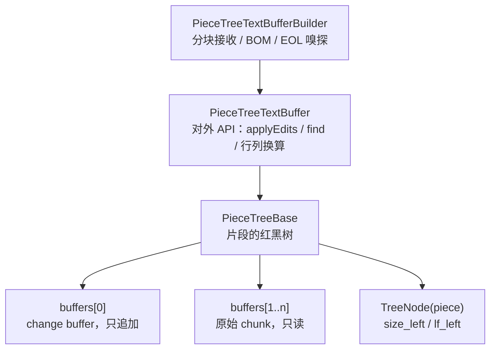

# piecetable

Kotlin 实现的 **Piece Tree（红黑树 + 片段表）文本缓冲区**，移植自
[VSCode](https://github.com/microsoft/vscode) 的 `pieceTreeTextBuffer`，面向 Android 上的代码编辑器。

[English](README.md)

相比 `StringBuilder` 或行数组（`List<String>`）：

- **打开大文件不复制内容**：原始 chunk 原样持有，编辑只往一个 append-only 缓冲追加；
- **插入 / 删除是 O(log n)**（n 为 piece 数），与文档大小无关；
- **行列 ↔ 偏移量换算 O(log n)**，每个节点缓存左子树的字符数 `size_left` 与换行数 `lf_left`；
- **读操作可以并行**：没有编辑进行时，多个线程可以同时读（见[线程模型](#线程模型)）。
- **后台任务不阻塞输入**：不可变快照可以在缓冲区继续编辑的同时被任意线程读取（见[快照](#快照)）。

---

## 目录

- [快速开始](#快速开始)
- [实现原理](#实现原理)
- [API 速查](#api-速查)
- [复杂度](#复杂度)
- [线程模型](#线程模型)
- [编辑器集成](#编辑器集成)
- [内存与压缩](#内存与压缩)
- [本次改动](#本次改动)
- [仍然存在的限制](#仍然存在的限制)
- [测试](#测试)
- [许可证](#许可证)

---

## 快速开始

### 1. 接入

```kotlin
// settings.gradle.kts
include(":piecetable")

// app/build.gradle.kts
dependencies {
    implementation(project(":piecetable"))
}
```

模块本身只依赖 `kotlinx-serialization`，用于公开值类型（`Range`、`Position`、`TextChange` 等）上的
`@Serializable` 标注。缓冲区和树本身不可序列化：请持久化文本（以及编辑器状态），恢复时重新 build。

### 2. 构建缓冲区

```kotlin
import x.github.module.piecetable.*
import x.github.module.piecetable.common.*

// 流式读入，大文件不需要一次性构造 String
val builder = PieceTreeTextBufferBuilder()
file.bufferedReader().use { reader ->
    val chars = CharArray(64 * 1024)
    while (true) {
        val n = reader.read(chars)
        if (n <= 0) break
        builder.acceptChunk(String(chars, 0, n))
    }
}

val textBuffer: PieceTreeTextBuffer = builder.build(
    eol = EndOfLine.LF,
    normalizeEOL = true
)

textBuffer.getLineCount()      // 行数
textBuffer.getLineContent(1)   // 第 1 行，行号从 1 开始
textBuffer.getEOL()            // "\n" 或 "\r\n"，从内容嗅探得到
textBuffer.getBOM()            // 文件自带的 UTF-8 BOM
```

`acceptChunk` 会正确处理跨 chunk 的 `\r\n` 和 UTF-16 代理对，所以按任意长度切块都安全。
过大的 chunk 会被切成不超过 64K 字符的缓冲区，因此把整个文件作为一个 String 传入（包括
`PieceTreeTextBufferBuilder(text)` 构造函数）也没有问题。

### 3. 编辑

```kotlin
val result = textBuffer.applyEdits(
    listOf(
        SingleEditOperation(Range(1, 1, 1, 1), "// "),   // 第 1 行行首插入
        SingleEditOperation(Range(3, 1, 4, 1), "")       // 删除第 3 行
    ),
    recordTrimAutoWhitespace = false,
    computeUndoEdits = true                              // 需要撤销就传 true
)

result.changes        // ContentChange 列表，用来刷新 UI / 重新高亮
result.reverseEdits   // 反向编辑，压入撤销栈
```

内部按位置从后往前应用，多个操作之间的偏移量不会互相影响。**区间不允许重叠**（相邻接触可以），
重叠会抛 `IllegalArgumentException`；越界的区间会被钳制进文档，而不是击穿到底层数据结构。
插入文本的换行符会统一转换成缓冲区的 EOL，混用多种换行符的文本也一样。

### 4. 撤销

```kotlin
val undo = result.reverseEdits!!.map { SingleEditOperation(it.range, it.text) }
textBuffer.applyEdits(undo, false, false)   // 回到上一个状态
```

连续输入想合并成一步撤销时，用 `TextChange.compressConsecutiveTextChanges` 把多次编辑的
`textChange` 压缩成一组。

反向编辑用 String 保存被删除的文本，所以撤销一次大范围删除，要多保留一份完整副本。
`applyEditsWithSliceUndo` 返回的撤销批次是引用存储的片段，不复制文本，见[片段](#片段不复制大段内容的撤销)：

```kotlin
val result = textBuffer.applyEditsWithSliceUndo(ops)        // 编辑内容与 applyEdits 相同
val undone = textBuffer.applySliceEdits(result.reverseEdits) // 撤销，返回重做批次
textBuffer.applySliceEdits(undone.reverseEdits)              // 重做
```

### 5. 搜索

```kotlin
// 纯文本查找；搜索词含换行时跨行匹配，不区分 \n / \r\n / \r
buffer.find("TODO", searchRange, limitResultCount = 1000) { false }

// 正则，逐行匹配
buffer.find(Regex("""fun\s+\w+"""), searchRange, 1000) { isCancelled() }

// 跨行正则：带 RegexOption.MULTILINE，或模式中出现 \n、\r、\W
buffer.find(Regex("""\{\s*\n\s*\}"""), searchRange, 1000) { isCancelled() }
```

- 搜索区间会先钳制进文档，区间的起止列会被遵守。
- 两种引擎里 `^` 和 `$` 都表示**行**首和行尾，与 VSCode 的 `m` 标志一致。搜索区间的起止列不算行首、
  行尾；前后断言和 `\b` 能看到同一行里区间外的文本。
- 逐行匹配的结果不会跨越换行。可能匹配到换行的模式（字面换行、`\n`、`\r`、`\W`）会自动改走多行
  引擎：它把区间涉及的行用 `\n` 拼接，只在区间内匹配，所以 `\n` 能匹配任意一种换行符。
- 最后一个参数是取消回调，配合协程可以随时中断长搜索。

### 6. 保存

```kotlin
textBuffer.readPiecesContent { chunk ->
    outputStream.write(chunk.toByteArray())   // 分片写盘，不构造整份副本
}
```

`toString()` 会把整个文档拼成一个 String，大文件可能 OOM，落盘请用 `readPiecesContent`。

### 7. 在后台读取：快照

```kotlin
// 在编辑线程上（或持读锁）创建：很便宜，不复制文件内容
val snapshot = textBuffer.createSnapshot()

// 任意线程、任意时间读取，不加锁，用户继续输入也没关系
executor.execute {
    var offset = 0
    while (true) {
        val chunk = snapshot.getNearestChunk(offset)   // 增量解析器就是这样读的
        if (chunk.isEmpty()) break
        offset += chunk.length
    }
    // snapshot.versionId 是创建时的 textBuffer.getVersionId()：
    // 两者一比，就知道结果是否仍然对应当前内容
}
```

快照是文档在某一个版本的内容，之后无论缓冲区发生什么（编辑、`compact()`、`setEOL()`）都不会变。
后台高亮和保存都读快照，而不是持有锁，见[边输入边高亮](#边输入边高亮)。

---

## 实现原理



- **Piece** 是「属于哪个 buffer + 起点 + 终点」的三元组，本身不持有字符。
- `buffers[0]` 是唯一可写的缓冲区，新输入一律追加到末尾；`buffers[1..n]` 是文件原始内容，永不修改。
  所以「删除」只是把 piece 切开，不搬运字符。
- 红黑树的**中序遍历**就是文档顺序；节点缓存 `size_left` 与 `lf_left`，因此偏移量与行号可以
  在 O(log n) 内定位。
- 每个 buffer 自带 **lineStarts**（现在是不装箱的 `IntList`），piece 内部的定位靠它二分查找。
- **CRLF 必须始终落在同一个 piece 内**，否则行数会算错。每次编辑后的
  `validateCRLFWithPrevNode` / `fixCRLF` 就在做这件事。

---

## API 速查

### 读

| 方法 | 说明 |
| --- | --- |
| `getLineCount()` | 行数，最少为 1 |
| `getLineContent(line)` | 行内容，**不含**行尾符，带缓存 |
| `getLineContentWithEOL(line)` | 行内容 + EOL |
| `getLinesContent()` | 全部行的列表 |
| `getLineLength(line)` / `getLineMaxColumn(line)` | 行长度 / 行长度 + 1，未归一化 EOL 的缓冲区也准确 |
| `getLineFirstNonWhitespaceColumn(line)` | 首个非空白列，全空白返回 0 |
| `getValueInRange(range, eol)` | 取区间文本（区间先钳制进文档），可指定输出行尾 |
| `getOffsetAt(line, column)` / `getPositionAt(offset)` | 行列 ↔ 偏移，均做钳制 |
| `getCharCode(offset)` / `getLineCharCode(line, index)` | UTF-16 code unit（`charCodeAt` 语义），文档末尾返回 0 |
| `getNearestChunk(offset)` | 从 offset 开始的一整段连续文本（最多约 64K 字符，到末尾返回 `""`），给 tree-sitter 之类增量解析器用 |
| `createSnapshot(preserveBOM = false)` | 当前内容的不可变副本，编辑期间任意线程都能读，见[快照](#快照) |
| `getVersionId()` | 内容每次变化（`applyEdits`、`setEOL`）都会改变，读操作和 `compact()` 不会 |
| `find(text 或 regex, range, limit, isCancelled)` | 搜索，见[搜索](#5-搜索) |
| `length` / `get(i)` / `subSequence(a, b)` | `CharSequence` 实现，越界下标抛 `IndexOutOfBoundsException` |
| `contentEquals(other)` | 比较 BOM、EOL 与全部内容 |

### 写

| 方法 | 说明 |
| --- | --- |
| `applyEdits(ops, recordTrimAutoWhitespace, computeUndoEdits)` | 所有编辑的统一入口 |
| `setEOL(eol)` | 切换行尾并重建全文 |
| `compact()` | 用当前文本重建存储，见[内存与压缩](#内存与压缩) |
| `getStorageStats()` | 文档长度、实际存储的字符数、change buffer 大小、piece 数 |
| `applyEditsWithSliceUndo(ops)` | 与 `applyEdits` 相同的文本编辑，撤销批次以片段返回，见[片段](#片段不复制大段内容的撤销) |
| `applySliceEdits(edits)` | 用 `TextSlice` 替换区间（撤销 / 重做），返回变更和反向批次 |

**参数规则。** 按行查询的方法（`getLineContent`、`getLineContentWithEOL`、`getLineLength`、
`getLineMinColumn` / `getLineMaxColumn`、`getLineCharCode`、首尾非空白列）要求行号存在，即
`1..getLineCount()`，否则抛 `IndexOutOfBoundsException`。按位置或区间的方法（`getOffsetAt`、
`getValueInRange`、`getValueLengthInRange`、`getCharacterCountInRange`、`applyEdits`、`find`）则会钳制。

`PieceTreeBase.insert` / `delete` 是底层原语，现在会校验偏移量并抛 `IndexOutOfBoundsException`，
但不会对插入文本做 EOL 归一化，业务层请优先用 `applyEdits`。

### 快照

`createSnapshot()` 返回一个 `PieceTreeSnapshot`：创建那一刻的内容，之后永远不变。创建它是对缓冲区
的一次读操作，耗时 O(piece 数)，外加复制仍在文档中的输入文本，不复制文件内容。读快照不需要任何锁，
任意线程都可以读，缓冲区正在编辑、压缩或切换 EOL 时也一样。

| 成员 | 说明 |
| --- | --- |
| `length` / `get(i)` / `substring(a, b)` / `subSequence(a, b)` | 按文档偏移量的 `CharSequence`（不含 BOM）；`get` 是 O(log n) |
| `getNearestChunk(offset)` | 与缓冲区的同名方法约定相同：offset 所在 piece 的剩余部分，最多约 64K 字符，到末尾返回 `""` |
| `readPiecesContent { }` | 逐个 piece 交出全部内容，例如用来保存 |
| `toString()` | 全部内容拼成一个 String |
| `versionId` / `lineCount` / `eol` | 创建快照时缓冲区的状态 |
| `bom` / `read()` | VSCode 风格的顺序读取：先返回 `bom`（`preserveBOM = true` 时是 BOM，否则为 `""`），再逐个返回 piece，最后返回 `null`。`read()` 会记住读到哪里，同一时间只能有一个线程调用；其他成员都可以多线程同时使用 |

为什么不受后续编辑影响：创建时，每个 piece 都被换算成「文本、起点、长度」。原始 chunk 里的 piece
直接引用那个 chunk，树持有 chunk 之后再也不会写它；change buffer 每次编辑都会增长，其中的 piece
复制一份。之后不再经过树、缓冲区列表或 lineStarts 查找任何东西。代价是：快照存活期间，它引用的
chunk 不能被回收，即使 `compact()` / `setEOL()` 已经在缓冲区里把它们换掉，所以处理完就不要再持有快照。

### 片段：不复制大段内容的撤销

`applyEdits` 用 String 返回每个编辑删除的内容（`reverseEdits[i].text`），所以删除或替换一大段选区时，
撤销数据要再保留一份被删文本的完整副本。片段接口改用 `TextSlice` 返回：短内容是 String，长内容是
指向所在存储的引用，不复制。

```kotlin
// 编辑：文本编辑与 applyEdits 相同，撤销批次以片段返回
val result = buffer.applyEditsWithSliceUndo(listOf(SingleEditOperation(selection, "")))
undoStack.add(result.reverseEdits)

// 撤销：应用反向批次，返回的是重做批次
val undone = buffer.applySliceEdits(undoStack.removeAt(undoStack.size - 1))
redoStack.add(undone.reverseEdits)

// 重做，依此类推
val redone = buffer.applySliceEdits(redoStack.removeAt(redoStack.size - 1))
undoStack.add(redone.reverseEdits)
```

| 成员 | 说明 |
| --- | --- |
| `exportSlice(range)` | 区间（先钳制）的内容，以片段返回；读操作 |
| `applySliceEdits(edits)` | 把每个 `SliceEdit.range` 替换为它的 `content`（`null` 表示删除）；返回 `changes` 和 `reverseEdits` |
| `applyEditsWithSliceUndo(ops)` | 与 `applyEdits` 相同的文本编辑，`reverseEdits` 为片段 |
| `TextSlice.of(text)` | 持有 String 的片段，可以插入任何缓冲区 |
| `TextSlice.length` / `eolCount` / `firstLineLength` / `lastLineLength` | 内容的长度和行结构，不需要读取内容 |
| `TextSlice.toText()` | 内容的 String 形式（持有引用时会复制一份） |

- **两种形式。** 短于 `TextSlice.TEXT_THRESHOLD`（16K 字符）的内容保存为 String，和 `reverseEdits`
  一样。更长的内容保存为若干段「缓冲区、起点、长度」；插回时生成指向这些段的 piece，既不复制，也不往
  change buffer 追加。期间被 `compact()` 或 `setEOL()` 换掉的存储，插回时会重新纳入缓冲区。删除 1MB
  再撤销，`getStorageStats()` 与删除前完全相同。
- **换行符。** 能原样插回时就原样插回：EOL 相同，并且导出时缓冲区已归一化，或者插入的缓冲区本身也
  未归一化。否则像 `applyEdits` 的文本一样归一化为缓冲区的 EOL。所以只要期间没有调用 `setEOL()`，
  撤销就能还原完全相同的文本，混合换行符也一样。
- **规则。** 与 `applyEdits` 相同：区间指批次执行前的文档并会被钳制，区间重叠抛
  `IllegalArgumentException`，从下往上应用，所有检查都在第一处修改之前完成。不支持：自动空白的修剪、
  `forceMoveMarkers`、1000 个以上编辑的合并。
- **变更。** `SliceEditResult.changes` 是 `SliceChange`（区间、偏移、长度，以及以片段表示的新内容），
  不是 `ContentChange`：更新装饰或驱动增量解析器时，用 `content.length` / `eolCount` /
  `lastLineLength`，而不是文本。`SliceChange.removed` 是这一处删掉的内容（与对应反向编辑的内容是同一个
  片段，没有删除时为 null），自己维护基于偏移量的撤销历史时不必再把 changes 和 reverseEdits 一一对应。
- **形式与大小。** `TextSlice.isText` 表示内容是否以 String 保存（可在任何线程读取、可脱离缓冲区保留），
  `segmentCount` 是引用的存储段数，可用来估算片段自身的占用。
- **持有引用的片段属于它的缓冲区。** 插入到其他缓冲区会抛 `IllegalArgumentException`（跨缓冲区移动
  内容请用 `TextSlice.of(slice.toText())`）。读取它（`toText()`、插回）是对该缓冲区的读操作，所以片段
  要放在撤销栈所在的地方，在缓冲区的锁下使用。它会让引用的存储无法回收，并且不可序列化：要持久化撤销
  历史，请保存 `toText()`。
- **合并连续编辑。** `TextChange.compressConsecutiveTextChanges` 只处理文本。使用片段时，每个批次
  单独作为一个撤销条目，或者只合并内容为文本的条目。

---

## 复杂度

| 操作 | 复杂度 |
| --- | --- |
| `insert` / `delete` | O(log n)，n 为 piece 数 |
| `getOffsetAt` / `getPositionAt` | O(log n) |
| `getLineContent` | O(log n) + 行长度 |
| `getLinesRawContent` / `toString` | O(文档长度)，会分配等长内存 |
| `createSnapshot` | O(n) + 复制仍在文档中的输入文本 |
| `exportSlice` | O(log n + 区间内的 piece 数)；只复制 16K 字符以下的内容 |
| 插回一个含 k 段引用的片段 | O((k + 1) log n)，不复制文本 |
| 快照的 `get` / `getNearestChunk` | O(log n) |
| 构建（builder） | O(文档长度)，内存约等于文件本身 |

长时间编辑后 piece 数会增长，`compact()` 可以把碎片重新合并，见[内存与压缩](#内存与压缩)。

---

## 线程模型

**以缓冲区为单位：可以多个线程同时读，或者一个线程写，但读写不能同时进行。不同缓冲区互不影响。**

1. **没有编辑时，并发读是安全的。** 读操作只会更新两处状态：搜索缓存（方法都是 `synchronized`）
   和单行缓存 `_lastVisitedLine`（`@Volatile` 字段里的不可变对象，只整体替换）。读线程必须能看到
   编辑完成后的结果，即最后一次编辑要 *happens-before* 这些读操作，例如通过锁，或在编辑之后再提交
   读任务。树本身的字段不是 volatile 的。
2. **编辑在本缓冲区内必须独占**：同一缓冲区上不能同时有其他编辑或读取。缓冲区之间没有共享的可变
   状态（每棵树有自己的 sentinel），两个缓冲区可以在两个线程上同时编辑，无需任何协调。
3. **快照可以在编辑期间读取。** `createSnapshot()` 是读操作，遵守第 1 条。之后快照再也不碰缓冲区
   （见[快照](#快照)），任意多个线程可以随时读它，不需要锁。快照的字段都是 final 的，用常见的方式
   交给其他线程（executor、channel、volatile 字段）都能保证对方看到完整内容。

实践中二选一：

- 编辑和读取都放在同一个线程（编辑器线程，或一个 single-thread dispatcher），后台任务拿文本副本
  （在该线程上用 `readPiecesContent` / `toString` 生成）；
- 或者给每个缓冲区**一把自己的** `ReentrantReadWriteLock`：

```kotlin
import java.util.concurrent.locks.ReentrantReadWriteLock
import kotlin.concurrent.read
import kotlin.concurrent.write

val lock = ReentrantReadWriteLock()   // 每个缓冲区一把

lock.write { buffer.applyEdits(ops, false, true) }          // 编辑线程
lock.read { buffer.find(regex, range, 1000) { cancelled } }  // 任意线程
```

耗时较长、又不能阻塞输入的工作（高亮、保存、建索引）使用快照，而不是持有读锁。

### 边输入边高亮

后台解析在整个过程中需要同一个版本的文本；在两次按键之间读实时的缓冲区，会把两个版本拼在一起。
所以交给它一个快照：

1. 每次编辑后，在编辑线程上记下 `applyEdits` 返回的 `changes`。
2. 防抖到期后，在编辑线程上创建快照，连同上一轮以来积累的 `changes` 一起交给后台线程。
3. 后台线程先用这些 `changes` 更新上一棵语法树，再在快照上增量解析（读取回调用
   `getNearestChunk`），生成高亮区间。
4. 只有结果仍然对应当前内容时才使用：缓冲区是同一个，且 `getVersionId() == snapshot.versionId`。
   否则按之后的编辑平移这些区间，或者等下一轮结果。同一时间只做一次解析。

绘制可见行仍然和其他读操作一样留在编辑线程上，挪到后台的只有解析这一步。

```kotlin
import java.util.concurrent.Executors
import x.github.module.piecetable.*
import x.github.module.piecetable.common.*

// 代表你使用的解析器绑定（tree-sitter 或其他）
interface SyntaxTree
interface IncrementalParser {
    /** [read] 返回某个字符偏移处的文本，到末尾返回 "" */
    fun parse(old: SyntaxTree?, edits: List<ContentChange>, read: (Int) -> String): SyntaxTree
}

class Highlighter<Span>(
    private val doc: EditorDocument,                   // 见「编辑器集成」
    private val parser: IncrementalParser,
    private val computeSpans: (SyntaxTree) -> List<Span>,
    private val postToUi: (Runnable) -> Unit,
    private val onSpans: (List<Span>) -> Unit          // 在 UI 线程上调用
) {
    private val worker = Executors.newSingleThreadExecutor()   // 同一时间只做一次解析

    // 只在编辑线程上访问
    private val pendingEdits = mutableListOf<ContentChange>()
    private var lastBuffer: PieceTreeTextBuffer? = null

    // 只在后台线程上访问
    private var oldTree: SyntaxTree? = null

    /** 编辑线程，每次编辑成功后调用 */
    fun onEdited(result: ApplyEditsResult) {
        pendingEdits += result.changes
    }

    /** 编辑线程，防抖到期时调用 */
    fun highlight() {
        val (buffer, snapshot) = doc.snapshot()
        val fullParse = buffer !== lastBuffer       // 第一轮，或者文档被重建过
        lastBuffer = buffer
        val edits = if (fullParse) emptyList() else pendingEdits.toList()
        pendingEdits.clear()

        worker.execute {
            // 这里只读快照：不加锁，用户同时可以继续输入
            val tree = parser.parse(if (fullParse) null else oldTree, edits) { offset ->
                snapshot.getNearestChunk(offset)
            }
            oldTree = tree
            val spans = computeSpans(tree)
            postToUi(Runnable {
                if (doc.isCurrent(buffer, snapshot)) onSpans(spans)
            })
        }
    }
}
```

tree-sitter 的绑定通常按字节偏移读取；输入编码为 UTF-16 时，字符偏移等于 `byteOffset / 2`。

---

## 编辑器集成

缓冲区只是数据结构，不是编辑器。下面四件事应该由持有它的那一层负责：编辑失败后的恢复、
校验来自 UI 的位置、不要每帧都复制超长行、给后台任务提供快照。一个类把四件事都做了：

```kotlin
import java.io.File
import java.util.concurrent.locks.ReentrantReadWriteLock
import kotlin.concurrent.read
import kotlin.concurrent.write
import x.github.module.piecetable.*
import x.github.module.piecetable.common.*

class EditorDocument(private val file: File) {

    /** 每个文档一把锁：缓冲区之间不共享状态，文档之间从不互相等待 */
    private val lock = ReentrantReadWriteLock()

    @Volatile
    var buffer: PieceTreeTextBuffer = load()
        private set

    /** 反向编辑，最新的在末尾；无论用什么撤销管理器，恢复时都必须清空 */
    private val undoStack = ArrayDeque<List<SingleEditOperation>>()

    /** 例如提示「文档已从磁盘重新加载」，并整体重绘 */
    var onRecovered: (Throwable) -> Unit = {}

    private fun load(): PieceTreeTextBuffer {
        val builder = PieceTreeTextBufferBuilder()
        file.bufferedReader().use { reader ->
            val chars = CharArray(64 * 1024)
            while (true) {
                val n = reader.read(chars)
                if (n <= 0) break
                builder.acceptChunk(String(chars, 0, n))
            }
        }
        return builder.build(EndOfLine.LF, normalizeEOL = true)
    }

    // ------------------------------------------------------------- 1. 编辑与恢复

    /** 应用 [ops]。编辑失败且文档已重建时返回 null。 */
    fun edit(ops: List<SingleEditOperation>): ApplyEditsResult? = lock.write {
        try {
            val result = buffer.applyEdits(ops, false, true)
            undoStack.addLast(result.reverseEdits!!.map { SingleEditOperation(it.range, it.text) })
            result
        } catch (e: IllegalArgumentException) {
            // 只会在第一处修改之前的校验阶段抛出（区间重叠）：调用方的 bug，缓冲区完好
            throw e
        } catch (e: Throwable) {
            // 其他异常都可能发生在树操作的中途
            recover(e)
            null
        }
    }

    // 调用时已持有写锁
    private fun recover(cause: Throwable) {
        // 失败的编辑只可能损坏这个缓冲区，其他文档不受影响
        // 1. 尽力而为：把还能读出来的内容存下来。树可能已经损坏，结果可能不对或直接失败；
        //    runCatching 也能接住损坏的树引发的 StackOverflowError
        runCatching {
            File(file.path + ".recovered").bufferedWriter().use { out ->
                buffer.readPiecesContent { out.write(it) }
            }
        }
        // 2. 从可信来源重建：最近一次保存的文件（或你的自动保存 / 日志）
        buffer = load()
        // 3. 撤销历史描述的是旧内容
        undoStack.clear()
        onRecovered(cause)
    }

    // ------------------------------------------------------------- 2. 校验位置

    /**
     * 把 (line, column) 钳制进文档，并且不让它停在代理对中间。
     * 凡是来自 UI 的位置都先过一遍：点击、恢复的光标、旧版本文档上的搜索结果。
     */
    fun validPosition(line: Int, column: Int): Position = lock.read {
        val b = buffer
        val l = line.coerceIn(1, b.getLineCount())
        var c = column.coerceIn(1, b.getLineMaxColumn(l))
        if (c in 2..b.getLineLength(l)) {
            val before = b.getLineCharCode(l, c - 2).toChar()
            val at = b.getLineCharCode(l, c - 1).toChar()
            if (before.isHighSurrogate() && at.isLowSurrogate()) c--
        }
        Position(l, c)
    }

    // ------------------------------------------------------------- 3. 超长行

    /**
     * 视图要绘制的一行：短行取整行，长行只取可见窗口。getLineContent 会复制整行，
     * 压缩过的文件可能每帧都要复制几 MB；getValueInRange 只复制请求的列。
     */
    fun renderText(line: Int, firstVisibleColumn: Int, visibleColumns: Int): String =
        lock.read {
            val b = buffer
            when {
                line !in 1..b.getLineCount() -> ""
                // 归一化的缓冲区上只是两次偏移量查找，不复制
                b.getLineLength(line) <= LONG_LINE -> b.getLineContent(line)
                else -> {
                    val maxColumn = b.getLineMaxColumn(line)
                    val start = firstVisibleColumn.coerceIn(1, maxColumn)
                    val end = (start + visibleColumns).coerceAtMost(maxColumn)
                    b.getValueInRange(Range(line, start, line, end))
                }
            }
        }

    // ------------------------------------------------------------- 4. 后台任务

    /** 给后台任务（高亮、保存）用的快照，以及它来自哪个缓冲区 */
    fun snapshot(): Pair<PieceTreeTextBuffer, PieceTreeSnapshot> =
        lock.read { buffer to buffer.createSnapshot() }

    /** 在 [source] 的快照 [snapshot] 上算出的结果，是否仍然对应当前文档 */
    fun isCurrent(source: PieceTreeTextBuffer, snapshot: PieceTreeSnapshot): Boolean =
        lock.read { buffer === source && source.getVersionId() == snapshot.versionId }

    companion object {
        const val LONG_LINE = 10_000
    }
}
```

四部分的说明：

- **恢复。** `IllegalArgumentException` 只会在任何修改发生之前抛出，缓冲区仍然完好，要修的是
  调用方。其他异常（内部缺陷、`OutOfMemoryError`）都可能让树停在更新到一半的状态：这个缓冲区
  不要再编辑。损坏只限于这个缓冲区（每棵树有自己的 sentinel），其他文档无需任何处理。
  `.recovered` 文件只是给用户的补救，不是可信数据源。
- **位置。** 传给 `applyEdits`、`getValueInRange`、`find` 的区间会被钳制，按行查询的方法遇到不存在的
  行会抛 `IndexOutOfBoundsException`。来自 UI 的位置仍建议在一个地方统一钳制，这样还能避免光标停在
  emoji 中间（缓冲区内部的区间校验不处理这一点）。
- **超长行。** `getLineLength` / `getLineMaxColumn` 只有在 EOL 已归一化的缓冲区上才便宜
  （`normalizeEOL = true`）；未归一化时它们要把整行读出来测量。
- **后台任务。** 创建快照很快，在读锁下进行；读快照不需要任何锁。恢复后的文档换了一个新缓冲区，
  版本号重新从 0 开始，所以 `isCurrent` 还要比较缓冲区是否同一个。见[边输入边高亮](#边输入边高亮)。

---

## 内存与压缩

**内存为什么会增长。** 编辑从不修改或释放文本。插入的文本追加到 change buffer，之后即使被删除
也仍然留在那里（撤销、重做还会再追加一次）；原始 chunk 即使大部分内容已被删除，也会整块保留。
每次在新位置编辑还会把 piece 切开，长时间编辑后会留下大量小 piece。读操作仍是 O(log n)，
但内存大致等于「文件 + 输入过的全部文本」，外加每个 piece 约 100 字节。VSCode 原版也是这样。

**解决办法：`compact()`。** 它用当前文本重建存储：新的、每块不超过 64K 字符的 chunk，每块一个
piece，change buffer 清空。文本、EOL、偏移量、位置、行号都不变，所以光标、装饰和撤销数据
（保存的是文本和偏移量，从不引用缓冲区）依然有效。耗时 O(n)，运行期间需要额外约一份文档大小的
内存。`setEOL()` 也会重建，但会改写换行符；`compact()` 从不改写，`normalizeEOL = false` 的缓冲区
也会原样保留。

**什么时候调用。** 用 `getStorageStats()` 判断是否值得。一个合理的策略是：「存储的文本里超过
一半是垃圾且至少有几 MB，或者 piece 数非常多」，在保存之后或编辑器空闲时检查：

```kotlin
// EditorDocument 的成员函数，与 edit() 并列
fun compactIfWorthIt() = lock.write {
    val stats = buffer.getStorageStats()
    val garbage = stats.storedLength - stats.length
    if (garbage > maxOf(stats.length.toLong(), 4L * 1024 * 1024) || stats.pieceCount > 50_000) {
        buffer.compact()
    }
}
```

`compact()` 属于编辑操作：整个过程都持有写锁，读线程要等待，所以应该放在空闲时，而不是输入路径上。
请在最慢的目标设备上用最大的文件测一下耗时。

快照会让它引用的 chunk 一直留在内存里，即使 `compact()` 已经把它们换掉；只有旧存储的快照都不再被
持有之后，这部分内存才会释放。

**撤销历史。** 使用 `applyEdits` 时，撤销历史用 String 保存每段被删除的文本：`compact()` 之后存储
变小了，但历史里仍有自己的副本。使用[片段](#片段不复制大段内容的撤销)时，历史引用存储本身，被删除的
文本只存在一份；`compact()` 无法释放历史仍在引用的存储，而那正是撤销需要的文本。

---

## 仍然存在的限制

- **快照会让旧的 chunk 无法回收**：快照存活期间，它引用的 chunk 一直留在内存里，即使
  `compact()` / `setEOL()` 已经把它们换掉。快照的 `read()` 会记住读取位置，不能两个线程同时调用
  （其他成员可以）。
- **持有引用的片段只能用于它的缓冲区**，并会让引用的存储无法回收，也不可序列化。片段接口不修剪
  自动空白，没有 `forceMoveMarkers`，变更中也不带文本。
- **`CharSequence` 实现方便但慢**：`get(i)` 是 O(log n)，直接拿缓冲区跑 `Regex` 会严重退化，
  请改用 `find()`。
- **压缩需要手动触发**：已删除的文本和碎片化的 piece 只有 `compact()`（或 `setEOL()`）才会释放，
  缓冲区不会自动压缩，见[内存与压缩](#内存与压缩)。
- **多行搜索会复制搜索区间涉及的所有行**（包括首尾两整行），在 CRLF 缓冲区上换算偏移时假设每个
  换行都是 `\r\n`。
  `normalizeEOL = false` 且行尾混杂的缓冲区上，返回的区间可能有偏差。
- **编辑可能劈开代理对**：区间校验不会把落在 emoji 两半之间的列挪开（VSCode 会）。
- **`getValueLengthInRange` 忽略 `eol` 参数。**

---

## 测试

全部用例都放在 **`src/sharedTest`**，一份代码跑两遍：JVM 上 `testDebugUnitTest`，真机上
`connectedDebugAndroidTest`。只有必须在设备上才有意义的用例才留在 `androidTest`。

```
src/
├── main/java/x/github/module/piecetable/        # 实现
├── sharedTest/java/x/github/module/piecetable/  # JVM 与设备共用
│   ├── TestSupport.kt                   # 公共断言、红黑树不变量与元数据对账
│   ├── PieceTreeBaseTest.kt             # 移植自 VSCode 的用例集（86 条）
│   ├── PieceTreeBuilderTest.kt          # 分块、BOM、EOL 嗅探、代理对
│   ├── PieceTreeEditingTest.kt          # 编辑、行列映射、CRLF、快照
│   ├── PieceTreeTextBufferApiTest.kt    # applyEdits、撤销数据、区间、CharSequence
│   ├── PieceTreeSearchTest.kt           # 按词 / 正则 / 多行搜索
│   ├── PieceTreeEditOperationTest.kt    # getInverseEditRanges、toSingleEditOperation
│   ├── PieceTreeUndoRedoTest.kt         # 撤销 / 重做，不依赖协程与真实时间
│   ├── PieceTreeStressTest.kt           # 固定种子的随机测试、大文档
│   ├── PieceTreeMaintenanceTest.kt      # compact、存储统计、共享状态恢复
│   ├── PieceTreeSnapshotTest.kt         # 快照跨编辑 / compact / setEOL 不变、编辑期间并发读取
│   ├── PieceTreeUndoRoundTripTest.kt    # CRLF 与混合换行下 applyEdits + 撤销 / 重做的随机往返
│   ├── PieceTreeSearchOracleTest.kt     # find() 与朴素实现随机对拍
│   ├── PieceTreeSliceTest.kt            # 片段撤销 / 重做：随机往返、穿插 compact / setEOL、内存
│   ├── RandomEditing.kt                 # 随机测试共用：String 模型、随机编辑、位置换算
│   └── RegressionTest.kt                # 每个已修复缺陷一条（49 条），请勿删除
└── androidTest/java/x/github/module/piecetable/
    └── AndroidDeviceTest.kt             # API level 敏感路径、真机耗时
```

把共享源集同时挂到两个测试变体上：

```kotlin
android {
    defaultConfig {
        testInstrumentationRunner = "androidx.test.runner.AndroidJUnitRunner"
    }
    sourceSets {
        // java + kotlin 都要加：使用 AGP 内置 Kotlin（没有 org.jetbrains.kotlin.android 插件）时，
        // Kotlin 文件只会通过 kotlin.srcDir 被收录
        getByName("test") {
            java.srcDir("src/sharedTest/java")
            kotlin.srcDir("src/sharedTest/java")
        }
        getByName("androidTest") {
            java.srcDir("src/sharedTest/java")
            kotlin.srcDir("src/sharedTest/java")
        }
    }
    testOptions {
        unitTests.all {
            // 缓冲区之间没有共享的可变状态，测试类也可以并行跑
            // （例如 maxParallelForks = 2），这里无需额外配置
            it.forkEvery = 0
        }
    }
}

dependencies {
    // JVM：JUnit 5（tasks.withType<Test> { useJUnitPlatform() }）
    testImplementation("org.jetbrains.kotlin:kotlin-test-junit5")
    testRuntimeOnly("org.junit.platform:junit-platform-launcher")
    // 设备：AndroidJUnitRunner 是 JUnit 4 运行器，kotlin.test 必须用 JUnit 4 版本
    androidTestImplementation("org.jetbrains.kotlin:kotlin-test-junit")
    androidTestImplementation("androidx.test.ext:junit:1.2.1")
    androidTestImplementation("androidx.test:runner:1.6.2")
    androidTestImplementation("androidx.test:rules:1.6.1")
}
```

测试里访问了 `internal` 成员（`PieceTreeBase`、`TreeNode`、sentinel）。AGP 会把 `test` 与
`androidTest` 两个编译单元都设为主变体的 friend module，无需额外配置。

### androidTest 报 `Unresolved reference 'TestSupport'`

`TestSupport` 在 `src/sharedTest` 里。只有把这个目录挂到 `androidTest` 源集上，androidTest 的编译
才能看到它，所以这个错误说明没有挂上（如果是 `internal` 可见性问题，报错会是 "Cannot access"，
而不是 "Unresolved reference"）：

1. 确认模块的 `build.gradle.kts` 里，上面的 `sourceSets` 配置对 `test` **和** `androidTest` 都写了，
   而且每个都同时有 `java.srcDir` **和** `kotlin.srcDir`。没有 `org.jetbrains.kotlin.android` 插件的
   模块使用 AGP 内置 Kotlin，它只通过 `kotlin.srcDir` 收录 Kotlin 文件；只写 `java.srcDir` 时，
   JVM 测试可能正常，而 androidTest 里唯一的文件 `AndroidDeviceTest` 找不到 `TestSupport`。
2. `./gradlew :piecetable:sourceSets` 会打印每个源集包含的目录，`androidTest` 一项里必须有
   `src/sharedTest/java`。
3. 如果目录已列出但其中的 Kotlin 文件仍未参与编译，检查 `androidTest` 是否也加了 `kotlin.srcDir`。
4. Android Studio 可能把两个源集共享的目录里的代码标红，而 Gradle 构建其实正常，以命令行结果为准。
5. 不经过 AGP 的构建会忽略 `sourceSets`：把 `src/sharedTest/java` 里的文件复制（或软链接）到
   `src/androidTest/java`。

### 设备测试能编译，但几乎什么都没跑

`AndroidJUnitRunner` 是 JUnit 4 运行器。androidTest 的依赖里如果是 `kotlin-test-junit5`，
`kotlin.test.Test` 就是 JUnit 5 的注解：所有共享用例都会被跳过且不报错，只有使用 `org.junit.Test`
的 `AndroidDeviceTest` 会运行，`@BeforeTest` 也从不执行。androidTest 请用 `kotlin-test-junit`，
JVM 测试继续用 `kotlin-test-junit5`；共享源码只用 `kotlin.test.*`，两种都能编译。

### `Space characters in SimpleName ... are not allowed prior to DEX version 040`

反引号测试名在 JVM 上可以含空格，但 DEX 从 API 30 起才接受。模块的 `minSdk` 低于 30 时
（没写 `minSdk` 等于 1），打包 androidTest APK 会在 `` `random insert and delete bug 2` `` 这类名字上
失败。把所有共享用例名里的空格换成下划线即可（PieceTreeBaseTest、PieceTreeEditOperationTest、
PieceTreeUndoRedoTest 共 116 个，替换后名字仍然唯一）：

```bash
perl -pi -e 's/fun `([^`]*)`/"fun `" . ($1 =~ tr| |_|r) . "`"/ge' \
    src/sharedTest/java/x/github/module/piecetable/*.kt
```

同时在 `defaultConfig` 里把 `minSdk` 设成与应用一致，让设备测试按库真正支持的 API 级别构建。

```bash
# JVM 上跑整套共享用例
./gradlew :piecetable:testDebugUnitTest

# 真机 / 模拟器上跑共享用例 + AndroidDeviceTest
./gradlew :piecetable:connectedDebugAndroidTest

# JVM 上只跑某一个类
./gradlew :piecetable:testDebugUnitTest --tests "*RegressionTest"

# 设备上只跑某一个类
./gradlew :piecetable:connectedDebugAndroidTest \
    -Pandroid.testInstrumentationRunnerArguments.class=x.github.module.piecetable.RegressionTest
```

随机用例全部使用固定种子（`PieceTreeStressTest.SEEDS`、`PieceTreeBaseTest.SEED`、
`PieceTreeUndoRoundTripTest.SEEDS`、`PieceTreeSearchOracleTest.SEEDS`），失败可以原样复现；
失败信息会写明种子和步骤。想扩大覆盖面就加种子，不要换回 `Math.random()`。

针对曾经的死循环写回归用例时，用 `TestSupport.runWithTimeout { ... }` 包住调用：缺陷复发时
该用例会在 10 秒后失败，而不是把整套测试卡住。

新增用例时注意两点：

- `sharedTest` 里不能出现 `android.*` / `androidx.*`，否则 JVM 变体编译不过；设备特有的用例
  放 `androidTest`。
- 可以并行跑测试：缓冲区之间没有共享的可变状态。`TestSupport.resetGlobalState()` 只是为了让现有的
  `@BeforeTest` 继续编译而保留的廉价保险。

## 许可证

Apache License 2.0，与 X Editor 其余部分相同。piece tree 移植自 [Visual Studio Code](https://github.com/microsoft/vscode)，后者采用 MIT 许可证，版权所有 (c) 2015 - present Microsoft Corporation，许可证全文见 [LICENSE-vscode](LICENSE-vscode)。该文件需要与本模块及其衍生文件一同保留。算法与原始测试用例的版权归原作者所有。

每个移植自 VS Code 的源文件，都在自身的许可证文件头之后注明了来源，并写明对应的 VS Code 源文件。这些文件包括：piece tree 本身（`pieceTreeBase`、`pieceTreeSnapshot`、`pieceTreeTextBuffer`、`pieceTreeTextBufferBuilder`、`rbTreeBase`）、`common/` 下的 `charCode`、`strings`、`position`、`range`、`model`，以及测试 `PieceTreeBaseTest`、`PieceTreeEditOperationTest` 和 `TestSupport`。`common/intList.kt`、`textSlice.kt` 和其余测试是本模块自己的代码。
