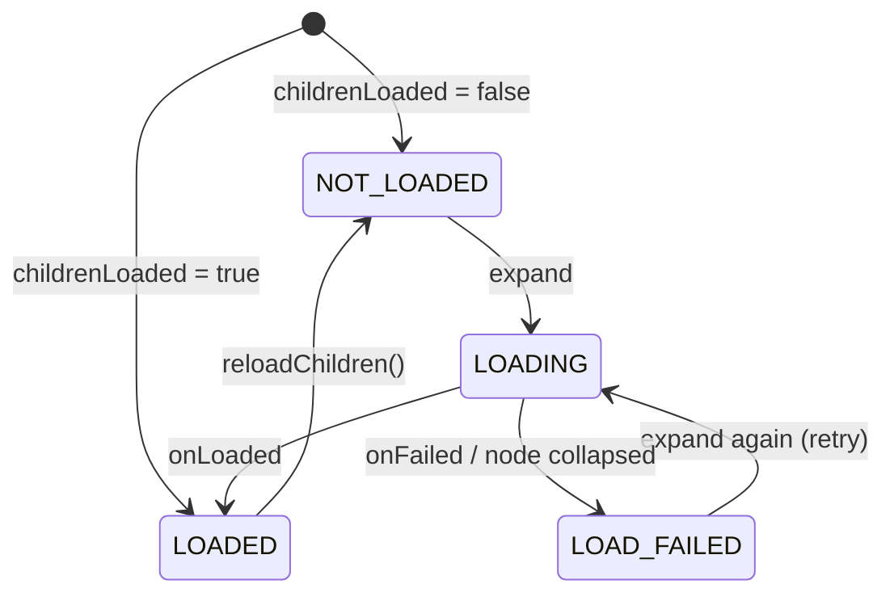

# treeview: design

English | [中文](DESIGN_CN.md) · [Guide](README.md)

## The data model

A `TreeNode` holds its `value`, `parent`, `children`, `isExpanded` and `loadState`, and compares by identity (two nodes may hold equal values). Its `depth` is cached and updated on attach and detach, since the adapter compares depths in tight loops.

Structural methods such as `addChild` change only the data and tell no one; they are for building a tree before it goes to the adapter. That is also why `isExpanded` and `loadState` are read-only outside the library: once a tree is shown, every change goes through `TreeAdapter`.

## The tree as a list of rows

A RecyclerView shows a flat list, so the adapter keeps the top-level `roots` and `visibleNodes`: the nodes of a pre-order walk whose ancestors are all expanded. An adapter position is an index into that list.

```
x ▼                 [0]
├── github ▼        [1]
│   └── module ▶    [2]   (its children are hidden: not in the list)
└── README.md       [3]
```

A node's visible descendants always follow it in one block, so **collapsing is one range removal and expanding one range insertion**. Each operation changes `visibleNodes` in place and sends the narrowest notification: `notifyItemRangeInserted` / `Removed` for the subtree, and `notifyItemChanged` with `PAYLOAD_EXPANSION_CHANGED` for the node whose arrow changed, so `onBindNode` can update just the arrow.

Expand, collapse, insert and remove are O(visible rows) at worst. `toggleAt(position)` skips finding the node's position, so prefer it in click handlers.

## Lazy loading



- **Request identity**: each load is a request object, and the node remembers the one it waits for; only results of that request are applied. Results for a node removed, reloaded or replaced by `setRoots` are dropped silently, and no callback is applied twice.
- **Thread hop**: callbacks may come on any thread; results are posted to the main thread before they touch the adapter.
- **Deferred start**: loads asked for in the middle of an operation are queued until the adapter is consistent again, so a loader that answers synchronously is safe.
- Collapsing while loading does not cancel: the children are added but stay hidden. A node that loads empty and is not expandable, or fails, is collapsed so the next expand retries.

**Single-child chains**: with `autoExpandSingleChild`, expanding walks down while there is exactly one expandable child; the state of the whole chain is updated first and all its rows inserted with **one** notification, so it animates as one change. A node whose children are not loaded is loaded, and the walk goes on when they arrive. `reveal()` never chains.

## The layout manager

**Coordinates**: the scroll position is two absolute offsets, `verticalOffset` and `horizontalOffset`. With a fixed row height the visible rows follow directly from the offset divided by the row height, so layout is O(visible rows), fast flings leave no gaps, and jumping anywhere is O(1). Horizontal scrolling never changes which rows are visible; it only shifts the attached views.

**Recycling**: vertical scrolling shifts the children, recycles rows that leave and adds rows that come in; rows only shifted are neither measured nor laid out again.

**Content width** (the horizontal scroll range) is the larger of two, so an underestimate never cuts a row off:

1. A `ContentWidthProvider` (the adapter by default): with a `RowWidthCalculator`, the exact width of the widest visible row. Widths are cached on the nodes with a generation stamp, so `invalidateRowWidths()` just bumps the generation.
2. The natural widths of the rows measured so far: reset on structural changes, only growing while scrolling, so scrolling vertically never makes the horizontal position jump.

When the content narrows while the view is scrolled to the right, the horizontal offset is pulled back into range.

**Measuring rows**: first `UNSPECIFIED` for the natural width; with `stretchRowWidth`, again at `max(content width, viewport width)`, only when that target changes.

**Axis lock**: RecyclerView asks `canScrollHorizontally()` / `canScrollVertically()` on every touch event and when computing fling velocity. The layout manager watches touches with an `OnItemTouchListener` that intercepts nothing, locks the dominant axis once the finger moves past touch slop, and answers `false` for the other, which stops both its drag and its fling without subclassing RecyclerView. The lock is released when the gesture ends, so programmatic scrolling is never restricted.

**Clicks**: `onCreateViewHolder` is final and installs the listeners once per ViewHolder; the node is found by `bindingAdapterPosition` when the event happens. A click goes to the listener first, then toggles expansion if the row still shows the same node (the listener may have changed the tree). Rows are long-clickable only when there is a long-click listener, so accessibility services do not announce an action that does nothing.
