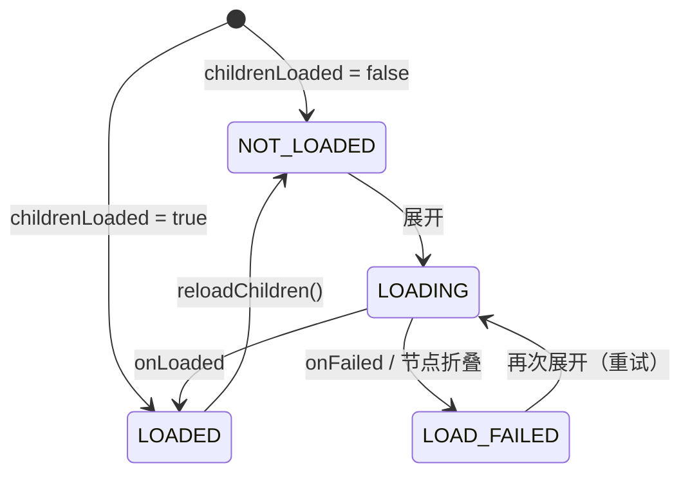

# treeview：设计

[English](DESIGN.md) | 中文 · [说明](README_CN.md)

## 数据模型

`TreeNode` 持有 `value`、`parent`、`children`、`isExpanded` 和 `loadState`，按引用比较（两个节点可以持有相等的值）。`depth` 被缓存并在挂载、摘除时更新，因为适配器会在循环中频繁比较深度。

`addChild` 等结构方法只改数据、不通知任何人，用于在交给适配器之前构建树。所以 `isExpanded` 和 `loadState` 在库外部只读：树显示之后，所有修改都要经过 `TreeAdapter`。

## 把树扁平化为行

RecyclerView 显示的是扁平列表，所以适配器维护两样东西：顶层节点 `roots`，以及 `visibleNodes`：前序遍历中所有祖先都已展开的节点。适配器位置就是在这个列表中的下标。

```
x ▼                 [0]
├── github ▼        [1]
│   └── module ▶    [2]   （子节点隐藏，不在列表中）
└── README.md       [3]
```

一个节点的可见后代总是紧跟在它后面、连成一块，所以**折叠就是一次区间删除，展开就是一次区间插入**。每个操作原地修改 `visibleNodes`，并发出范围最小的通知：子树用 `notifyItemRangeInserted` / `Removed`，箭头变化的节点用带 `PAYLOAD_EXPANSION_CHANGED` 的 `notifyItemChanged`，让 `onBindNode` 只更新箭头。

展开、折叠、插入、删除在最坏情况下为 O(可见行数)。`toggleAt(position)` 省去了按节点查位置这一步，点击处理中优先用它。

## 懒加载



- **请求标识**：每次加载是一个请求对象，节点记住自己当前等待的请求，只应用属于它的结果。所以已删除、重新加载或被 `setRoots` 替换的节点，结果会被静默丢弃，同一个回调也不会被应用两次。
- **线程切换**：回调可以在任意线程调用，结果先投递到主线程再接触适配器。
- **延迟启动**：在某个操作过程中触发的加载会排队，等适配器状态一致后再启动。因此同步返回结果的加载器也是安全的。
- 加载中折叠不会取消请求：子节点照常添加，但保持隐藏。加载后为空且不可展开的节点、加载失败的节点会被折叠，下次展开时重试。

**单子节点链**：启用 `autoExpandSingleChild` 后，展开时沿着「恰好一个可展开子节点」一路向下，整条链的状态先全部更新，再用**一次**通知插入所有行，所以以单个动画呈现。遇到未加载的节点就加载它，结果到达后继续。`reveal()` 不会链式展开。

## 布局管理器

**坐标**：滚动位置是两个绝对偏移 `verticalOffset`、`horizontalOffset`。行高固定，可见行范围直接按偏移除以行高算出，所以布局开销 O(可见行数)，快速惯性滑动不会留空白，跳到任意位置 O(1)。水平滚动不改变哪些行可见，只是平移已挂载的视图。

**回收**：垂直滚动时平移子视图，回收离开的行、添加进入的行；只是被平移的行既不重新测量也不重新布局。

**内容宽度**（水平滚动范围）取两者较大值，所以低估永远不会截断某一行：

1. `ContentWidthProvider`（默认就是适配器）：配合 `RowWidthCalculator`，报告可见行中最宽行的精确宽度。行宽缓存在节点上，带代次戳，`invalidateRowWidths()` 只需把代次加一。
2. 已测量行的自然宽度：结构变化时重置，滚动中只增不减，所以垂直滚动不会让水平位置跳动。

内容变窄而视图正滚在右侧时，水平偏移被拉回有效范围。

**行测量**：先以 `UNSPECIFIED` 测出自然宽度；启用 `stretchRowWidth` 时再以 `max(内容宽度, 视口宽度)` 重新测量，只在目标宽度变化时才重测。

**滚动轴锁定**：RecyclerView 在每个触摸事件和计算惯性速度时都会调用 `canScrollHorizontally()` / `canScrollVertically()`。布局管理器用一个不拦截事件的 `OnItemTouchListener` 观察触摸，手指移动超过 touch slop 后锁定主方向，另一方向返回 `false`，从而同时抑制拖动和惯性，不需要继承 RecyclerView。手势结束后释放，代码触发的滚动不受限制。

**点击**：`onCreateViewHolder` 是 final 的，为每个 ViewHolder 只安装一次监听器，事件发生时按 `bindingAdapterPosition` 找到节点。点击先通知监听器，再在该行仍显示同一节点时切换展开（防止监听器改了树）。只有设置了长按监听器时行才可长按，避免无障碍服务播报一个无效操作。
