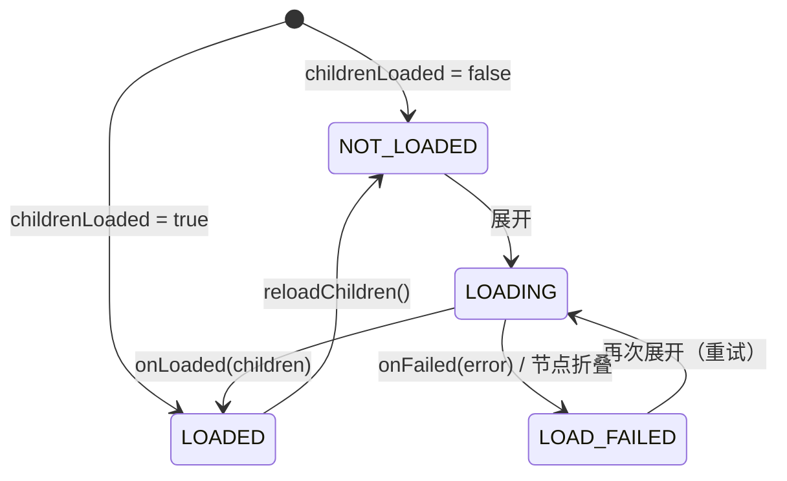

# TreeView

一个基于**单个 `RecyclerView`** 实现的 Android 树形视图。行高固定，内容宽度随节点的展开与折叠而变化，列表可同时进行垂直和水平滚动，无需嵌套滚动容器。节点是泛型的：同一个库可以用来展示文件系统、组织架构图、评论楼层或任何其他层级结构。

```
treeview
├── TreeNode<T>              数据模型：值、父/子节点、展开状态与加载状态
├── TreeAdapter<T, VH>       将树扁平化为行；负责展开、折叠、插入、删除、加载
├── TreeLayoutManager        固定行高、双向滚动、内容宽度、滚动轴锁定
├── RowWidthCalculator<T>    可选：无需测量视图即可计算行宽（精确的滚动范围）
├── ChildLoader<T>           可选：在首次展开时懒加载子节点
├── ContentWidthProvider     适配器与布局管理器之间的桥梁（由 TreeAdapter 实现）
└── OnNodeClickListener<T> / OnNodeLongClickListener<T>
```

## 特性

- 在同一个 RecyclerView 内同时支持垂直**和**水平滚动，并可选开启**按手势锁定滚动轴**（一次拖动及其后续惯性滑动只沿一个方向移动）。
- **精确的水平滚动范围**，会随节点的展开与折叠而增大或缩小。
- **细粒度的变更通知**：展开或折叠时只插入或删除受影响的行，因此条目动画可以正常工作，未受影响的行也会被保留。
- 子节点**懒加载**，支持加载中 / 加载失败状态、重试与刷新。
- **单子节点链式展开**（`x › github › module › treeview` 一次点击即可全部展开）。
- 每一行都支持**点击和长按**监听。
- 泛型节点、用于构建树的 Kotlin DSL、对 Java 友好的 API（`@JvmOverloads`、`fun interface`），并启用了 Kotlin 显式 API 模式。

## 环境要求

- minSdk 21
- `androidx.recyclerview:recyclerview` 1.4.0（以 `api` 依赖形式暴露）

## 安装

将该模块加入构建并添加依赖：

```kotlin
// settings.gradle.kts
include(":treeview")

// app/build.gradle.kts
dependencies {
    implementation(project(":treeview"))
}
```

## 使用方法

下面的示例展示了一个从磁盘懒加载目录的文件浏览器。

### 1. 数据模型与行布局

```kotlin
data class FileItem(
    val file: File,
    val isDirectory: Boolean = file.isDirectory,
) {
    val name: String get() = file.name
}
```

```xml
<!-- res/layout/item_file.xml：固定高度的行；缩进在代码中设置。 -->
<LinearLayout xmlns:android="http://schemas.android.com/apk/res/android"
    android:layout_width="wrap_content"
    android:layout_height="40dp"
    android:gravity="center_vertical"
    android:orientation="horizontal"
    android:paddingEnd="12dp">

    <TextView
        android:id="@+id/arrow"
        android:layout_width="24dp"
        android:layout_height="wrap_content"
        android:gravity="center" />

    <TextView
        android:id="@+id/icon"
        android:layout_width="24dp"
        android:layout_height="wrap_content"
        android:gravity="center" />

    <TextView
        android:id="@+id/name"
        android:layout_width="wrap_content"
        android:layout_height="wrap_content"
        android:layout_marginStart="8dp"
        android:maxLines="1"
        android:textSize="15sp" />
</LinearLayout>
```

### 2. 适配器

继承 `TreeAdapter`，实现 `onCreateNodeViewHolder` 和 `onBindNode`。不要在 item 视图上设置点击监听器，适配器会自行安装。

```kotlin
class FileAdapter(
    private val indentPx: Int,
) : TreeAdapter<FileItem, FileAdapter.ViewHolder>() {

    override fun onCreateNodeViewHolder(parent: ViewGroup, viewType: Int): ViewHolder =
        ViewHolder(LayoutInflater.from(parent.context).inflate(R.layout.item_file, parent, false))

    override fun onBindNode(holder: ViewHolder, node: TreeNode<FileItem>, payloads: List<Any>) {
        // PAYLOAD_EXPANSION_CHANGED：仅指示器（展开状态或加载状态）发生了变化。
        val indicatorOnly = payloads.isNotEmpty() &&
            payloads.all { it === TreeAdapter.PAYLOAD_EXPANSION_CHANGED }
        if (!indicatorOnly) {
            holder.itemView.setPaddingRelative(node.depth * indentPx, 0, 0, 0)
            holder.name.text = node.value.name
        }
        holder.arrow.text = when {
            node.loadState == TreeNode.LoadState.LOADING -> "…"
            !isExpandable(node) -> ""
            node.isExpanded -> "▼"
            else -> "▶"
        }
        holder.icon.text = if (node.value.isDirectory) "📁" else "📄"
        holder.icon.alpha = if (node.isKnownEmpty && node.value.isDirectory) 0.4f else 1f
    }

    class ViewHolder(view: View) : RecyclerView.ViewHolder(view) {
        val arrow: TextView = view.findViewById(R.id.arrow)
        val icon: TextView = view.findViewById(R.id.icon)
        val name: TextView = view.findViewById(R.id.name)
    }
}
```

### 3. 懒加载

当一个子节点未知的节点首次被展开时，会调用 `ChildLoader`。它可以在任意线程中回传结果。

```kotlin
class FileSystemLoader(private val executor: Executor) : ChildLoader<FileItem> {

    override fun loadChildren(node: TreeNode<FileItem>, callback: ChildLoadCallback<FileItem>) {
        executor.execute {
            try {
                val files = node.value.file.listFiles()
                    ?: throw IOException("Cannot list ${node.value.file}")
                val children = files
                    .sortedWith(compareBy<File>({ !it.isDirectory }, { it.name.lowercase() }))
                    // 目录本身也是懒加载的；文件没有需要加载的子节点。
                    .map { TreeNode(FileItem(it), childrenLoaded = !it.isDirectory) }
                callback.onLoaded(children)
            } catch (e: Exception) {
                callback.onFailed(e)
            }
        }
    }
}
```

### 4. 组装

```xml
<!-- RecyclerView 需要确定的尺寸：match_parent 或固定数值。 -->
<androidx.recyclerview.widget.RecyclerView
    android:id="@+id/tree"
    android:layout_width="match_parent"
    android:layout_height="match_parent"
    android:scrollbars="vertical|horizontal" />
```

```kotlin
val density = resources.displayMetrics.density
val indentPx = (20 * density).toInt()
val rowHeightPx = (40 * density).toInt()
val fixedPartsPx = ((24 + 24 + 8 + 12) * density).toInt() // 箭头 + 图标 + 外边距 + paddingEnd
val labelPaint = TextPaint(Paint.ANTI_ALIAS_FLAG).apply {
    textSize = TypedValue.applyDimension(TypedValue.COMPLEX_UNIT_SP, 15f, resources.displayMetrics)
}

val adapter = FileAdapter(indentPx).apply {
    // 精确的水平滚动范围，无需 inflate 视图即可计算。
    rowWidthCalculator = RowWidthCalculator { node ->
        node.depth * indentPx + fixedPartsPx + ceil(labelPaint.measureText(node.value.name)).toInt()
    }
    childLoader = FileSystemLoader(Executors.newSingleThreadExecutor())
    autoExpandSingleChild = true

    onNodeClickListener = OnNodeClickListener<FileItem> { node, _, _ ->
        if (!node.value.isDirectory) openFile(node.value.file)
        // 之后目录会自动切换展开状态（toggleOnClick = true）。
    }
    onNodeLongClickListener = OnNodeLongClickListener<FileItem> { node, _, view ->
        showContextMenu(node, view)
        true
    }
    onChildrenLoadFailed = { node, _ ->
        Toast.makeText(recyclerView.context, "Cannot open ${node.value.name}", Toast.LENGTH_SHORT).show()
    }

    // 已展开的懒加载根节点一经设置就会立即开始加载。
    setRoots(listOf(TreeNode(FileItem(rootDirectory), isExpanded = true, childrenLoaded = false)))
}

recyclerView.layoutManager = TreeLayoutManager(rowHeight = rowHeightPx)
recyclerView.adapter = adapter
```

### 5. 修改树

树显示出来之后，应通过适配器进行修改，以便通知 RecyclerView：

```kotlin
adapter.expand(node)                    // 另有：collapse、toggle、toggleAt(position)
adapter.insertNode(parent, TreeNode(FileItem(newDir)), index = 0)
adapter.removeNode(node)                // 删除整棵子树
adapter.reloadChildren(directoryNode)   // 丢弃子节点并重新加载
node.value = renamedItem
adapter.notifyNodeChanged(node)         // 重新绑定并重新计算其行宽

val position = adapter.reveal(deepNode) // 展开所有祖先节点
recyclerView.scrollToPosition(position)
```

静态树可以用 DSL 构建，不需要加载器：

```kotlin
val root = treeNode(Department("Headquarters"), isExpanded = true) {
    child(Department("R&D")) {
        child(Department("Mobile"))
        child(Department("Backend"))
    }
    child(Department("Marketing"))
}
```

## 设计

### 数据模型：`TreeNode`

节点持有 `value`、其 `parent` 和 `children`、`isExpanded` 以及 `loadState`。节点按引用（identity）比较，而不是按值比较，因此两个节点可以持有相等的值。`depth` 会被缓存，并在节点挂载或解除挂载时更新，因为适配器会在密集循环中比较深度。

`TreeNode` 的结构性方法（`addChild`、`insertChild`、`removeChild`）只修改数据，不会通知任何人；它们用于在将树交给适配器之前构建树。出于同样的原因，`isExpanded` 和 `loadState` 在库外部是只读的：一旦树被显示，所有修改都必须通过 `TreeAdapter` 进行。

### 扁平化投影：`TreeAdapter`

RecyclerView 显示的是一个扁平列表，因此适配器维护两个结构：

- `roots` —— 顶层节点；
- `visibleNodes` —— 一个前序遍历列表，只包含所有祖先都已展开的节点。节点的适配器位置就是它在该列表中的索引。

```
x ▼                     visibleNodes[0]
├── github ▼            visibleNodes[1]
│   └── module ▶        visibleNodes[2]   （子节点被隐藏：不在列表中）
└── README.md           visibleNodes[3]
```

由于一个节点的可见后代总是紧跟在它之后形成一个连续的块（即比它更深的那些行），折叠就是一次区间删除，展开就是一次区间插入。每个操作都会原地修改 `visibleNodes`，并发出范围最小的通知：对子树使用 `notifyItemRangeInserted` / `notifyItemRangeRemoved`，对指示器发生变化的节点使用 `notifyItemChanged(position, PAYLOAD_EXPANSION_CHANGED)`。带有该 payload 的局部重新绑定让 `onBindNode` 可以只更新指示器。

展开、折叠、插入和删除在最坏情况下的复杂度为 O(可见行数)（列表移位和位置查找）。`toggleAt(position)` 省去了查找步骤，推荐在点击处理中使用。

### 可展开性

`isExpandable(node)` 决定一行是否显示指示器以及是否响应展开。默认规则是*有子节点，或其子节点尚未加载*。该方法是 open 的，因此可以使用其他规则，例如让空目录也可展开：

```kotlin
override fun isExpandable(node: TreeNode<FileItem>) =
    super.isExpandable(node) || node.value.isDirectory
```

`node.isKnownEmpty`（已加载且没有子节点）让 UI 可以以不同方式展示空节点。

### 懒加载



- **请求标识。** 每次加载都由一个请求对象表示，节点会将其保存为当前等待的请求。只有属于该请求的结果才会被应用，因此已被删除、重新加载或被 `setRoots` 替换的节点的结果会被静默丢弃，并且同一个回调永远不会被应用两次。
- **线程切换。** `ChildLoadCallback` 可以在任意线程中被调用；结果会先被投递到主线程，然后才会触及适配器。
- **延迟启动。** 在某个操作过程中请求的加载会被放入队列，直到适配器状态重新一致后才启动。因此，同步返回结果的加载器重新进入的是一个有效的适配器，而由该嵌套结果触发的加载也会被同一个循环处理。
- **加载中折叠**不会取消请求：子节点会被添加，但会保持隐藏，直到该节点再次被展开。
- 如果一个节点加载后发现为空且不可展开，它会被重新折叠；加载失败的节点也会被折叠，以便下次展开时进行重试。

### 单子节点链

启用 `autoExpandSingleChild` 后，展开一个节点时会持续向下遍历，只要当前节点恰好只有一个子节点，且该子节点可展开、未知为空，并被受保护的钩子方法 `canAutoExpand(child)` 接受。整条链上的状态会先全部更新，然后用**一次**通知插入所有行，因此整条链会以单个变更的形式呈现动画。如果遍历到一个子节点尚未加载的节点，则会加载该节点，并在结果到达后继续遍历。折叠不受影响，`reveal()` 也永远不会进行链式展开。

### 布局：`TreeLayoutManager`

**坐标模型。** 滚动位置由两个绝对偏移量 `verticalOffset` 和 `horizontalOffset` 表示。由于行高固定，可见行范围就是 `verticalOffset / rowHeight … (verticalOffset + viewportHeight) / rowHeight`，因此布局开销为 O(可见行数)，较大的滚动增量（快速惯性滑动）也不会留下空白，跳转到任意位置的复杂度为 O(1)。水平滚动永远不会改变哪些行可见，它只是平移已挂载的子视图。

**回收。** 垂直滚动时，布局管理器会平移子视图，回收离开可见范围的行，并添加进入可见范围的行，同时保持已挂载的子视图连续并按位置排序。仅仅被平移的行既不会重新测量，也不会重新布局。

**内容宽度。** 水平滚动范围等于最宽行的宽度。它有两个来源，取两者中较大者，因此低估永远不会导致某一行被截断：

1. 一个 `ContentWidthProvider` —— 如果设置了 `contentWidthProvider` 则使用它，否则若适配器实现了该接口则使用适配器。`TreeAdapter` 实现了该接口：配合 `RowWidthCalculator` 时，它会报告可见行中最宽行的精确宽度；
2. 到目前为止已测量行的自然宽度。该值在结构变化（展开、折叠、插入、删除）时会被重置，而在滚动过程中只增不减，因此垂直滚动永远不会导致水平位置跳动。

当内容变窄（例如折叠之后）而视图正处于向右滚动的位置时，水平偏移量会被拉回到有效范围内。

**行宽缓存。** 适配器将每一行的宽度连同一个代次戳（generation stamp）缓存在其节点上。`invalidateRowWidths()` 只是将代次戳加一（O(1)）；单个节点自身的缓存会在调用 `notifyNodeChanged` 或其深度变化时被丢弃。添加行时最大值会增量更新，删除行后则会惰性地重新计算一次。

**行测量。** 每一行首先以 `UNSPECIFIED` 宽度进行测量以得到其自然宽度。启用 `stretchRowWidth`（默认）时，行随后会以 `max(contentWidth, viewportWidth)` 的精确宽度重新测量，使背景和分割线能够横跨整个可滚动区域。只有当目标宽度变化时，行才会被重新测量。

**滚动轴锁定。** RecyclerView 会在每个触摸事件中、以及在计算惯性滑动速度时，调用 `canScrollHorizontally()` / `canScrollVertically()`。布局管理器通过一个不拦截事件的 `OnItemTouchListener` 观察触摸事件，RecyclerView 会在处理每个事件*之前*调用它。一旦手指移动超过触摸阈值（touch slop），主导方向就会被锁定，另一个方向的 `canScroll…()` 返回 `false`，从而同时抑制该方向上的拖动和惯性滑动，且无需继承 RecyclerView。手势结束后锁定会被释放，因此通过代码触发的滚动不受限制。

**其他行为。** `scrollToPosition` 只滚动显示该行所需的最小距离（与 `LinearLayoutManager` 一致）；`scrollToPositionWithOffset` 会将其对齐到顶部；`smoothScrollToPosition` 只进行垂直滚动，并保持水平位置不变。两个偏移量都会随实例状态一起保存和恢复。

### 点击

`TreeAdapter.onCreateViewHolder` 是 final 的：它调用 `onCreateNodeViewHolder`，并为每个 ViewHolder 在其 item 视图上安装一次点击和长按监听器。节点在事件发生时通过 `bindingAdapterPosition` 解析，因为随着树的变化，ViewHolder 会被重新绑定，行也会移动。一次点击会先通知 `onNodeClickListener`，然后在启用 `toggleOnClick` 时切换该行的展开状态 —— 但前提是该行仍显示同一个节点，以防监听器修改了树。只有在设置了 `onNodeLongClickListener` 时行才可长按，这样无障碍服务就不会播报一个毫无作用的长按操作。

### 线程

所有适配器和布局管理器的方法都必须在主线程中调用。唯一的例外是 `ChildLoadCallback`，它可以在任意线程中调用。

## API 概览

| 类型 | 主要成员 |
|---|---|
| `TreeNode<T>` | `value`、`children`、`parent`、`depth`、`isExpanded`、`loadState`、`isLeaf`、`isKnownEmpty`、`root`、`addChild`、`insertChild`、`removeChild`、`child { }`、`ancestors()`、`descendants()`、`isDescendantOf()`、顶层函数 `treeNode { }` |
| `TreeAdapter<T, VH>` | `onCreateNodeViewHolder`、`onBindNode`、`isExpandable`、`canAutoExpand`（protected）、`setRoots`、`expand`、`collapse`、`toggle`、`toggleAt`、`expandAll`、`collapseAll`、`reveal`、`insertNode`、`removeNode`、`reloadChildren`、`notifyNodeChanged`、`invalidateRowWidths`、`getNode`、`getNodeOrNull`、`positionOf`、`contains`、`isDisplayed`、`rootNodes`、`maxRowWidth`、`PAYLOAD_EXPANSION_CHANGED` |
| `TreeAdapter` 属性 | `rowWidthCalculator`、`childLoader`、`autoExpandSingleChild`、`toggleOnClick`、`onNodeClickListener`、`onNodeLongClickListener`、`onNodeExpansionChanged`、`onChildrenLoadFailed` |
| `TreeLayoutManager` | `rowHeight`、`contentWidthProvider`、`stretchRowWidth`、`isAxisLockEnabled`、`contentWidth`、`invalidateContentWidth`、`findFirstVisibleItemPosition`、`findLastVisibleItemPosition`、`scrollToPositionWithOffset` |
| 接口 | `RowWidthCalculator<T>`、`ChildLoader<T>`、`ChildLoadCallback<T>`、`ContentWidthProvider`、`OnNodeClickListener<T>`、`OnNodeLongClickListener<T>` |

## 局限性

- RecyclerView 必须具有确定的尺寸；不支持自动测量（`wrap_content`）。
- 所有行共用同一个高度（`rowHeight`，包含 decoration 的 inset 和外边距）。如果它 `<= 0`，则会对第一个条目测量一次。
- 不支持从右到左（RTL）布局；行总是从左边缘开始。
- 不支持预测性（predictive）条目动画；常规的添加、删除和移动动画可以正常运行。
- `expandAll()` 只展开子节点已加载的节点；它不会触发懒加载。

## 许可证

```
Copyright © 2026 Github Lzhiyong

Licensed under the Apache License, Version 2.0 (the "License");
you may not use this file except in compliance with the License.
You may obtain a copy of the License at

     http://www.apache.org/licenses/LICENSE-2.0

Unless required by applicable law or agreed to in writing, software
distributed under the License is distributed on an "AS IS" BASIS,
WITHOUT WARRANTIES OR CONDITIONS OF ANY KIND, either express or implied.
See the License for the specific language governing permissions and
limitations under the License.
```

## 测试

`TreeNodeTest`，在 JVM 上运行（`./gradlew :treeview:testDebugUnitTest`）。覆盖内容：子节点的顺序；父节点与深度（包括把子树移到别处之后）；祖先与后代；`addChild` 返回调用它的那个节点；叶子节点，以及"已知为空"的判断。依赖 `RecyclerView` 的部分（适配器、布局管理器）不在测试范围内。
